  

<h1>Starfield Technologies, LLC 
Public TLS 
Certificate Policy and 
Certification Practice Statement (CP/CPS)</h1>

**Version 6.1**  
**Date: October 13, 2026**

## Table of Contents

| Section | Title |
|---|---|
| 1 | INTRODUCTION |
| 1.1 | Overview |
| 1.2 | Document Name and Identification |
| 1.2.1 | Document History |
| 1.3 | PKI Participants |
| 1.3.1 | Certification Authorities |
| 1.3.2 | Registration Authorities |
| 1.3.3 | Subscribers |
| 1.3.4 | Relying Parties |
| 1.3.5 | Other Participants |
| 1.4 | Certificate Usage |
| 1.4.1 | Appropriate Certificate Uses |
| 1.4.2 | Prohibited Certificate Uses |
| 1.5 | Policy Administration |
| 1.5.1 | Organization Administering the Document |
| 1.5.2 | Contact Person |
| 1.5.3 | Person Determining CPS Suitability for the Policy |
| 1.5.4 | CPS Approval Procedure |
| 1.6 | Definitions, Acronyms, and References |
| 1.6.1 | Definitions and Acronyms |
| 1.6.2 | References |
| 1.6.3 | Conventions |
| 2 | PUBLICATION AND REPOSITORY RESPONSIBILITIES |
| 2.1 | Repositories |
| 2.2 | Publication of Certification Information |
| 2.3 | Time or Frequency of Publication |
| 2.4 | Access Controls on Repositories |
| 3 | IDENTIFICATION AND AUTHENTICATION |
| 3.1 | Naming |
| 3.1.1 | Types of Names |
| 3.1.2 | Need for Names to be Meaningful |
| 3.1.3 | Anonymity or Pseudonymity of Subscribers |
| 3.1.4 | Rules for Interpreting Various Name Forms |
| 3.1.5 | Uniqueness of Names |
| 3.1.6 | Recognition, Authentication and Role of Trademarks |
| 3.2 | Initial Identity Validation |
| 3.2.1 | Method to Prove Possession of Private Key |
| 3.2.2 | Authentication of Organization and Domain Identity |
| 3.2.3 | Authentication of Individual Identity |
| 3.2.4 | Non-verified Subscriber Information |
| 3.2.5 | Validation of Authority |
| 3.2.6 | Criteria for Interoperation |
| 3.3 | Identification and Authentication for Re-key Requests |
| 3.3.1 | Identification and Authentication for Routine Re-key |
| 3.3.2 | Identification and Authentication for Re-key After Revocation |
| 3.4 | Identification and Authentication for Revocation Request |
| 4 | CERTIFICATE LIFE-CYCLE OPERATIONAL REQUIREMENTS |
| 4.1 | Certificate Application |
| 4.1.1 | Who Can Submit a Certificate Application |
| 4.1.2 | Enrollment Process and Responsibilities |
| 4.2 | Certificate Application Processing |
| 4.2.1 | Performing Identification and Authentication Functions |
| 4.2.2 | Approval or Rejection of Certificate Applications |
| 4.2.3 | Notification to Subscriber by the CA of Issuance of Certificate |
| 4.3 | Certificate Issuance |
| 4.3.1 | CA Actions During Certificate Issuance |
| 4.3.2 | Notification to Subscriber by the CA of Issuance of Certificate |
| 4.4 | Certificate Acceptance |
| 4.4.1 | Conduct Constituting Certificate Acceptance |
| 4.4.2 | Publication of the Certificate by the CA |
| 4.4.3 | Notification of Certificate Issuance by the CA to Other Entities |
| 4.5 | Key Pair and Certificate Usage |
| 4.5.1 | Subscriber Private Key and Certificate Usage |
| 4.5.2 | Relying Party Public Key and Certificate Usage |
| 4.6 | Certificate Renewal |
| 4.6.1 | Circumstance for Certificate Renewal |
| 4.6.2 | Who May Request Renewal |
| 4.6.3 | Processing Certificate Renewal Requests |
| 4.6.4 | Notification of New Certificate Issuance to Subscriber |
| 4.6.5 | Conduct Constituting Acceptance of a Renewal Certificate |
| 4.6.6 | Publication of the Renewal Certificate by the CA |
| 4.6.7 | Notification of Certificate Issuance by the CA to Other Entities |
| 4.7 | Certificate Re-key |
| 4.7.1 | Circumstance for Certificate Re-key |
| 4.7.2 | Who May Request Certification of a New Public Key |
| 4.7.3 | Processing Certificate Re-keying Requests |
| 4.7.4 | Notification of New Certificate Issuance to Subscriber |
| 4.7.5 | Conduct Constituting Acceptance of a Re-keyed Certificate |
| 4.7.6 | Publication of the Re-keyed Certificate by the CA |
| 4.7.7 | Notification of Certificate Issuance by the CA to Other Entities |
| 4.8 | Certificate Modification |
| 4.8.1 | Circumstance for Certificate Modification |
| 4.8.2 | Who May Request Certificate Modification |
| 4.8.3 | Processing Certificate Modification Requests |
| 4.8.4 | Notification of New Certificate Issuance to Subscriber |
| 4.8.5 | Conduct Constituting Acceptance of Modified Certificate |
| 4.8.6 | Publication of the Modified Certificate by the CA |
| 4.8.7 | Notification of Certificate Issuance by the CA to Other Entities |
| 4.9 | Certificate Revocation and Suspension |
| 4.9.1 | Circumstances for Revocation |
| 4.9.1.1 | Reasons for Revoking a Subscriber Certificate |
| 4.9.1.2 | Reasons for Revoking a Subordinate CA Certificate |
| 4.9.2 | Who Can Request Revocation |
| 4.9.3 | Procedure for Revocation Request |
| 4.9.4 | Revocation Request Grace Period |
| 4.9.5 | Time Within Which CA Must Process the Revocation Request |
| 4.9.6 | Revocation Checking Requirement for Relying Parties |
| 4.9.7 | CRL Issuance Frequency |
| 4.9.8 | Maximum Latency for CRLs (if applicable) |
| 4.9.9 | On-line Revocation/Status Checking Availability |
| 4.9.10 | On-line Revocation Checking Requirements |
| 4.9.11 | Other Forms of Revocation Advertisements Available |
| 4.9.12 | Special Requirements Regarding Key Compromise |
| 4.9.13 | Circumstances for Suspension |
| 4.9.14 | Who Can Request Suspension |
| 4.9.15 | Procedure for Suspension Request |
| 4.9.16 | Limits on Suspension Period |
| 4.10 | Certificate Status Services |
| 4.10.1 | Operational Characteristics |
| 4.10.2 | Service Availability |
| 4.10.3 | Optional Features |
| 4.11 | End of Subscription |
| 4.12 | Key Escrow and Recovery |
| 4.12.1 | Key Escrow and Recovery Policy and Practices |
| 4.12.2 | Session Key Encapsulation and Recovery Policy and Practices |
| 5 | FACILITY, MANAGEMENT, AND OPERATIONAL CONTROLS |
| 5.1 | Physical Controls |
| 5.1.1 | Site Location and Construction |
| 5.1.2 | Physical Access |
| 5.1.3 | Power and Air Conditioning |
| 5.1.4 | Water Exposures |
| 5.1.5 | Fire Prevention and Protection |
| 5.1.6 | Media Storage |
| 5.1.7 | Waste Disposal |
| 5.1.8 | Offsite Backup |
| 5.2 | Procedural Controls |
| 5.2.1 | Trusted Roles |
| 5.2.2 | Number of Persons Required Per Task |
| 5.2.3 | Identification and Authentication for Each Role |
| 5.2.4 | Roles requiring separation of duties |
| 5.3 | Personnel Controls |
| 5.3.1 | Qualifications, Experience, and Clearance Requirements |
| 5.3.2 | Background Check Procedures |
| 5.3.3 | Training Requirements |
| 5.3.4 | Retraining Frequency and Requirements |
| 5.3.5 | Job Rotation Frequency and Sequence |
| 5.3.6 | Sanctions for Unauthorized Actions |
| 5.3.7 | Independent Contractor Requirements |
| 5.3.8 | Documentation Supplied to Personnel |
| 5.4 | Audit Logging Procedures |
| 5.4.1 | Types of Events Recorded |
| 5.4.2 | Frequency of Processing Log |
| 5.4.3 | Retention Period for Audit Log |
| 5.4.4 | Protection of Audit Log |
| 5.4.5 | Audit Log Backup Procedures |
| 5.4.6 | Audit Collection System (Internal vs. External) |
| 5.4.7 | Notification to Event-Causing Subject |
| 5.4.8 | Vulnerability Assessments |
| 5.5 | Records Archival |
| 5.5.1 | Types of Records Archived |
| 5.5.2 | Retention Period for Archive |
| 5.5.3 | Protection of Archive |
| 5.5.4 | Archive Backup Procedures |
| 5.5.5 | Requirements for Time-Stamping of Records |
| 5.5.6 | Archive Collection System (Internal or External) |
| 5.5.7 | Procedures to Obtain and Verify Archive Information |
| 5.6 | Key Changeover |
| 5.7 | Compromise and Disaster Recovery |
| 5.7.1 | Incident and Compromise Handling Procedures |
| 5.7.2 | Computing Resources, Software, and/or Data are Corrupted |
| 5.7.3 | Entity Private Key Compromise Procedures |
| 5.7.4 | Business Continuity Capabilities After a Disaster |
| 5.8 | CA or RA Termination |
| 6 | TECHNICAL SECURITY CONTROLS |
| 6.1 | Key Pair Generation and Installation |
| 6.1.1 | Key Pair Generation |
| 6.1.2 | Private Key Delivery to Subscriber |
| 6.1.3 | Public Key Delivery to Certificate Issuer |
| 6.1.4 | CA Public Key Delivery to Relying Parties |
| 6.1.5 | Key Sizes |
| 6.1.6 | Public Key Parameters Generation and Quality Checking |
| 6.1.7 | Key Usage Purposes |
| 6.2 | Private Key Protection and Cryptographic Module Engineering Controls |
| 6.2.1 | Cryptographic Module Standards and Controls |
| 6.2.2 | Private Key Multi-Person Control |
| 6.2.3 | Private Key Escrow |
| 6.2.4 | Private Key Backup |
| 6.2.5 | Private Key Archival |
| 6.2.6 | Private Key Transfer Into or From a Cryptographic Module |
| 6.2.7 | Private key storage on cryptographic module |
| 6.2.8 | Method of Activating Private Keys |
| 6.2.9 | Method of Deactivating Private Key |
| 6.2.10 | Method of Destroying Private Key |
| 6.2.11 | Cryptographic Module Rating |
| 6.3 | Other Aspects of Key Pair Management |
| 6.3.1 | Public Key Archival |
| 6.3.2 | Certificate Operational Periods and Key Pair Usage Periods |
| 6.4 | Activation Data |
| 6.4.1 | Activation Data Generation and Installation |
| 6.4.2 | Activation Data Protection |
| 6.4.3 | Other Aspects of Activation Data |
| 6.5 | Computer Security Controls |
| 6.5.1 | Specific Computer Security Technical Requirements |
| 6.5.2 | Computer Security Rating |
| 6.6 | Life Cycle Technical Controls |
| 6.6.1 | System Development Controls |
| 6.6.2 | Security Management Controls |
| 6.6.3 | Life Cycle Security Controls |
| 6.7 | Network Security Controls |
| 6.8 | Time-Stamping |
| 7 | CERTIFICATE, CRL, AND OCSP PROFILES |
| 7.1 | Certificate Profile |
| 7.1.1 | Version Number |
| 7.1.2 | Certificate Extensions |
| 7.1.3 | Algorithm Object Identifiers |
| 7.1.4 | Name Forms |
| 7.1.5 | Name Constraints |
| 7.1.6 | Certificate Policy Object Identifier |
| 7.1.7 | Usage of Policy Constraints Extension |
| 7.1.8 | Policy Qualifier Syntax and Semantics |
| 7.1.9 | Processing Semantics for the Critical Certificate Policies Extension |
| 7.2 | CRL Profile |
| 7.2.1 | Version Number |
| 7.2.2 | CRL and CRL Entry Extensions |
| 7.3 | OCSP Profile |
| 7.3.1 | Version Number |
| 7.3.2 | OCSP Extensions |
| 8 | COMPLIANCE AUDIT AND OTHER ASSESSMENTS |
| 8.1 | Frequency or Circumstances of Assessment |
| 8.2 | Identity/Qualifications of Assessor |
| 8.3 | Assessor's Relationship to Assessed Entity |
| 8.4 | Topics Covered by Assessment |
| 8.5 | Actions Taken as a Result of Deficiency |
| 8.6 | Communication of Results |
| 8.7 | Self–Audits |
| 8.8 | Specification Administration |
| 8.8.1 | Specification Change Procedures |
| 8.8.2 | Publication and Notification Policies |
| 8.9 | CPS Approval Procedures |
| 9 | OTHER BUSINESS AND LEGAL MATTERS |
| 9.1 | Fees |
| 9.1.1 | Certificate Issuance or Renewal Fees |
| 9.1.2 | Certificate Access Fees |
| 9.1.3 | Revocation or Status Information Access Fees |
| 9.1.4 | Fees for Other Services |
| 9.1.5 | Refund Policy |
| 9.2 | Financial Responsibility |
| 9.2.2 | Other Assets |
| 9.2.3 | Insurance or Warranty Coverage for End-entities |
| 9.3 | Confidentiality of Business Information |
| 9.3.1 | Scope of Confidential Information |
| 9.3.2 | Information not Within the Scope of Confidential Information |
| 9.3.3 | Responsibility to Protect Confidential Information |
| 9.4 | Privacy of Personal Information |
| 9.4.1 | Privacy Plan |
| 9.4.2 | Information Treated as Private |
| 9.4.3 | Information Not Deemed Private |
| 9.4.4 | Responsibility to Protect Private Information |
| 9.4.5 | Notice and Consent to Use Private Information |
| 9.4.6 | Disclosure Pursuant to Judicial or Administrative Process |
| 9.4.7 | Other Information Disclosure Circumstances |
| 9.5 | Intellectual Property Rights |
| 9.5.1 | Property Rights in Certificates and Revocation Information |
| 9.5.2 | Property Rights in the Agreement |
| 9.5.3 | Property Rights to Names |
| 9.5.4 | Property Rights in Keys and Key Material |
| 9.6 | Representations and Warranties |
| 9.6.1 | CA Representations and Warranties |
| 9.6.2 | RA Representations and Warranties |
| 9.6.3 | Subscriber Representations and Warranties |
| 9.6.4 | Relying Party Representations and Warranties |
| 9.6.5 | Representations and Warranties of Other Participants |
| 9.7 | Disclaimers of Warranties |
| 9.7.1 | Fiduciary Relationships |
| 9.8 | Limitations of Liability |
| 9.9 | Indemnities |
| 9.9.1 | Indemnification by Starfield |
| 9.9.2 | Indemnification by Subscribers |
| 9.9.3 | Indemnification by Relying Parties |
| 9.10 | Term and Termination |
| 9.10.1 | Term |
| 9.10.2 | Termination |
| 9.10.3 | Effect of Termination and Survival |
| 9.11 | Individual Notices and Communications with Participants |
| 9.12 | Amendments |
| 9.12.1 | Procedure for Amendment |
| 9.12.2 | Notification Mechanism and Period |
| 9.12.3 | Circumstances Under Which OID Must be Changed |
| 9.13 | Dispute Resolution Provisions |
| 9.14 | Governing Law |
| 9.15 | Compliance with Applicable Law |
| 9.16 | Miscellaneous Provisions |
| 9.16.1 | Entire Agreement |
| 9.16.2 | Assignment |
| 9.16.3 | Severability |
| 9.16.4 | Enforcement |
| 9.16.5 | Force Majeure |
| 9.17 | Other Provisions |
| 10 | APPENDIX A – CERTIFICATE PROFILES |
| 10.1 | Root CAs |
| 10.1.1 | Starfield Class 2 Certification Authority |
| 10.1.2 | Starfield Root Certificate Authority – G2 |
| 10.1.3 | Go Daddy Class 2 Certification Authority |
| 10.1.4 | Go Daddy Root Certificate Authority – G2 |
| 10.1.5 | Starfield Services Root Certification Authority |
| 10.1.6 | GoDaddy Root Certificate Authority - G5 |
| 10.1.7 | Starfield Root Certificate Authority - G5 |
| 10.1.8 | GoDaddy Root Certificate Authority – G6 (Historical) |
| 10.1.9 | Starfield Root Certificate Authority - G6 (Historical) |
| 10.1.10 | GoDaddy TLS Root CA - R1 |
| 10.1.11 | Starfield TLS Root CA - R1 |
| 10.2 | Issuing CAs |
| 10.2.1 | Starfield Issuing (subordinate) CAs (Historical) |
| 10.2.2 | Starfield Issuing CA - G2 |
| 10.2.3 | Starfield TLS Issuing CA DV - R1v1 |
| 10.2.4 | Starfield TLS Issuing CA OV - R1v1 |
| 10.2.5 | Starfield TLS Issuing CA EV - R1v1 |
| 10.2.6 | GoDaddy Issuing CA - G1 (Historical) |
| 10.2.7 | GoDaddy Issuing CA - G2 |
| 10.2.8 | GoDaddy TLS Issuing CA DV - R1v1 |
| 10.2.9 | GoDaddy TLS Issuing CA OV - R1v1 |
| 10.2.10 | GoDaddy TLS Issuing CA EV - R1v1 |
| 10.3 | Cross CA Certificates |
| 10.3.1 | Go Daddy Root Certificate Authority - G2 + Go Daddy Class 2 Certification Authority |
| 10.3.2 | Starfield Root Certificate Authority - G2 + Starfield Class 2 Certification Authority |
| 10.3.3 | Starfield Services Root Certificate Authority + Starfield Services Root Certificate Authority |
| 10.3.4 | Starfield Services Root Certificate Authority - G2 + Starfield Class 2 Certification |
| 10.3.5 | Certainly E1 + Starfield Services Root Certificate Authority - G2 |
| 10.3.6 | Certainly R1 + Starfield Services Root Certificate Authority - G2 |
| 10.3.7 | GoDaddy TLS Root CA - R1 + Go Daddy Root Certificate Authority - G2 |
| 10.3.8 | Starfield TLS Root CA - R1 + Starfield Root Certificate Authority - G2 |
| 10.4 | End Entity SSL Certificates |
| 10.4.1 | Go Daddy Issuing CA: Subscriber Certificates (Historical) |
| 10.4.2 | Starfield Issuing CA: Subscriber Certificates (Historical) |
| 10.4.3 | Go Daddy Issuing CA – G2: Subscriber Certificates (Historical) |
| 10.4.4 | Starfield Issuing CA – G2: Subscriber Certificates (Historical) |
| 10.4.5 | GoDaddy TLS Intermediate CA DV - R1v1: Subscriber Certificates |
| 10.4.6 | GoDaddy TLS Intermediate CA OV - R1v1: Subscriber Certificates |
| 10.4.7 | GoDaddy TLS Intermediate CA EV - R1v1: Subscriber Certificates |
| 10.4.8 | Starfield TLS Intermediate CA DV - R1v1: Subscriber Certificates |
| 10.4.9 | Starfield TLS Intermediate CA OV - R1v1: Subscriber Certificates |
| 10.4.10 | Starfield TLS Intermediate CA EV - R1v1: Subscriber Certificates |
| 11 | APPENDIX B: TEST SITES |

#  **1 INTRODUCTION**

Starfield Technologies is an innovator in the field of Internet foundation services, providing advanced software and Internet solutions critical to the building of online presence and e-commerce.

The Starfield Public Key Infrastructure ("Starfield PKI") has been established to provide a variety of digital certificate services.

##  **1.1 Overview**

This Certificate Policy and Certification Practice Statement (CP/CPS) describes the practices of the Starfield PKI and applies to all Certification Authorities (CAs) within the Starfield PKI hierarchy. This CP/CPS is applicable to all entities with relationships with the Starfield PKI, including Policy Authorities (PAs), Certification Authorities (CAs), Registration Authorities (RAs), Subscribers, and Relying Parties.

The Starfield PKI conforms to the current version of the *Baseline Requirements for the Issuance and Management of Publicly-Trusted TLS Server Certificates* as well as *Guidelines for Issuance and Management of Extended Validation Certificates* and *Network and Certificate System Security Requirements* published at https://www.cabforum.org. In the event of any inconsistency between this document and those Requirements, those Requirements take precedence over this document. The following policy identifiers are managed in accordance with these requirements: **2.23.140.1.2.1**, **2.23.140.1.2.2**, and **2.23.140.1.1**

*Note: References to Baseline Requirements sections are denoted in short form using the section number. For example [BR 3.2.2.1] denotes section 3.2.2.1 of the current revision of the Baseline Requirements for the Issuance and Management of Publicly-Trusted TLS Server Certificates.*

In addition, Starfield attests that it adheres to the latest published versions of the following policies and program requirements:

- CCADB Policy – <https://www.ccadb.org/policy>
- Chrome Root Program Policy – <https://googlechrome.github.io/chromerootprogram/>
- Microsoft Trusted Root Program Requirements – https://docs.microsoft.com/en-us/security/trusted-root/program-requirements
- Mozilla Root Store Policy – https://www.mozilla.org/en-US/about/governance/policies/security-group/certs/policy/
- Apple Root Certificate Program https://www.apple.com/certificateauthority/ca_program.html

This CP/CPS is structured according to the common outline set forth in RFC 3647, divided into nine primary components that cover the
security controls and practices and procedures for certificate issuance services within Starfield. To preserve the outline specified by
RFC 3647, section headings that do not apply have the statement "Not applicable" or "No stipulation."

##  **1.2 Document Name and Identification**

This document is formally referred to as the "Starfield Public TLS Certificate Policy and Certification Practice Statement" (Starfield CP/CPS). Starfield CAs issue certificates in accordance with the policy and practice requirements of this document.

The OID-arcs associated with this document are **2.16.840.1.114413** and **2.16.840.1.114414**.

###  **1.2.1 Document History**

| Version | Effective Date     | Change Summary                                                                                                                          |
|---------|--------------------|-----------------------------------------------------------------------------------------------------------------------------------------|
| 3.12    | August 15, 2017    | • Added this changelog                                                                                                                  |
|         |                    | • Updated 3.3.9 to state that Starfield now relies on 3rd party data sources to identify high risk requests                             |
|         |                    | • Updated section 4.1.1 to confirm that Starfield now processes CAA records                                                             |
| 3.12.2  | November 9, 2017   | • Corrected the 3.1.8 section to reference valid subsections                                                                            |
| 3.13    | September 18, 2018 | • Reformat to RFC 3647 Part 1                                                                                                           |
| 4.0     | September 27, 2018 | • Reformat to RFC 3647 Part 2                                                                                                           |
| 4.1     | May 14, 2019       | • Added text to sections 1.4 and 1.4.1                                                                                                  |
|         |                    | • Updated section 9.8                                                                                                                   |
| 4.2     | March 11, 2020     | • Updated to reflect Mozilla Root Store requirements                                                                                    |
|         |                    | • Updated section 3.2                                                                                                                   |
| 4.3     | May 26, 2020       | • Updated section 7.2 to show both versions of CRL                                                                                      |
| 4.4     | June 19, 2020      | • Updated section 4.9.4 in accordance to BRs                                                                                            |
| 4.5     | July 23, 2020      | • Removed the G3 and G4 roots from 1.3.1, 3.2.2.4.9 and Appendix A                                                                      |
| 4.6     | July 30, 2020      | • Updated link to repository in section 2.1                                                                                             |
| 4.7     | August 31, 2020    | • Updated section 6.3.2 to reflect 398 day maximum validity period                                                                      |
|         |                    | • Updated section 2.1 to reflect updated repository link                                                                                |
| 4.8     | September 30, 2020 | • Updated 7.2.2.1 and 7.2.2.2 to remove reason code 6                                                                                   |
|         |                    | • Updated section 3.2 to add link to agency disclosure list                                                                             |
|         |                    | • Updated sections 10.4 and 10.5 to reflect SHA2                                                                                        |
|         |                    | • Updates section 8.6 to acknowledge new audit requirements                                                                             |
| 4.9     | October 21, 2020   | • Added section 9.16.5 Force Majeure                                                                                                    |
|         |                    | • Updated sections 1.6 and 4.9.1 to add definitions and details to revocation                                                           |
| 4.10    | April 19, 2021     | • Updated section 1.5.2 with more clear instructions for Certificate Problem Report                                                     |
|         |                    | • Updated section 4.2.2 to indicate that SOD is also applicable to Code Signing                                                         |
|         |                    | • Updated section 5.4.3 to reflect the 7 years retention period for audit log                                                           |
| 4.11    | June 10, 2021      | • Updated section 1.4 to indicate Code signing EOL as of May 30, 2021                                                                   |
|         |                    | • Updated section 4.9.12 to specify methods used to demonstrate private key compromise                                                  |
| 4.12    | July 9, 2021       | • Updated section 1.4 to reflect Code Signing policy updates in relation to Code Signing EOL                                            |
|         |                    | • Updated section 1.5.2 to reflect new company address                                                                                  |
|         |                    | • Updated section 3.2.2 header to include Domain                                                                                        |
|         |                    | • Added section 3.2.2.4.20 TLS Using ALPN (Ballot SC33)                                                                                 |
|         |                    | • Removed Code Signing references in the following sections: 1.1, 3.2, 4.2.2, 6.3.2, 7.1.6, 8.7, 10.2                                   |
|         |                    | • Updated section 10.5 in relation to Code Signing EOL                                                                                  |
| 4.13    | September 8, 2021  | • Updated section 10.4 to reflect removal of OU (Ballot SC47)                                                                           |
|         |                    | • Ballot SC48 clean up:                                                                                                                 |
|         |                    | 	o Replaced all instances of Fully Qualified with Fully-Qualified                                                                     |
|         |                    | 	o Added and updated some definitions in 1.6.1                                                                                        |
|         |                    | 	o Updated applicable sections under 3.2.2.4 to replace instances of label(s) with Domain Label(s)                                    |
|         |                    | • Added subsections to 7.1.4 Name Forms: 7.1.4.1, 7.1.4.2, 7.1.4.2.1, 7.1.4.2.2, 7.1.4.3, 7.1.4.3.1.                                    |
|         |                    | • Added 3.2.2.5 Authentication for an IP Address, and 3.2.2.6 Wildcard Domain Validation.  Re-numbered Data Source Accuracy to 3.2.2.7. |
| 4.14    | October 15, 2021   | • Updated sections 4.9.7, 4.9.10, 7.2.2.1, and 7.2.2.2 regarding OCSP and CRL timeframes.                                               |
| 4.15    | November 29, 2021  | • Updated sections 3.2.2.4.18 and 3.2.2.4.19 regarding redirects and Wildcard Domain Names                                              |
| 4.16    | March 9, 2022      | • Updated sections 3.2.2.4.20, 3.4, 4.2.1, 4.2.3, 4,9.2, 4.9.3, 4.9.7, 4.9.10, and 9.1.5 to account for Certainly CPS alignment.        |
|         |                    | • Cleaned up formatting in sections 1.5.3, 1.6, and 8.6.                                                                                |
|         |                    | • Fixed references in sections 2.3, 6.1.1, 6.1.6, and 6.2.1.                                                                            |
|         |                    | • Updated section 4.9.1 and subsections, to be in-line with BR formatting, and include timeframes.                                      |
| 4.17    | June 17, 2022      | • Updated audit log retention in section 5.4.3                                                                                          |
|         |                    | • Updated section 9.9 to include indemnification by Starfield                                                                           |
|         |                    | • Added definition of Application Software Supplier in section 1.6                                                                      |
| 4.18    | November 11, 2022  | • Corrected spelling mistake in 1.3.1                                                                                                   |
|         |                    | • Added Certainly to 1.3.1 diagram                                                                                                      |
|         |                    | • Increased diagram sizes for readability                                                                                               |
|         |                    | • Added 2 new roots to 10.1                                                                                                             |
|         |                    | • Added 2 new Cross CA Certs to 10.3                                                                                                    |
| 5.0     | August 1, 2023     | • Added Appendices for Test Sites, adjusted formatting of appendices                                                                    |
|         |                    | • Added Definitions and Acronyms in 1.6.1 to align with CA/B forum definitions as well as ensure all acronyms used are pre-defined      |
|         |                    | • Updated reference URLs within this document to display the Section name as well as the section number                                 |
|         |                    | • Introduced \[BR X.XX\] formatting to delineate CA/B Forum alignment sections from CP/CPS sections                                     |
|         |                    | • Updated formatting: Section indentation, table formatting, font styling                                                               |
|         |                    | • Added new Section 3.2.2.8 CAA Records                                                                                                 |
|         |                    | • Added text to Section 5 for BR alignment                                                                                              |
|         |                    | • Added References to new Section 1.6.2                                                                                                 |
|         |                    | • Added clarifying text to 4.2.1                                                                                                        |
|         |                    | • Added lastUpdate/nextUpdate clarification to 4.9.7                                                                                    |
|         |                    | • Added bullet expansion to 5.4.1 for CA/B alignment                                                                                    |
|         |                    | • Added 1.6.3 Conventions                                                                                                               |
|         |                    | • Added 7.2.2 text and modified 7.2.2.1 and 7.2.2.2 for CAB alignment                                                                   |
|         |                    | • Added 7.3 text for CAB alignment                                                                                                      |
|         |                    | • Updated 4.9.1.1 and 4.9.1.2 for CAB alignment                                                                                         |
| 5.01    | April 1, 2024      | • Updated 1.3.3 to clarify when Starfield may act as a subscriber                                                                       |
|         |                    | • Added definition for short lived certificate to 1.6.1                                                                                 |
|         |                    | • Added RFC8954 as a reference in 1.6.2                                                                                                 |
|         |                    | • Updated to allow use of FIPS 140-2 or FIPS 140-3                                                                                      |
|         |                    | • Updated references to the Baseline Requirements                                                                                       |
|         |                    | • Updated term from "Random Number" to "Random Value" in sections 3.2.2.4.10 and 3.2.2.4.18                                             |
|         |                    | • Updated CRL frequency to align with current business practices                                                                        |
|         |                    | • Updated contact address in 1.5.2                                                                                                      |
|         |                    | • Updated 5.4.1 to align with BR update                                                                                                 |
|         |                    | • Added 5.4.1.1 to align with BR update                                                                                                 |
| 5.02    | February 28, 2025  | • Annual review updates including grammatical updates, correcting naming, adding clarity where helpful and wording updates to better align with BRs |
|         |                    | • Removed items related to IV and code signing certificates, OU field, and IP Address requirements as applicable                        |
|         |                    | • Updated the following sections: 1.6.1, 1.6.2, 2.2, 3.2.2.4.2, 3.2.2.4.7, 3.2.2.4.12, 3.2.2.4.18, 3.2.2.4.19, 3.2.2.4.20, 3.2.2.8, 4.9.3, 4.9.9, 4.9.9.1, 5.4.8, 6.7, 7.1.4.2.2, 8.1 |
|         |                    | • Added the following sections: 3.2.2.9, 4.3.1.1, 4.3.1.2, 4.3.1.3, 6.1.1.1, 6.1.1.2, 6.1.1.3                                           |
|         |                    | • Removed the following sections: 10.5.1, 10.5.2, 10.5.3, 10.5.4                                                                        |
| 5.03	  | August 28, 2025	   | • Added GoDaddy, Starfield and GoDaddy vmark R1 root certificates																		 |
|         |                    | • Added validation methods supporting Certainly's Issuing CA                                                                            |
| 5.04	  | September 26, 2025	   | • Added Details of RFC 8657 Support to Section 4.2.1	|
|    	  | 	                   | • Added Details of R1 to G2 cross-signed certificates to Section 10.3.7 & 10.3.8 	|
|    	  | 	                   | • Added Updates to Table of Contents	|
| 5.05	  | November 28, 2025	   | • Added Mass Revocation requirements to Section 5.7.1	|
| 5.06	  | April 15, 2026  | • Annual review updates including grammatical updates, correcting naming, adding clarity where helpful and wording updates to better align CAB Ballot and Root Program updates |
|         |                    | • Removed items related to Mark Certificates                        |
|         |                    | • Updated the following sections: 1.3.1, 1.6, 1.6.1, 1.6.2, 2.3, 3.2.2.4, 3.2.2.4.4, 3.2.2.8.1, 3.2.2.9, 3.2.2.10, 4.2.1, 4.2.2, 4.10.2, 5.4.1, 5.4.3, 6.1.5.1, 6.1.5.2, 6.1.5.3, 6.1.6, 6.3.2, 7.1.1, 7.1.3, 7.1.4.1, 7.1.4.2.1, 7.2.2.1, 7.2.2.2, 7.3.1, 8.4, 8.6, 10.2.1, 10.4.3, 10.4.4, 10.4.5, 10.4.6, 10.4.7, 10.4.8, 10.4.9, 10.4.10 |
|         |                    | • Added the following sections: 3.2.2.8.1, 3.2.2.9.1, 3.2.2.9.2                                         |
|         |                    | • Removed the following sections: 10.1.12                                                                      |
| 6.0	  | October 7, 2026  | • Updated section 1.3.2 to distinguish automated and manual processes for validation |
|         |                    | • Updated section 3.2 to clarify EV Roles |
|         |                    | • Updated section 4.2.1 EV data-reuse table to include "certificate requester" |
|         |                    | • Added definition of "Verified Method of Communication" |
|         |                    | • Updated the following sections: 1.3.2, 2.2, 3.1.1, 3.1.2, 3.1.3, 3.2, 3.2.2.4, 3.2.2.4.7, 3.2.2.4.12, 3.2.2.4.20, 3.2.2.4.21, 3.2.2.6, 3.2.2.8, 4.2.1, 4.2.2.1, 3.2.2.9, 3.2.3, 4.3.1.2, 4.6.3, 4.7.1, 4.7.3, 4.8.3, 4.9.1.1, 4.9.2, 4.9.3, 4.9.4, 4.9.5, 4.9.9, 4.9.10, 4.9.12, 4.10.2, 5, 5.2, 5.3.2, 5.4.2, 5.4.4, 5.5.6, 5.5.7, 5.7, 6.1.1.1, 6.1.5, 6.2.4, 6.2.5, 6.3.2, 6.5.1, 6.7, 7.1.4, 7.1.4.1, 7.1.4.2, 7.1.4.2.1, 7.1.4.3, 7.1.6, 7.1.8, 7.2.2, 8.1, 8.2, 8.3, 8.4, 8.5, 8.8, 8.9, 9.1.3, 9.3.1, 9, 10.2.1, 10.4 |
| 6.1	  | October 13, 2026  | • Updates the following sections: 10.4.6, 10.4.7, 10.4.8, 10.4.9, 10.4.10 |
##  **1.3 PKI Participants**

This CP/CPS is applicable to all certificates issued by Starfield CAs within the Starfield PKI. This document defines the specific communities for which a specific class or type of certificate is applicable, specific Starfield PKI practices and requirements for the issuance and management of such certificates, and the intended purposes and uses of such certificates.

###  **1.3.1 Certification Authorities**

Starfield Certification Authorities (CAs) perform the following general functions:

- Create and sign certificates
- Distribute certificates to the appropriate Subscribers and Relying Parties
- Revoke certificates
- Distribute certificate status information in the form of Certificate Revocation Lists (CRLs) or other mechanisms
- Provide a repository where certificates and certificate status information are stored and made available (if applicable).

Obligations of the CAs within the Starfield PKI include:

- Generating, issuing, and distributing public key certificates
- Distributing CA certificates
- Generating and publishing certificate status information (such as CRLs)
- Maintaining the security, availability, and continuity of the certificate issuance and CRL signing functions
- Providing a means for Subscribers to request revocation
- Revoking public-key certificates
- Periodically demonstrating internal or external audited compliance with this CP/CPS.

Within the Starfield PKI, there are two general types of CAs: Root and Issuing CAs. Currently, the Starfield PKI hierarchy consists of the CAs in the diagrams below. Relationships between these CA certificates are represented in the following diagrams:

# Certificate Hierarchies

This document contains the current Starfield and GoDaddy certificate hierarchy diagrams based on the updated CCADB entries, excluding the red-X items.

The figures below show each certificate hierarchy separately.

## Starfield

### Starfield Class 2 hierarchy

source: [diagrams/Starfield_Class2_Hierarchy.mmd](diagrams/Starfield_Class2_Hierarchy.mmd)

### Starfield G2 hierarchy

source: [diagrams/Starfield_G2_Hierarchy.mmd](diagrams/Starfield_G2_Hierarchy.mmd)

### Starfield R1 hierarchy

source: [diagrams/Starfield_R1_Hierarchy.mmd](diagrams/Starfield_R1_Hierarchy.mmd)

## GoDaddy

### GoDaddy Class 2 hierarchy

source: [diagrams/GoDaddy_Class2_Hierarchy.mmd](diagrams/GoDaddy_Class2_Hierarchy.mmd)

### GoDaddy G2 hierarchy

source: [diagrams/GoDaddy_G2_Hierarchy.mmd](diagrams/GoDaddy_G2_Hierarchy.mmd)

### GoDaddy R1 hierarchy

source: [diagrams/GoDaddy_R1_Hierarchy.mmd](diagrams/GoDaddy_R1_Hierarchy.mmd)

###  **1.3.2 Registration Authorities**

Registration Authorities (RAs) evaluate and either approve or reject Subscriber certificate management transactions (including certificate requests, renewal and re-key requests, and revocation requests). Starfield serves as the sole RA for the Starfield PKI; Starfield does not delegate RA authority to unaffiliated third parties, but MAY rely on Delegated Third Parties for limited, well-defined functions as described below.

Root CAs. For Starfield Root CAs, the Subscribers are Subordinate CAs under Starfield's control. The RA function for these certificates is performed entirely manually by authorized Starfield PKI personnel, and certificate issuance additionally requires a deliberate, multi-person authorized command (see Section 4.3.1.1).

Issuing CAs. For Starfield Issuing CAs, the RA function combines automated and manual processing, varying by certificate type and risk profile:

- Domain Validated (DV) Certificates: Domain authorization/control validation (Section 3.2.2.4), CAA processing (Section 4.2.2.1), and Multi-Perspective Issuance Corroboration (Section 3.2.2.9) are fully automated. Automation in this context performs substantive validation determinations (i.e., pass/fail decisions on domain control and CAA permission), not merely workflow routing. Certificate requests flagged as high-risk by internal or third-party fraud/phishing data sources (Section 3.2.2.12.1) are automatically routed for mandatory manual review before issuance.
- Organization Validated (OV) Certificates: Domain control validation is automated as above. Organization identity, address, and DBA/tradename verification (Sections 3.2.2.1–3.2.2.2) and validation of the Applicant Representative's authority (Section 3.2.5) are performed manually by trained Validation Specialists, using automated tooling to query Reliable Data Sources but requiring human review and sign-off of the results.
- Extended Validation (EV) Certificates: All EV-specific verification and approval steps (Section 3.2, EV bullets) are performed manually by trained Validation Specialists. Consistent with Section 5.2.4, approval of an EV Certificate request must be performed by a person other than the person who performed the underlying verification (separation of duties); this approval can never be automated.

Functions that always require human approval, regardless of certificate type:

- Approval of any certificate request flagged as high-risk, suspicious, or previously rejected/revoked for fraud (Section 3.2.2.12.1);
- All EV verification and approval steps (separation of duties per Section 5.2.4);
- Root CA certificate issuance (Section 4.3.1.1);
- Any manual override of an automated validation failure.

**Role of automation** - Automated systems perform domain control and CAA validation determinations, generate and check Random Values/Request Tokens, run Multi-Perspective Issuance Corroboration, and lint each to-be-signed certificate for technical conformance with the Baseline Requirements prior to signing (Sections 4.3.1.2–4.3.1.3). Automation is not limited to workflow routing — for DV issuance, the automated validation result is itself the basis for issuance authorization, subject to linting and CAA gating controls that can block issuance even after validation passes.

**Delegated Third Parties** - Where a Delegated Third Party (as defined in Section 1.6.1) participates in the Certificate Management Process — for example, providing or hosting a Random Value used in DNS Change domain validation (Section 3.2.2.4.7) — Starfield remains fully responsible for the resulting validation and issuance decision. Starfield authorizes Delegated Third Parties only under a written agreement that obligates them to comply with the applicable requirements of this CP/CPS and the Baseline Requirements, and Starfield does not treat any output from a Delegated Third Party as a substitute for Starfield's own validation, approval, or issuance-authorization functions. 

###  **1.3.3 Subscribers**

For the Root CAs, the Subscribers include subordinate CAs. For Starfield Issuing CAs, Subscribers typically include organizations and individuals. In some situations, Starfield may act as an Applicant or Subscriber, for instance, when it generates and protects a Private Key, requests a Certificate, demonstrates control of a Domain, or obtains a Certificate for its own use.

Obligations of Subscribers within the Starfield PKI include:

- Generating or causing to be generated one or more asymmetric key pairs
- Submitting public keys and credentials for registration
- Providing information to the RA that is accurate and complete to the best of the Subscribers' knowledge and belief regarding information in their certificates and identification and authentication information
- Taking appropriate measures to protect their private keys from compromise
- Promptly reporting loss or compromise of private key(s) and inaccuracy of certificate information
- Using its key pair(s) in compliance with this CP/CPS.

###  **1.3.4 Relying Parties**

Relying Parties include any entity that may rely upon a Starfield certificate for purposes of determining the organizational or individual identity of an entity providing a web site, data encryption, digital signature verification, and user authentication.

Obligations of Relying Parties within the Starfield PKI include:

- Confirming the validity of Subscriber public-key certificates
- Verifying that Subscriber possesses the asymmetric private key corresponding to the public-key certificate (e.g., through digital signature verification)
- Using the public-key in the Subscriber's certificate in compliance with this CP/CPS.

###  **1.3.5 Other Participants**

Not applicable.

## 1.4 Certificate Usage

Certificates issued under this CP/CPS are intended for the trust purpose of TLS server authentication.

Starfield offers TLS Certificates in the following levels of assurance:
- Domain Validation (DV)
- Organization Validation (OV)
- Extended Validation (EV)

Subscriber certificates issued under this CP/CPS require the Extended Key Usage value **id-kp-serverAuth (1.3.6.1.5.5.7.3.1)**. Certain certificate profiles issued under this CP/CPS may also include **id-kp-clientAuth (1.3.6.1.5.5.7.3.2)**, as specified in the applicable certificate profile.

###  **1.4.1 Appropriate Certificate Uses**

A certificate issued by Starfield shall be used only as designated by the terms of this CP/CPS and any service agreements. However, the sensitivity of the information processed or protected by a Certificate varies greatly, and each Relying Party must evaluate the associated risks before deciding on whether to rely on a Certificate issued under this CP/CPS.

###  **1.4.2 Prohibited Certificate Uses**

As defined in the applicable Subscriber Agreement.

##  **1.5 Policy Administration**

###  **1.5.1 Organization Administering the Document**

This CP/CPS is administered by the Starfield Governance and Policy Committee (GPC).

###  **1.5.2 Contact Person**
  
Starfield Technologies, LLC 
100 S Mill Ave, Suite 1600 
Tempe, AZ 85281 
Phone: 480-505-8800 
E-mail: [practices@starfieldtech.com](mailto:practices@starfieldtech.com) 
  
To submit a Certificate Problem Report concerning a compromised key, a misissued Certificate, or any other suspicious activity involving a Certificate, please contact Starfield using one of the following methods:
- Phone: (480) 505-8852
- Email: [practices@starfieldtech.com](mailto:practices@starfieldtech.com)
- GoDaddy Certificate Problem Report: [https://sec.godaddy.com/report-certificate](https://sec.godaddy.com/report-certificate)
- Starfield Certificate Problem Report: [https://sec.secureserver.net/report-certificate](https://sec.secureserver.net/report-certificate)

The Starfield Governance and Policy Committee consists of representatives from executive management, corporate security, PKI operations, and legal.  
  
Obligations of the Starfield GPC include:

- Approving and maintaining this CP/CPS
- Interpreting adherence to this CP/CPS
- Specifying the content of public-key certificates
- Resolving or causing resolution of disputes related to this CP/CPS
- Remaining current regarding security threats and ensuring that appropriate actions are taken to counteract significant threats.

###  **1.5.3 Person Determining CPS Suitability for the Policy**

The Starfield GPC determines the suitability of a CPS for the policy based on the results of independent audits.

###  **1.5.4 CPS Approval Procedure**

All changes to this document are approved by a quorum of the Starfield GPC.

##  **1.6 Definitions, Acronyms, and References**

###  **1.6.1 Definitions and Acronyms**

| Term                                               | Acronym   | Definition                                                                                                                                                                                                             |
|----------------------------------------------------|-----------|----------------------------------------------------------------------------------------------------------------------------------------------------------------------------------------------------------------------- |
| Affiliate                                          |           | A corporation, partnership, joint venture or other entity controlling, controlled by, or under common control with another entity, or an agency, department, political subdivision, or any entity operating under the direct control of a Government Entity. |
| American Institute of Certified Public Accountants | AICPA     | American Institute of Certified Public Accountants                                                                                                                                                                     |
| Applicant                                          |           | The natural person or legal entity that applies for (or seeks renewal of) a Certificate. Once the Certificate issues, the Applicant is referred to as the Subscriber.                                                  |
| Applicant Representative                           |           | A natural person or human sponsor who is either the Applicant, employed by the Applicant, or an authorized agent who has express authority to represent the Applicant: I.	who signs and submits, or approves a certificate request on behalf of the Applicant, and/or II.	who signs and submits a Subscriber Agreement on behalf of the Applicant, and/or III.	who acknowledges the Terms of Use on behalf of the Applicant when the Applicant is an Affiliate of the CA or is the CA. |
| Application‐Layer Protocol Negotiation             | ALPN      | A TLS Extension that includes the protocol negotiation within the exchange of hello messages.                                                                                                                          |
| Application Software Supplier                      |           | A supplier of Internet browser software or other relying‐party application software that displays or uses Certificates and incorporates Root Certificates.                                                             |
| Attestation Letter                                 |           | A letter attesting that Subject Information is correct written by an accountant, lawyer, government official, or other reliable third party customarily relied upon for such information.                              |
| Audit Period                                       |           | In a period-of-time audit, the period between the first day (start) and the last day of operations (end) covered by the auditors in their engagement. (This is not the same as the period of time when the auditors are on-site at the CA.) The coverage rules and maximum length of audit periods are defined in [Section 8.1 Frequency or Circumstances of Assessment](#page-71-1) |
| Audit Report                                       |           | A report from a Qualified Auditor stating the Qualified Auditor's opinion on whether an entity's processes and controls comply with the mandatory provisions of these Requirements.                                    |
| Authorization Domain Name                          | ADN       | The FQDN used to obtain authorization for a given FQDN to be included in a Certificate. The CA may use the FQDN returned from a DNS CNAME lookup as the FQDN for the purposes of domain validation. If a Wildcard Domain Name is to be included in a Certificate, then the CA MUST remove “*.” from the left-most portion of the Wildcard Domain Name to yield the corresponding FQDN. The CA may prune zero or more Domain Labels of the FQDN from left to right until encountering a Base Domain Name and may use any one of the values that were yielded by pruning (including the Base Domain Name itself) for the purpose of domain validation. |
| Authorized Port                                    |           | One of the following ports: 80 (http), 443 (http), 115 (sftp), 25 (smtp), 22 (ssh).                                                                                                                                    |
| Base Domain Name                                   |           | The portion of an applied‐for FQDN that is the first Domain Name node left of a registry-controlled or public suffix plus the registry‐controlled or public suffix. (e.g. "example.co.uk" or "example.com"). For FQDNs where the right‐most Domain Name node is a gTLD having ICANN Specification 13 in its registry agreement, the gTLD itself may be used as the Base Domain Name. |
| Baseline Requirements                              | BR [BR X.X] | **Baseline Requirements for the Issuance and Management of Publicly-Trusted TLS Server Certificates** published by the [CA/Browser Forum](https://www.cabforum.org).  References to Baseline Requirements sections are denoted in short form using the section number. For example [BR 3.2.2.1] denotes section 3.2.2.1 of the current revision of the **Baseline Requirements for the Issuance and Management of Publicly-Trusted TLS Server Certificates**.  |
| Certificate Authority Authorization                | CAA       | From [RFC 8659](https://tools.ietf.org/html/rfc8659): “The Certification Authority Authorization (CAA) DNS Resource Record allows a DNS domain name holder to specify one or more Certification Authorities (CAs) authorized to issue certificates for that domain name. CAA Resource Records allow a public CA to implement additional controls to reduce the risk of unintended certificate mis-issue.” |
| CA Key Pair                                        |           | A Key Pair where the Public Key appears as the Subject Public Key Info in one or more Root CA Certificate(s) and/or Subordinate CA Certificate(s).                                                                     |
| Certificate                                        |           | An electronic document that uses a digital signature to bind a public key and an identity.                                                                                                                             |
| Certificate Data                                   |           | Certificate requests and data related thereto (whether obtained from the Applicant or otherwise) in the CA's possession or control or to which the CA has access.                                                      |
| Certificate Management Process                     |           | Processes, practices, and procedures associated with the use of keys, software, and hardware, by which the CA verifies Certificate Data, issues Certificates, maintains a Repository, and revokes Certificates.        |
| Certificate Policy                                 | CP        | A set of rules that indicates the applicability of a named Certificate to a particular community and/or PKI implementation with common security requirements.                                                          |
| Certificate Problem Report                         |           | Complaint of suspected Key Compromise, Certificate misuse, or other types of fraud, compromise, misuse, or inappropriate conduct related to Certificates.                                                              |
| Certificate Profile                                |           | A set of documents or files that defines requirements for Certificate content and Certificate extensions, e.g. a Section in a CA's CPS or a certificate template file used by CA software.  |
| Certificate Revocation List                        | CRL       | A regularly updated time-stamped list of revoked Certificates that is created and digitally signed by the CA that issued the Certificates.                                                                             |
| Certificate Signing Request                        | CSR       | A message sent to the certification authority containing the information required to issue a digital certificate.                                                                                                      |
| Certification Authority                            | CA        | Certificate Issuing entity defined further in [Section 1.3.1 Certificate Authorities](#page-11-1) of this document.                                                                                                    |
| Certification Practice Statement                   | CPS       | One of several documents forming the governance framework in which Certificates are created, issued, managed, and used.                                                                                                |
| Canonical Name                                     | CNAME     | A DNS resource record to provide the canonical name associated with an alias name further defined in [RFC 2181 Section 10.1](https://tools.ietf.org/html/rfc2181).                                                     |
| Compromise                                         |           | A loss, theft, disclosure, modification, unauthorized use, or other breach of security related to a Private Key.                                                                                                       |
| Country                                            |           | Either a member of the United Nations OR a geographic region recognized as a Sovereign State by at least two UN member nations.                                                                                        |
| Country code top-level domain                      | ccTLD     | An internet top level domain reserved for a country or dependent territory.                                                                                                                                            |
| Cross Certificate                                  |           | A certificate that is used to establish a trust relationship between two Root CAs.                                                                                                                                     |
| Delegated Third Party                              |           | A natural person or Legal Entity that is not the CA but is authorized by the CA, and whose activities are not within the scope of the appropriate CA audits, to assist in the Certificate Management Process by performing or fulfilling one or more of the CA requirements found herein. |
| Distinguished Name                                 | DN        | A globally unique identifier representing a Subscriber.                                                                                                                                                                |
| Doing Business As                                  | DBA       | An entity name or trade name used for Subject Identity Information                                                                                                                                                     |
| Domain Authorization Document                      |           | Documentation provided by, or a CA's documentation of a communication with, a Domain Name Registrar attesting to the authority of an Applicant to request a Certificate for a specific domain namespace.               |
| Domain Contact                                     |           | The Domain Name Registrant, technical contact, or administrative contact (or the equivalent under a ccTLD) as listed in the WHOIS record of the Base Domain Name or in a DNS SOA record, or as obtained through direct contact with the Domain Name Registrar. |
| Domain Label                                       |           | From [RFC 8499](https://datatracker.ietf.org/doc/html/rfc8499): "An ordered list of zero or more octets that makes up a portion of a domain name. Using graph theory, a label identifies one node in a portion of the graph of all possible domain names." |
| Domain Name                                        |           | An ordered list of one or more Domain Labels assigned to a node in the Domain Name System.                                                                                                                             |
| Domain Namespace                                   |           | The set of all possible Domain Names that are subordinate to a single node in the Domain Name System.                                                                                                                  |
| Domain Name Registrant                             |           | Sometimes referred to as the “owner” of a Domain Name, but more properly the person(s) or entity(ies) registered with a Domain Name Registrar as having the right to control how a Domain Name is used, such as the natural person or Legal Entity that is listed as the “Registrant” by WHOIS or the Domain Name Registrar. |
| Domain Name Registrar                              |           | A person or entity that registers Domain Names under the auspices of or by agreement with: I.	the Internet Corporation for Assigned Names and Numbers (ICANN), II.	a national Domain Name authority/registry, or III.	a Network Information Center (including their affiliates, contractors, delegates, successors, or assignees).  |
| Domain Naming Service                              | DNS       | An internet service used to map IP addresses to domain names.                                                                                                                                                          |
| Expiry Date                                        |           | The "Not After" date in a Certificate that defines the end of a Certificate's validity period.                                                                                                                         |
| Extended Validation                                | EV        | Certificate issued under the Guidelines for the Issuance and Management of Extended Validation Certificates published by the [CA/Browser Forum](https://www.cabforum.org).                                             |
| Fully-Qualified Domain Name                        | FQDN      | An absolute Domain Name that includes the Domain Labels of all superior nodes in the Internet Domain Name System.                                                                                                      |
| Generic top-level domain                           | gTLD      | A category of top-level domains maintained by the Internet Assigned Numbers Authority.                                                                                                                                 |
| Government Entity                                  |           | A government-operated legal entity, agency, department, ministry, branch, or similar element of the government of a country, or political subdivision within such country (such as a state, province, city, county, etc.). |
| Governance and Policy Committee                    | GPC       | The Starfield committee which creates and maintains the policies related to the Starfield Public Key Infrastructure.                                                                                                   |
| Hardware Security Module                           | HSM       | A specialized computer hardware system designed to securely store encryption keys.                                                                                                                                     |
| Internal Name                                      |           | A string of characters (not an IP address) in a Common Name or Subject Alternative Name field of a Certificate that cannot be verified as globally unique within the public DNS at the time of certificate issuance because it does not end with a Top Level Domain registered in IANA's Root Zone Database. |
| International Organization for Standardization     | ISO       | An independent, non-governmental international organization which sets and oversees standards.                                                                                                                         |
| Internationalized Domain Name                      | IDN       | An Internet domain name that contains at least one label displayed in software applications, in whole or in part, in non-latin script or alphabet.                                                                     |
| Internet Assigned Numbers Authority                | IANA      | The organization responsible for overseeing the allocation of unique names and numbers used in technical standards.                                                                                                    |
| Internet Corporation for Assigned Names and Numbers | ICANN    | The nonprofit organization overseeing the use of internet domains.                                                                                                                                                     |
| Internet Protocol                                  | IP        | A network layer communications protocol used for addressing and routing.                                                                                                                                               |
| IP Address                                         |           | A 32-bit or 128-bit number assigned to a device that uses the Internet Protocol for communication                                                                                                                      |
| IP Address Contact                                 |           | The person(s) or entity(ies) registered with an IP Address Registration Authority as having the right to control how one or more IP Addresses are used.                                                                |
| IP Address Registration Authority                  |           | The Internet Assigned Numbers Authority (IANA) or a Regional Internet Registry (RIPE, APNIC, ARIN, AfriNIC, LACNIC).                                                                                                   |
| IP Reverse Zone Suffix                  |           | One of the two FQDNs that consist of the Domain Labels "in-addr.arpa" or "ip6.arpa". These two FQDNs serve as the root of the IP version 4 and IP version 6 reverse mapping space. "in-addr.arpa" is the root of the IP version 4 reverse mapping space and "ip6.arpa" is the root of the IP version 6 reverse mapping space.                                                                                                   |
| Issuer                                             |           | An entity that issues certificates.                                                                                                                                                                                    |
| Issuing CA                                         |           | In relation to a particular Certificate, the CA that issued the Certificate. This could be either a Root CA or a Subordinate CA.                                                                                       |
| Key Compromise                                     |           | A Private Key is said to be compromised if its value has been disclosed to an unauthorized person, or an unauthorized person has had access to it.                                                                     |
| Key Generation Script                              |           | A documented plan of procedures for the generation of a CA Key Pair.                                                                                                                                                   |
| Key Pair                                           |           | The Private Key and its associated Public Key.                                                                                                                                                                         |
| LDH Label                                          |           | From [RFC 5890](https://datatracker.ietf.org/doc/html/rfc5890): "A string consisting of ASCII letters, digits, and the hyphen with the further restriction that the hyphen cannot appear at the beginning or end of the string. Like all DNS labels, its total length must not exceed 63 octets." |
| Legal Entity                                       |           | An association, corporation, partnership, proprietorship, trust, government entity or other entity with legal standing in a country's legal system.                                                                    |
| Linting                                            |           | A process in which the content of digitally signed data such as a Precertificate [RFC 6962 (https://datatracker.ietf.org/doc/html/rfc6962), Certificate, Certificate Revocation List, or OCSP response, or data-to-be-signed object such as a `tbsCertificate` (as described in [RFC 5280, Section 4.1.1.1](https://datatracker.ietf.org/doc/html/rfc5280#section-4.1.1.1)) is checked for conformance with the profiles and requirements defined in these Requirements. |
| Multi-Perspective Issuance Corroboration           | MPIC      | A process by which the determinations made during domain validation and CAA checking by the Primary Network Perspective are corroborated by other Network Perspectives before Certificate issuance.                    |
| National Institute of Standards and Technology     | NIST      | US Government Department of Commerce agency for advancing measurements, science, and technology.                                                                                                                       |
| Network Perspective                                |           | Related to Multi-Perspective Issuance Corroboration. A system (e.g., a cloud-hosted server instance) or collection of network components (e.g., a VPN and corresponding infrastructure) for sending outbound Internet traffic associated with a domain control validation method and/or CAA check. The location of a Network Perspective is determined by the point where unencapsulated outbound Internet traffic is typically first handed off to the network infrastructure providing Internet connectivity to that perspective. |
| Non-Reserved LDH Label                             |           | From [RFC 5890](https://datatracker.ietf.org/doc/html/rfc5890): "The set of valid LDH labels that do not have '`--`' in the third and fourth positions."                                                                         |
| Object Identifier                                  | OID       | A unique alphanumeric or numeric identifier registered under the International Organization for Standardization’s applicable standard for a specific object or object class.                                           |
| Onion Domain Name                                  |           | A Fully Qualified Domain Name ending with the [RFC 7686](https://datatracker.ietf.org/doc/html/rfc7686) ".onion" Special-Use Domain Name.                                                                                        |
| Online Certificate Status Protocol                 | OCSP      | A standardized query/response protocol whereby a client can request the status of a given Certificate and be given a response that will indicate whether the Certificate is valid or revoked.                          |
| OCSP Responder                                     |           | An online server operated under the authority of the CA and connected to its Repository for processing Certificate status requests.                                                                                    |
| P-Label                                            |           | A XN-Label that contains valid output of the Punycode algorithm as defined in [RFC 3492 Section 6.3](https://tools.ietf.org/html/rfc3492) from the fifth and subsequent positions.                                     |
| Place of Business                                  |           | The location of any facility (such as a factory, retail store, warehouse, etc.) where the Applicant's business is conducted.                                                                                           |
| Policy Authority                                   | PA        | The entity responsible for identifying and maintaining requirements for a Public Key Infrastructure                                                                                                                    |
| Precertificate                        |           | A Precertificate is a signed data structure that can be submitted to a Certificate Transparency log, as defined by [RFC 6962](https://datatracker.ietf.org/doc/html/rfc6962) and containing the critical poison extension (OID: 1.3.6.1.4.1.11129.2.4.3). |
| Primary Network Perspective                        |           | The Network Perspective used by Starfield to make the determination of 1) Starfield’s authority to issue a Certificate for the requested domain(s) and 2) the Applicant's authority and/or domain authorization or control of the requested domain(s). |
| Principle of Separation of Duties                        |           | The principle that tasks are divided among multiple individuals such that no single person has complete control over sensitive operations. |
| Private Key                                        |           | The key of a Key Pair that is kept secret by the holder of the Key Pair, and that is used to create Digital Signatures and/or to decrypt electronic records or files that were encrypted with the corresponding Public Key.  |
| Public Key                                         |           | The key of a Key Pair that may be publicly disclosed by the holder of the corresponding Private Key and that is used by a Relying Party to verify Digital Signatures created with the holder’s corresponding Private Key and/or to encrypt messages so that they can be decrypted only with the holder’s corresponding Private Key. |
| Public Key Infrastructure                          | PKI       | A set of hardware, software, people, procedures, rules, policies, and obligations used to facilitate the trustworthy creation, issuance, management, and use of Certificates and keys based on Public Key Cryptography. |
| Public Suffix List                                 | PSL       | A list of usable domain suffixes as defined by ICANN.                                                                                                                                                                  |
| Publicly-Trusted Certificate                       |           | A Certificate that is trusted by virtue of the fact that its corresponding Root Certificate is distributed as a trust anchor in widely-available application software.                                                 |
| Qualified Auditor                                  |           | A natural person or Legal Entity that meets the requirements of [Section 8.2 Identity/Qualifications of Assessor](#page-71-1).                                                                                                   |
| Random Value                                       |           | A value specified by a CA to the Applicant that exhibits at least 112 bits of entropy.                                                                                                                                 |
| Registered Domain Name                             |           | A Domain Name that has been registered with a Domain Name Registrar.                                                                                                                                                   |
| Registration Authority                             | RA        | Any Legal Entity that is responsible for identification and authentication of subjects of Certificates, but is not a CA, and hence does not sign or issue Certificates. An RA may assist in the certificate application process or revocation process or both. When "RA" is used as an adjective to describe a role or function, it does not necessarily imply a separate body, but can be part of the CA. | 
| Reliable Data Source                               |           | An identification document or source of data used to verify Subject Identity Information that is generally recognized among commercial enterprises and governments as reliable, and which was created by a third party for a purpose other than the Applicant obtaining a Certificate. |
| Reliable Method of Communication                   |           | A method of communication, such as a postal/courier delivery address, telephone number, or email address, that was verified using a source other than the Applicant Representative.                                    |
| Relying Party                                      |           | Any natural person or Legal Entity that relies on a Valid Certificate. An Application Software Supplier is not considered a Relying Party when software distributed by such Supplier merely displays information relating to a Certificate. |
| Relying Party Agreement                            |           | An agreement which specifies the stipulations under which a person or organization acts as a Relying Party.                                                                                                            |
| Repository                                         |           | An online database containing publicly-disclosed PKI governance documents (such as Certificate Policies and Certification Practice Statements) and Certificate status information, either in the form of a CRL or an OCSP response. |
| Request for Comment                                | RFC       | A publication in a series from the principal technical development and standards-setting bodies for the Internet, most prominently the Internet Engineering Task Force (IETF).                                         |
| Request Token                                      |           | A value, derived in a method specified by the CA which binds this demonstration of control to the certificate request.                                                                                                 |
| Required Website Content                           |           | Either a Random Value or a Request Token, together with additional information that uniquely identifies the Subscriber, as specified by the CA.                                                                        |
| Reseller                                           |           | A person or organization which is given permission by Starfield to sell products to Subscribers                                                                                                                        |
| Reserved IP Address                                |           | An IPv4 or IPv6 address that is contained in the address block of any entry in either of the following IANA registries: https://www.iana.org/assignments/iana-ipv4-special-registry/iana-ipv4-special-registry.xhtml https://www.iana.org/assignments/iana-ipv6-special-registry/iana-ipv6-special-registry.xhtml |
| Root CA                                            |           | The top level Certification Authority whose Root Certificate is distributed by Application Software Suppliers and that issues Subordinate CA Certificates.                                                             |
| Root Certificate                                   |           | The self-signed Certificate issued by the Root CA to identify itself and to facilitate verification of Certificates issued to its Subordinate CAs.                                                                     |
| Short-lived Subscriber Certificate                 |           | For Certificates issued on or after 15 March 2024 and prior to 15 March 2026, a Subscriber Certificate with a Validity Period less than or equal to 10 days (864,000 seconds). For Certificates issued on or after 15 March 2026, a Subscriber Certificate with a Validity Period less than or equal to 7 days (604,800 seconds). |
| Secure Socket Layer                                | SSL       | Deprecated transport layer protocol for securing communications. Acronym is still used in lieu of TLS, the superseding protocol. In the context of this document, SSL implies TLS.                                     |
| Starfield                                          |           | Starfield Technologies, LLC, and its resellers.                                                                                                                                                                        |
| Starfield PKI                                      |           | The Starfield Public Key Infrastructure that provides Certificates for individuals and entities.                                                                                                                       |
| Start of Authority                                 | SOA       | A DNS resource record containing administrative information about the base DNS zone  marking the start of the zone of authority.                                                                                       |
| Subject                                            |           | The natural person, device, system, unit, or Legal Entity identified in a Certificate as the Subject. The Subject is either the Subscriber or a device under the control and operation of the Subscriber.              |
| Subject Alternative Name                           | SAN       | An extension in a digital certificate that allows a single certificate to secure multiple domains, subdomains, or IP addresses. Further  defined in [RFC 5280](https://tools.ietf.org/html/rfc5280).                   |
| Subject Identity Information                       |           | Information that identifies the Certificate Subject. Subject Identity Information does not include a Domain Name listed in the subjectAltName extension or the Subject commonName field                                |
| Subordinate CA                                     |           | A Certification Authority whose Certificate is signed by the Root CA, or another Subordinate CA.                                                                                                                       |
| Subscriber                                         |           | A natural person or Legal Entity to whom a Certificate is issued and who is legally bound by a Subscriber Agreement or Terms of Use.                                                                                   |
| Subscriber Agreement                               |           | An agreement between the CA and the Applicant/Subscriber that specifies the rights and responsibilities of the parties.                                                                                                |
| Technically Constrained Subordinate CA Certificate |           | A Subordinate CA certificate which uses a combination of Extended Key Usage and/or Name Constraint extensions, as defined within the relevant Certificate Profiles of this document, to limit the scope within which the Subordinate CA Certificate may issue Subscriber or additional Subordinate CA Certificates. |
| Terms of Use                                       |           | Provisions regarding the safekeeping and acceptable uses of a Certificate issued in accordance with these Requirements when the Applicant/Subscriber is an Affiliate of the CA or is the CA.                           |
| Trusted Role                                       |           | An individual employee or contractor of a CA or Delegated Third Party who has authorized access to any Certificate System or Root CA System.                           |
| Trustworthy System                                 |           | Computer hardware, software, and procedures that are: reasonably secure from intrusion and misuse; provide a reasonable level of availability, reliability, and correct operation; are reasonably suited to performing their intended functions; and enforce the applicable security policy. |
| Transport Layer Security                           | TLS       | Protocol used for secure communications over the transport layer of networking leveraging encryption and certificates.                                                                                                 |
| Unified Communications Certificate                 | UCC       | Certificate that includes multiple Fully-Qualified Domain Names in the Subject Alternative Name extension used for unified communications.                                                                             |
| Unregistered Domain Name                           |           | A Domain Name that is not a Registered Domain Name.                                                                                                                                                                    |
| Valid Certificate                                  |           | A Certificate that passes the validation procedure specified in [RFC 5280](https://datatracker.ietf.org/doc/html/rfc5280).                                                                                                      |
| Validation Specialist                              |           | Someone who performs the information verification duties specified by the BRs.                                                                                                                                         |
| Validity Period                                    |           | From [RFC 5280](https://datatracker.ietf.org/doc/html/rfc5280): "The period of time from notBefore through notAfter, inclusive."                                                                                                 |
| Verified Method of Communication | | The use of a telephone number, a fax number, an email address, or postal delivery address, confirmed by the CA in accordance with Section 3.2.2.1 as a reliable way of communicating with the Applicant. |
| WHOIS                                              |           | Information retrieved directly from the Domain Name Registrar or registry operator via the protocol defined in [RFC 3912](https://datatracker.ietf.org/doc/html/rfc3912), the Registry Data Access Protocol defined in [RFC 7482](https://datatracker.ietf.org/doc/html/rfc7482), or an HTTPS website. |
| Wildcard Certificate                               |           | A Certificate containing at least one Wildcard Domain Name in the Subject Alternative Names in the Certificate.                                                                                                        |
| Wildcard Domain Name                               |           | A string starting with "\*." (U+002A ASTERISK, U+002E FULL STOP) immediately followed by a Fully-Qualified Domain Name.                                                                                                |
| XN-Label                                           |           | From [RFC 5890](https://datatracker.ietf.org/doc/html/rfc5890): "The class of labels that begin with the prefix `"xn--"` (case independent), but otherwise conform to the rules for LDH labels.”                                   |

###  **1.6.2 References**

| Standard          | Standard Name                                                                  | Date |
|-------------------|--------------------------------------------------------------------------------|------------------|
| FIPS 140-2        | Federal Information Processing Standards Publication - Security Requirements For Cryptographic Modules, Information Technology Laboratory, National Institute of Standards and Technology | May 25, 2001 |
| FIPS 140-3        | Federal Information Processing Standards Publication - Security Requirements For Cryptographic Modules, Information Technology Laboratory, National Institute of Standards and Technology | March 22, 2019 |
| FIPS 186-5        | Federal Information Processing Standards Publication - Digital Signature Standard (DSS), Information Technology Laboratory, National Institute of Standards and Technology | February 2023 |
| NIST SP 800-89    | Recommendation for Obtaining Assurances for Digital Signature Applications [11-2006](http://csrc.nist.gov/publications/nistpubs/800-89/SP-800-89_November2006.pdf) | 2006 |
| RFC2119           | Request for Comments: 2119, Key words for use in RFCs to Indicate Requirement Levels. S. Bradner | March 1997 |
| RFC3492           | Request for Comments: 3492, Punycode: A Bootstring encoding of Unicode for Internationalized Domain Names in Applications (IDNA). A. Costello | March 2003 |
| RFC3647           | Request for Comments: 3647, Internet X.509 Public Key Infrastructure: Certificate Policy and Certification Practices Framework. S. Chokhani, et al | November 2003 |
| RFC3912           | Request for Comments: 3912, WHOIS Protocol Specification. L. Daigle | September 2004 |
| RFC3986           | Request for Comments: 3986, Uniform Resource Identifier (URI): Generic Syntax. T. Berners-Lee, et al | January 2005 |
| RFC5019           | Request for Comments: 5019, The Lightweight Online Certificate Status Protocol (OCSP) Profile for High-Volume Environments. A. Deacon, et al | September 2007 |
| RFC5280           | Request for Comments: 5280, Internet X.509 Public Key Infrastructure: Certificate and Certificate Revocation List (CRL) Profile. D. Cooper, et al | May 2008 |
| RFC5890           | Request for Comments: 5890, Internationalized Domain Names for Applications (IDNA): Definitions and Document Framework. J. Klensin | August 2010 |
| RFC5952           | Request for Comments: 5952, A Recommendation for IPv6 Address Text Representation. S. Kawamura, et al | August 2010 |
| RFC6960           | Request for Comments: 6960, X.509 Internet Public Key Infrastructure Online Certificate Status Protocol - OCSP. S. Santesson, et al | June 2013 |
| RFC6962           | Request for Comments: 6962, Certificate Transparency. B. Laurie, et al | June 2013.| 
| RFC7231           | Request For Comments: 7231, Hypertext Transfer Protocol (HTTP/1.1): Semantics and Content. R. Fielding, et al | June 2014 |
| RFC7482           | Request for Comments: 7482, Registration Data Access Protocol (RDAP) Query Format. A. Newton, et al | March 2015 |
| RFC7538           | Request For Comments: 7538, The Hypertext Transfer Protocol Status Code 308 (Permanent Redirect). J. Reschke | April 2015 |
| RFC8499           | Request for Comments: 8499, DNS Terminology. P. Hoffman, et al | January 2019 |
| RFC8555 | Request for Comments: 8555, Automatic Certificate Management Environment (ACME). R. Barnes, et al | March 2019 |
| RFC8657 | Request for Comments: 8657, Certification Authority Authorization (CAA) Record Extensions for Account URI and Automatic Certificate Management Environment (ACME) Method Binding. H. Landau | November 2019 |
| RFC8659           | Request for Comments: 8659, DNS Certification Authority Authorization (CAA) Resource Record. P. Hallam-Baker, et al | November 2019 |
| RFC8738           | Request for Comments: 8738, Automated Certificate Management Environment (ACME) IP Identifier Validation Extension. R.B.Shoemaker, Ed | February 2020 |
| RFC8954           | Request for Comments: 8954, Online Certificate Status Protocol (OCSP) Nonce Extension. M. Sahni, Ed | November 2020 |
| WebTrust for Certification Authorities, SSL Baseline with Network Security | available at https://www.cpacanada.ca/business-and-accounting-resources/audit-andassurance/overview-of-webtrust-services/principles-and-criteria. | |
| X.509, Recommendation ITU-T X.509 (08/2005) / ISO/IEC 9594-8:2005 | Information technology – Open Systems Interconnection – The Directory: Public-key and attribute certificate frameworks. | 2005 |

The Starfield CP/CPS also observed the most current versions of the following documents:

| **Standard** | **Link** |
|---|---|
| Baseline Requirements for the Issuance and Management of Publicly-Trusted TLS Server Certificates | <https://cabforum.org/baseline-requirements-documents/> |
| Guidelines For The Issuance And Management Of Extended Validation Certificates | <https://cabforum.org/working-groups/server/extended-validation/documents/> |
| Network and Certificate System Security Requirements | <https://cabforum.org/working-groups/netsec/documents/> |

###  **1.6.3 Conventions**

Terms not otherwise defined in these Requirements shall be as defined in applicable agreements, user manuals, Certificate Policies and Certification Practice Statements, of Starfield.

The key words "MUST", "MUST NOT", "REQUIRED", "SHALL", "SHALL NOT", "SHOULD", "SHOULD NOT", "RECOMMENDED", "MAY", and "OPTIONAL" in these Requirements shall be interpreted in accordance with RFC 2119.

By convention, this document omits time and time zones when listing effective requirements such as dates. Except when explicitly specified, the associated time with a date shall be 00:00:00 UTC.

#  **2 PUBLICATION AND REPOSITORY RESPONSIBILITIES**

##  **2.1 Repositories**

In providing Repository services, obligations of the Starfield PKI include:

- Storing and distributing public-key certificates (where relevant)
- Storing and distributing certificate status information (such as CRLs and/or online certificate status)
- Storing and distributing this CP/CPS and subsequent updates.
- Storing and distributing the Relying Party and Subscriber agreements.

##  **2.2 Publication of Certification Information**

The Starfield repository shall contain the current and historical versions of this CP/CPS, a fingerprint of the Starfield Root CAs, current CRLs for the Starfield CAs, and other information relevant to Subscribers and Relying Parties. The Starfield Repository is located at [https://certs.starfieldtech.com/repository](https://certs.starfieldtech.com/repository) and is available on a 24x7 basis.   This CP/CPS is structured in accordance with [RFC 3647](https://tools.ietf.org/html/rfc3647) in alignment with the most recent published version of the CA/B Forum *Baseline Requirements for the Issuance and Management of Publicly-Trusted TLS Server Certificates* published at <https://www.cabforum.org>.

## **2.3 Time or Frequency of Publication**

This CP/CPS is updated and published on no less than an annual basis. CRLs and OCSP responses are published in accordance with [Section 4.9.7 CRL Issuance Frequency](#page-44-4) and [Section 4.9.10 On-line Revocation Checking Requirements.](#page-45-1)

Starfield ensure that updated versions of this CP/CPS are uploaded to the Starfield Repository before the corresponding policy changes are put into practice. Corresponding policy changes are considered to be put into practice on the effective date specified in the policy document(s), unless individual requirements are explicitly future dated.

In addition, Starfield ensure that updated CP/CPS versions are submitted to CCADB within 14 calendar days of that effective date.

## **2.4 Access Controls on Repositories**

Read access to the Starfield repository is unrestricted. Write access to the repository is restricted to authorized Starfield PKI personnel through the use of appropriate logical access controls.

#  **3 IDENTIFICATION AND AUTHENTICATION**

##  **3.1 Naming**

###  **3.1.1 Types of Names**

Subscriber Certificates contain a Subject Alternative Name extension with at least one Subject Alternative Name in accordance with the applicable requirements. They may also contain a Distinguished Name in the Subject field that is in compliance with the X.500 standard for Distinguished Names. In the case where subject identity information is contained solely in the Subject Alternative Name extension, the Subject field of the Certificate shall be empty. 

The Issuer and Subject Distinguished Name fields for Certificates issued by Starfield are populated in accordance with [Section 7.1 Certificate Profile.](#page-63-1)

###  **3.1.2 Need for Names to be Meaningful**

Distinguished Names, if present in a certificate,  shall be meaningful. For Subscriber Certificates, the Subject Alternative Name extension contains validated Fully-Qualified Domain Names or Wildcard Domain Names.

###  **3.1.3 Anonymity or Pseudonymity of Subscribers**

For Internationalized Domain Names (IDNs), Starfield may include the Punycode representation of the name(s) in one or more Subject fields.

###  **3.1.4 Rules for Interpreting Various Name Forms**

Refer to [Section 3.1.1 Types of Names](#page-25-2)

###  **3.1.5 Uniqueness of Names**

Refer to Sections [3.1.1 Types of Names](#page-25-2) and [3.1.6 Recognition, Authentication and Role of Trademarks](#page-25-7)

###  **3.1.6 Recognition, Authentication and Role of Trademarks**

Certificate Applicants are prohibited from using names in their Certificate Applications that infringe upon others' Intellectual Property Rights. Starfield does not verify whether a Certificate Applicant has Intellectual Property rights in the name appearing in a Certificate Application nor does Starfield arbitrate, mediate, prosecute, or otherwise resolve any dispute concerning the ownership of any domain name, trade name, trademark, or service mark. Starfield may, without liability to any Certificate applicant, reject or suspend any Certificate application because of such dispute.

##  **3.2 Initial Identity Validation**

For DV SSL Server Certificate Subscribers, Starfield verifies the following:

- the individual requesting the certificate has control over the domain name(s) that are specified in the certificate application using the methods described in [Section 3.2.2.4 Validation of Domain Authorization or Control.](#page-27-0)

For OV SSL Server Certificate Subscribers, Starfield verifies the following:

- the individual requesting the certificate has control over the domain name(s) that are specified in the certificate application using the methods described in [Section 3.2.2.4 Validation of Domain Authorization or Control.](#page-27-0)
- the individual requesting the certificate is authorized to do so by the organization named in the certificate using the methods described in [Section 3.2.5 Validation of Authority](#page-33-2)
- the organization name represents an organization validated using the methods described in [Section 3.2.2 Authentication of Organization and Domain Identity.](#page-26-2)

For Extended Validation SSL Server Certificate Subscribers, Starfield verifies:

- Legal Existence and Identity;
- Assumed name, when applicable;
- Physical existence and business presence;
- Operational existence, when required;
- A Verified Method of Communication with the Applicant;
- Control of the domain name(s) included in the Certificate;
- The name, title, and authority of the Contract Signer, Certificate Approver, and Certificate Requester, as applicable;
- Authorization of the Subscriber Agreement; and
- Approval of the EV Certificate Request.

Starfield verifies Applicant organization information using applicable authoritative or independent sources, as described in Sections 3.2.2.1 through 3.2.2.3. As part of verifying the authority of individuals acting in EV roles, Starfield contacts the Applicant using a verified telephone number and confirms the individual's authority to act on behalf of the Applicant in the applicable role.

Starfield verifies that the Contract Signer is authorized to enter into the Subscriber Agreement on behalf of the Applicant, that the Certificate Approver is authorized to approve EV Certificate Requests, and that Certificate Requesters are authorized to submit EV Certificate Requests on behalf of the Applicant. The applicable validations and approvals must be completed prior to issuance, and — consistent with Section 5.2.4 — approval of the EV Certificate Request must be performed by a person other than the Validation Specialist who verified the underlying information.

*Note: Before using an incorporating or registration agency for validation of an Extended Validation Certificate, that agency is disclosed publicly via <https://ssltools.godaddy.com/compliance/Approved_Incorporating_and_Registration_Agencies.xlsx>. This document, Approved Incorporating and Registration Agencies, contains the name of the agency, jurisdiction(s) and website information as well as a document history including version numbers and publication dates for all edits.* 

###  **3.2.1 Method to Prove Possession of Private Key**

The Subscriber's certificate request must contain the public key to be certified and be digitally signed with the corresponding private key.

###  **3.2.2 Authentication of Organization and Domain Identity**

####  **3.2.2.1 Identity**

If the Subject Identity Information is to include the name or address of an organization, Starfield verifies the identity and address of the organization and that the address is the Applicant's address of existence or operation using documentation provided by, or through communication with, at least one of the following:

1. A government agency in the jurisdiction of the Applicant's legal creation, existence, or recognition;
2. A third party database that is periodically updated and considered a Reliable Data Source;
3. A site visit by Starfield or a third party who is acting as an agent for Starfield; or
4. An Attestation Letter.

Starfield may use the same documentation or communication described in 1 through 4 above to verify both the Applicant's identity and address, or Starfield may verify the address of the Applicant (but not the identity of the Applicant) using a utility bill, bank statement, credit card statement, government-issued tax document, or other form of identification determined to be reliable.

####  **3.2.2.2 DBA/Tradename**

If the Subject Identity Information is to include a DBA or tradename, Starfield verifies the Applicant's right to use the DBA/tradename using at least one of the following:

1. Documentation provided by, or communication with, a government agency in the jurisdiction of the Applicant's legal creation, existence, or recognition;
2. A Reliable Data Source;
3. Communication with a government agency responsible for the management of such DBAs or tradenames;
4. An Attestation Letter accompanied by documentary support; or
5. A utility bill, bank statement, credit card statement, government-issued tax document, or other form of identification that the Starfield determines to be reliable.

####  **3.2.2.3 Verification of Country**

If the subject:countryName field is present, then Starfield shall verify the country associated with the Subject using one of the following:

1. The IP Address range assignment by country for either
	* A. The web site's IP address, as indicated by the DNS record for the web site, or
	* B. The Applicant's IP address;
2. The ccTLD of the requested Domain Name;
3. Information provided by the Domain Name Registrar; or
4. A method identified in [Section 3.2.2.1 Identity.](#page-26-3)

####  **3.2.2.4 Validation of Domain Authorization or Control**

Domain names included in the Subject Common Name or Subject Alternative Name fields of an End Entity Certificate may be Fully-Qualified or wildcard. 

Verification of domain name access is performed when a domain name is first requested for a certificate in a given customer account.

Verification of domain name access may be performed when a Subscriber requests the renewal of a certificate in accordance with [Section 4.6 Certificate Renewal.](#page-37-5)

Effective March 15, 2026: DNSSEC validation back to the IANA DNSSEC root trust anchor must be performed on all DNS queries associated with the validation of domain authorization or control by the Primary Network Perspective. The DNS resolver used for all DNS queries associated with the validation of domain authorization or control by the Primary Network Perspective must:

1. Perform DNSSEC validation using the algorithm defined in RFC 4035 Section 5; and 
2. Support NSEC3 as defined in RFC 5155; and  
3. Support SHA-2 as defined in RFC 4509 and RFC 5702; and  
4. Properly handle the security concerns enumerated in RFC 6840 Section 4.  

Effective 2026-03-15: For e-mail Domain Validation methods described in sections 3.2.2.4.4, 3.2.2.4.13, 3.2.2.4.14, DNSSEC validation back to the IANA DNSSEC root trust anchor MUST be performed on all DNS CNAME, CAA, TXT queries attempting to obtain the Authorization Domain Name associated with the validation of domain authorization or control by the Primary Network Perspective and Starfield MUST NOT use local policy to disable DNSSEC validation. For all other DNS queries, DNSSEC validation back to the IANA DNSSEC root trust anchor SHOULD be performed and Starfield SHOULD NOT use local policy to disable DNSSEC validation.

For all other Domain Validation methods, DNSSEC validation back to the IANA DNSSEC root trust anchor MUST be performed on all DNS queries associated with the validation of domain authorization or control by the Primary Network Perspective and Starfield MUST NOT use local policy to disable DNSSEC validation on any DNS query associated with the validation of domain authorization or control.

DNSSEC validation back to the IANA DNSSEC root trust anchor is considered outside the scope of self-audits performed to fulfill the requirements in Section 8.7.

DNSSEC validation back to the IANA DNSSEC root trust anchor is considered outside the scope of the logging requirements of Section 5.4.1.

For each Fully-Qualified Domain Name listed in a Certificate, Starfield confirms that, as of the date the Certificate was issued, the Applicant either is the Domain Name Registrant or has control over the FQDN by using one or more of the following methods below. These procedures are intended to comply with the CA/Browser Forum Baseline Requirements.

##### 3.2.2.4.1 **Validating the Applicant as a Domain Contact**

This method of domain validation is not used.

##### 3.2.2.4.2 **Email, Fax, SMS, or Postal Mail to Domain Contact**

This method of domain validation is not used.

##### 3.2.2.4.3 **Phone Contact with Domain Contact**

This method of domain validation is not used.

##### 3.2.2.4.4 **Constructed Email to Domain Contact**

GoDaddy currently supports this method and uses it for non-ACME issuance workflows.

Communicating with the Domain's administrator by (i) using an email address created by pre-pending 'admin', 'administrator', 'webmaster', 'hostmaster', or 'postmaster' in the local part, followed by the at-sign ("@"), followed by an Authorization Domain Name, (ii) including a Random Value in the email, and (iii) receiving a confirming response utilizing the Random Value.

Effective March 15, 2028:
Starfield MUST NOT rely on this method.
Prior validations using this method and validation data gathered according to this method MUST NOT be used to issue Subscriber Certificates.

##### 3.2.2.4.5 **Domain Authorization Document**

This method of domain validation is not used.

##### 3.2.2.4.6 **Agreed-Upon Change to Website**

This method of domain validation is not used. Starfield does use method Agreed-Upon Change to Website v2 in accordance with Section 3.2.2.4.18.

##### 3.2.2.4.7 **DNS Change**

GoDaddy currently supports this method and uses it for certain issuance workflows.

Having the Applicant demonstrate practical control over the FQDN by confirming the presence of a Random Value generated by Starfield in a DNS TXT record for an Authorization Domain Name or an Authorization Domain Name that is prefixed with a Domain Label that begins with an underscore character.  Starfield does not currently support CNAME or CAA records for this purpose.

If a Random Value is used, Starfield or Delegated Third Party SHALL provide a Random Value unique to the certificate request and SHALL not use the Random Value after (i) 30 days or (ii) if the Applicant submitted the certificate request, the timeframe permitted for reuse of validated information relevant to the certificate.

Starfield has implemented a Multi-Perspective Issuance Corroboration as specified in [BR 3.2.2.9] whereby a Network Perspective observes the same challenge information (i.e. Random Value or Request Token) as the Primary Network Perspective.

Once the FQDN has been validated using this method, Starfield MAY also issue Certificates for other FQDNs that end with all the Domain Labels of the validated FQDN. This method is suitable for validating Wildcard Domain Names.

##### 3.2.2.4.8 **IP Address**

No IP address certificates are issued under this CPS.

##### 3.2.2.4.9 **Test Certificate**

Starfield does not validate domain authorization or control by confirming presence of a Test Certificate.

##### 3.2.2.4.10 **TLS Using a Random Value**

This method of domain validation is not used.

##### 3.2.2.4.11 **Any Other Method**

This method of domain validation is not used.

##### 3.2.2.4.12 **Validating Applicant as a Domain Contact**

GoDaddy currently supports this method and uses it for certain issuance workflows.

Confirming the Applicant is the Domain Name Contact directly with GoDaddy, an affiliate of the Starfield CA, and determining that the registered domain and SSL certificate request both originate from the same Domain Contact.  

Once the FQDN has been validated using this method, Starfield MAY also issue Certificates for other FQDNs that end with all the Domain Labels of the validated FQDN. This method is suitable for validating Wildcard Domain Names.

##### 3.2.2.4.13 **Email to DNS CAA Contact**

This method of domain validation is not used.

##### 3.2.2.4.14 **Email to DNS TXT Contact**

This method of domain validation is not used.

##### 3.2.2.4.15 **Phone Contact with Domain Contact**

This method of domain validation is not used.

##### 3.2.2.4.16 **Phone Contact with DNS TXT Record Phone Contact**

This method of domain validation is not used.

##### 3.2.2.4.17 **Phone Contact with DNS CAA Phone Contact**

This method of domain validation is not used.

##### 3.2.2.4.18 **Agreed-Upon Change to Website v2**

GoDaddy currently supports this method and uses it for certain issuance workflows.

Confirming the Applicant's control over the FQDN by verifying that the Request Token or Random Value is contained in the contents of a file.

1. The entire Request Token or Random Value MUST NOT appear in the request used to retrieve the file, and
2. The CA MUST receive a successful HTTP response from the request (meaning a 2xx HTTP status code must be received).

The file containing the Request Token or Random Value:

1. MUST be located on the Authorization Domain Name, and
2. MUST be located under the "/.well-known/pki-validation" directory, and
3. MUST be retrieved via either the "http" or "https" scheme, and
4. MUST be accessed over an Authorized Port.

If the CA follows redirects, the following apply:

1. Redirects MUST be initiated at the HTTP protocol layer.
	* a. For validations performed on or after December 1, 2021, redirects MUST be the result of a 301, 302, or 307 HTTP status code response, as defined in [RFC 7231, Section 6.4](https://tools.ietf.org/html/rfc7231#section-6.4), or a 308 HTTP status code response, as defined in [RFC 7538, Section 3.](https://tools.ietf.org/html/rfc7538#section-3) Redirects MUST be to the final value of the Location HTTP response header, as defined in [RFC 7231, Section 7.1.2.](https://tools.ietf.org/html/rfc7231#section-7.1.2)
	* b. For validations performed prior to December 1, 2021, redirects MUST be the result of an HTTP status code result within the 3xx Redirection class of status codes, as defined in RFC 7231, Section 6.4. Starfield SHOULD limit the accepted status codes and resource URLs to those defined within 1.a.
2. Redirects MUST be to resource URLs with either the "http" or "https" scheme.
3. Redirects MUST be to resource URLs accessed via Authorized Ports.

If a Random Value is used, then:
1. The CA MUST provide a Random Value unique to the certificate request.
2. The Random Value MUST remain valid for use in a confirming response for no more than 30 days from its creation. 

Starfield has implemented a Multi-Perspective Issuance Corroboration as specified in [BR 3.2.2.9] whereby a Network Perspective observes the same challenge information (i.e. Random Value or Request Token) as the Primary Network Perspective.

*Note:* 
*For Certificates issued prior to December 1, 2021, Starfield MAY also issue Certificates for other FQDNs that end with all the labels of the validated FQDN. This method is suitable for validating Wildcard Domain Names.* 
*For Certificates issued on or after December 1, 2021, Starfield MUST NOT issue Certificates for other FQDNs that end with all the labels of the validated FQDN unless Starfield performs a separate validation for that FQDN using an authorized method. This method is NOT suitable for validating Wildcard Domain Names.*

##### 3.2.2.4.19 **Agreed-Upon Change to Website - ACME**

GoDaddy currently supports this method and uses it for certain issuance workflows.

Confirming the Applicant's control over a FQDN by validating domain control of the FQDN using the ACME HTTP Challenge method defined in [Section 8.3 of RFC 8555](https://www.ietf.org/rfc/rfc8555.txt).

Additionally, Starfield MUST receive a successful HTTP response from the request (meaning a 2xx HTTP status code must be received).

The token (as defined in [Section 8.3 of RFC 8555](https://www.ietf.org/rfc/rfc8555.txt). ) MUST NOT be used for more than 30 days from its creation.

If the CA follows redirects, the following apply:
1.	Redirects MUST be initiated at the HTTP protocol layer.
	* a.	For validations performed on or after July 1, 2021, redirects MUST be the result of a 301, 302, or 307 HTTP status code response, as defined in [RFC 7231, Section 6.4](https://www.ietf.org/rfc/rfc7231.txt), or a 308 HTTP status code response, as defined in [RFC 7538, Section 3](https://www.ietf.org/rfc/rfc7538.txt). Redirects MUST be to the final value of the Location HTTP response header, as defined in [RFC 7231, Section 7.1.2](https://www.ietf.org/rfc/rfc7231.txt).
	* b.	For validations performed prior to July 1, 2021, redirects MUST be the result of an HTTP status code result within the 3xx Redirection class of status codes, as defined in [RFC 7231, Section 6.4](https://www.ietf.org/rfc/rfc7231.txt). 
2.	Redirects MUST be to resource URLs with either the "http" or "https" scheme.
3.	Redirects MUST be to resource URLs accessed via Authorized Ports.

Starfield has implemented a Multi-Perspective Issuance Corroboration as specified in [BR 3.2.2.9] whereby a Network Perspective observes the same challenge information (i.e. Random Value or Request Token) as the Primary Network Perspective.

*Note:* 
*For Certificates issued prior to December 1, 2021, Starfield MAY also issue Certificates for other FQDNs that end with all the labels of the validated FQDN. This method is suitable for validating Wildcard Domain Names.*
*For Certificates issued on or after December 1, 2021, Starfield MUST NOT issue Certificates for other FQDNs that end with all the labels of the validated FQDN unless Starfield performs a separate validation for that FQDN using an authorized method. This method is NOT suitable for validating Wildcard Domain Names.*

##### 3.2.2.4.20 **TLS Using ALPN**

This method of domain validation is not used. 

##### 3.2.2.4.21 **DNS Labeled with Account ID - ACME**

This method of domain validation is not used.

####  **3.2.2.5 Authentication for an IP Address**

While the issuing CAs under Starfield’s direct control, do not issue TLS certificates containing IPAddress type SAN entries,  Certainly issuing CAs MAY confirm control of an IP Address by validating the Applicant’s control using the ACME HTTP challenge for IP addresses or the ACME TLS ALPN challenge for IP addresses. Under these methods, the CA verifies that the Applicant can provision the required challenge response at the requested IP address prior to issuance.

####  **3.2.2.6 Wildcard Domain Validation**

Before issuing a Wildcard Certificate, Starfield  determines the FQDN portion of any Wildcard Domain Name in the Certificate is "registry‐controlled" or is a "public suffix" (e.g. "*.com", "*.co.uk", see [RFC 6454 Section 8.2](https://www.ietf.org/rfc/rfc6454.txt) for further explanation).  This is done by parsing the FQDN and comparing it against known TLD lists, which are scanned at least daily:
* Public Suffix List (PSL) https://publicsuffix.org/list/public_suffix_list.dat
* IANA: http://data.iana.org/TLD/tlds-alpha-by-domain.txt
* ICANN: https://www.icann.org/resources/registries/gtlds/v1/newgtlds.csv 

Starfield does not have an established process for demonstration control of an entire Domain Namespace and thus does not support that issuance case. 

Starfield chooses to use both the ICANN DOMAINS and PRIVATE DOMAINS sections of the PSL to further limit the possibility of issuing to an entire Domain Namespace.

#### **3.2.2.7 Data Source Accuracy**

Prior to using any data source as a Reliable Data Source, Starfield evaluates the source for its reliability, accuracy, and resistance to alteration or falsification. Starfield considers the following during its evaluation:

1. The age of the information provided,
2. The frequency of updates to the information source,
3. The data provider and purpose of the data collection,
4. The public accessibility of the data availability, and
5. The relative difficulty in falsifying or altering the data.

Databases maintained by Starfield, its owner, or its affiliated companies do not qualify as a Reliable Data Source if the primary purpose of the database is to collect information for the purpose of fulfilling the validation requirements under this section.

#### **3.2.2.8 CAA Records**

Refer to Section 4.2.2.1 CAA Record Processing for CAA record processing requirements.

##### 3.2.2.8.1 DNSSEC Validation of CAA Records

Refer to Section 4.2.2.2 DNSSEC Validation Requirements for DNSSEC validation of CAA record processing requirements.

#### **3.2.2.9 Multi-Perspective Issuance Corroboration**
Starfield has implemented Multi-Perspective Issuance Corroboration using at least five (5) remote Network Perspectives that fall within at least two (2) distinct Regional Internet Registries. Starfield ensure that the requirements defined in Quorum Requirements Table below are satisfied and the remote Network Perspectives that corroborate the Primary Network Perspective fall within the service
regions of at least two (2) distinct Regional Internet Registries in order to proceed with issuance of the Certificate.

| # of Distinct Remote Network Perspectives Used | # of Allowed non-Corroborations |
|---|---|
| 2-5 | 1 |
| 6+ | 2 |

Starfield MAY use either the same set, or different sets of Network Perspectives when performing Multi-Perspective Issuance Corroboration for the required 1) Domain Authorization or Control and 2) CAA Record checks.

The set of responses from the relied upon Network Perspectives MUST provide Starfield with the necessary information to allow it to affirmatively assess:

a. the presence of the expected 1) Random Value, 2) Request Token, 3) IP Address, or 4) Contact Address; and  
b. the CA's authority to issue to the requested domain(s),

Results or information obtained from one Network Perspective MUST NOT be reused or cached when performing validation through subsequent Network Perspectives (e.g., different Network Perspectives cannot rely on a shared DNS cache to prevent an adversary with control of traffic from one Network Perspective from poisoning the DNS cache used by other Network Perspectives). The network infrastructure providing Internet connectivity to a Network Perspective MAY be administered by the same organization providing the computational services required to operate the Network Perspective.

All communications between a remote Network Perspective and Starfield MUST take place over an authenticated and encrypted channel relying on modern protocols (e.g., over HTTPS).

A Network Perspective MAY use a recursive DNS resolver that is NOT co-located with the Network Perspective. However, the DNS resolver used by the Network Perspective MUST fall within the same Regional Internet Registry service region as the Network Perspective relying upon it. Furthermore, for any pair of DNS resolvers used on a Multi-Perspective Issuance Corroboration attempt, the straight-line distance between the two DNS resolvers MUST be at least 500 km. The location of a DNS resolver is determined by the point where unencapsulated outbound DNS queries are typically first handed off to the network infrastructure providing Internet connectivity to that DNS resolver.

Starfield does not rely on corroborations from previous attempts. There is no stipulation regarding the maximum number of validation attempts that may be performed in any period of time.

Starfield MAY reuse corroborating evidence for CAA record quorum compliance for a maximum of 398 days. After issuing a Certificate to a domain, remote Network Perspectives may omit retrieving and processing CAA records for the same domain or its subdomains in subsequent Certificate requests from the same Applicant for up to a maximum of 398 days.

#### 3.2.2.11 Verification of Certain Information Sources

Starfield complies with the verification requirements of Section 3.2.2.11 of the CA/Browser Forum EV Guidelines for each type of information source relied upon when validating EV Certificate Requests, as described below.

##### 3.2.2.11.1 Verified Legal Opinion

Starfield accepts Verified Legal Opinions as an information source and follows the verification requirements and acceptable methods of verification set forth in Section 3.2.2.11.1 of the EV Guidelines without deviation, including:

- Verifying the professional status (license/registration) of the authoring Legal Practitioner directly with the applicable licensing or registering authority;
- Confirming that the opinion states it is issued on behalf of the Applicant and is based on the Legal Practitioner's familiarity with the relevant facts; and
- Confirming authenticity of the opinion via telephone call or return of a copy to the Legal Practitioner at their address of record with the licensing authority, unless the opinion is digitally signed in a manner that already establishes authenticity and signer identity.

##### 3.2.2.11.2 Verified Accountant Letter

Starfield accepts Verified Accountant Letters as an information source and follows the verification requirements and acceptable methods of verification set forth in Section 3.2.2.11.2 of the EV Guidelines without deviation, including:

- Verifying the professional status (license/registration) of the authoring Accounting Practitioner directly with the applicable licensing or member organization in a jurisdiction whose accounting standards body holds full membership with the International Federation of Accountants;
- Confirming that the letter states it is issued on behalf of the Applicant and is based on the Accounting Practitioner's familiarity with the relevant facts; and
- Confirming authenticity via telephone call or return of a copy to the Accounting Practitioner at their address of record with the licensing authority, unless the letter is digitally signed in a manner that already establishes authenticity and signer identity.

##### 3.2.2.11.3 Face-to-Face Validation

Starfield accepts face-to-face validation performed by a qualified Third-Party Validator (Latin Notary, Notary, Lawyer, or Accountant). Starfield:

- Independently verifies that the Third-Party Validator is legally qualified to act in that capacity by confirming their license/registration with the applicable authority in their jurisdiction of residency – using the same verification process Starfield applies to Legal Practitioners and Accounting Practitioners under Sections 3.2.2.11.1 and 3.2.2.11.2 above;
- Obtains a statement from the Third-Party Validator attesting that the Vetting Documents were obtained during a face-to-face meeting with the individual being validated; and
- Where the Third-Party Validator is not a Latin Notary, confirms authenticity of the attestation and Vetting Documents by telephone call with the Third-Party Validator (or their assistant) to confirm the signature/seal, unless the attestation is digitally signed in a manner that already establishes authenticity and signer identity.

##### 3.2.2.11.4 Independent Confirmation From Applicant

Starfield MAY obtain an Independent Confirmation from the Applicant as an acceptable verification method under Section 3.2.2.11.4 of the EV Guidelines. If used, Starfield will follow the full Confirmation Request/Response process defined in the EV Guidelines, including:

- Directing the Confirmation Request to a qualified Confirming Person (e.g., an officer identified in a current QGIS/QIIS/QTIS/Verified Legal Opinion/Verified Accountant Letter, the Applicant's Registered Agent/Office, or a verified individual in the Applicant's management chain via Human Resources);
- Delivering the Confirmation Request via an acceptable out-of-band channel (paper mail, email, telephone, or facsimile) directed to the Confirming Person at a verified address, number, or domain; and
- Receiving and reliably verifying a Confirmation Response from the Confirming Person before relying on the confirmed fact.

##### 3.2.2.11.5 Qualified Independent Information Source (QIIS)

Starfield relies on one or more Qualified Independent Information Sources to verify Applicant information. The specific sources used vary and are maintained internally. Starfield applies a vetting process to confirm that each candidate source meets the QIIS definition in the EV Guidelines before use, including confirmation that:

- The source is relied upon by industries outside the certificate industry for accurate location, contact, or other information;
- The source is updated at least annually;
- The source's data is not self-reported without independent verification by the source itself; and
- Neither Starfield, its owners/affiliates, nor any outsourced Registration Authority or subcontractor (or their owners/affiliates) holds a controlling or beneficial interest in the source.

##### 3.2.2.11.6 Qualified Government Information Source (QGIS)

Starfield relies on one or more Qualified Government Information Sources to verify Applicant information. The specific sources used vary and are maintained internally. Starfield applies a vetting process to confirm that each candidate source meets the QGIS definition in the EV Guidelines before use, including confirmation that:

- The source is a regularly-updated and current, publicly available, database designed for the purpose of accurately providing the information for which it is consulted;
- Is generally recognized as a dependable source of such information provided that it is maintained by a Government Entity;
- The reporting of data is required by law, and false or misleading reporting is punishable with criminal or civil penalties.

Starfield MAY rely on third-party vendors to obtain the information from the Government Entity provided that the third party obtains the information directly from the Government Entity.

##### 3.2.2.11.7 Qualified Government Tax Information Source (QTIS)

Starfield relies on one or more Qualified Government Tax Information Sources to verify Applicant tax information. The specific sources used vary and are maintained internally, with the exception of sources that also serve as Incorporating or Registration Agencies, which are publicly disclosed in Starfield's Repository.

Starfield applies a vetting process to confirm that each candidate source meets the definition of a Qualified Government Tax Information Source (i.e., a QTIS specifically containing tax information relating to Private Organizations, Business Entities, or Individuals) before use.

#### 3.2.2.12 Other Verification Requirements
##### 3.2.2.12.1 High Risk Status

Starfield relies on internal and 3rd party data to identify High Risk Certificate requests prior to the Certificate's approval and denies these requests and/or subjects them to additional verification procedures.

##### 3.2.2.12.2 Denied Lists and Other Legal Block Lists

Starfield screens the Applicant, the Contract Signer, the Certificate Approver, the Applicant’s Jurisdiction of Incorporation, Registration, or Place of Business against the following lists:

i. BIS Denied Persons List 
ii. BIS Denied Entities List 
iii. US Treasury Department List of Specially Designated Nationals and Blocked Persons 
iv. US Government export regulations.

These checks are primarily performed via API calls to the International Trade Administration's [Consolidated Screening List API](https://developer.trade.gov/api-details?_gl=1*1ekss0u*_ga*MTIwODkzNjA5NC4xNzg5MDY3NjQx*_ga_L884J52XQ5*czE3ODkwNjc2NDAkbzEkZzEkdDE3ODkwNjgzNTYkajU3JGwwJGgw*_ga_6D3N6M4S6H*czE3ODkwNjc2NDAkbzEkZzEkdDE3ODkwNjgzNTYkajU3JGwwJGgw#api=consolidated-screening-list&operation=search). The data sources backing this list (ex. BIS, OFAC SDN) are updated at least daily.  If a potential match is detected, the RA will perform additional checks to see if the match is legitimate.  If it is, Starfield SHALL NOT issue the certificate.

##### 3.2.2.12.3 Parent/Subsidiary/Affiliate Relationship

Starfield verifies a Parent, Subsidiary, or Affiliate relationship using a Qualified Independent Information Source (QIIS), Qualified Government Information Source (QGIS), or a Verified Professional Letter.

Once the relationship has been verified, Starfield may rely on information associated with the Parent, Subsidiary, or Affiliate to establish the Applicant's Place of Business, or Verified Method of Communication, where the information is applicable to the Applicant and remains valid for use. Starfield independently performs all other validation required for the Applicant.

Starfield documents the verified relationship, the source used to establish the relationship, and the information relied upon as part of the Applicant's validation record.

###  **3.2.3 Authentication of Individual Identity**

Starfield does not currently issue Individual Identity Certificates.
###  **3.2.4 Non-verified Subscriber Information**

Not applicable.

###  **3.2.5 Validation of Authority**

If the Applicant for a Certificate containing Subject Identity Information is an organization, Starfield uses a Reliable Method of Communication including email, telephone, and postal services to verify the authenticity of the Applicant Representative's certificate request. Using a Reliable Method of Communication, Starfield establishes the authenticity of the certificate request directly with the Applicant Representative or with an authoritative source within the Applicant's organization, such as the Applicant's main business offices, corporate offices, human resource offices, information technology offices, or other department Starfield deems appropriate.

In addition, Starfield has a process that allows an Applicant to specify the individuals who may request Certificates. If an Applicant specifies, in writing, the individuals who may request a Certificate, then Starfield does not accept any certificate requests that are outside this specification. Starfield will provide an Applicant with a list of its authorized certificate requesters upon the Applicant's verified written request.

###  **3.2.6 Criteria for Interoperation**

Refer to [Section 10.3 Cross CA Certificates](#page-93-0) for all cross certificates that identify the CA as the Subject.

##  **3.3 Identification and Authentication for Re-key Requests**

###  **3.3.1 Identification and Authentication for Routine Re-key**

Subscriber requests for routine re-key are authenticated using a shared secret.

###  **3.3.2 Identification and Authentication for Re-key After Revocation**

The process for re-key after revocation of a Subscriber certificate is complete re-enrollment, which requires the generation of a new Subscriber key pair and the re-performance of the initial Subscriber identification and authentication procedures specified in [Section 3.2 Initial Identity Validation.](#page-26-0)

##  **3.4 Identification and Authentication for Revocation Request**

[Section 4.9 Certificate Revocation and Suspension](#page-39-9) describes requirements for identification and authentication of revocation requests.

When revocation is initiated by Starfield, identification and authentication is not required.

#  **4 CERTIFICATE LIFE-CYCLE OPERATIONAL REQUIREMENTS**

##  **4.1 Certificate Application**

Certificate applications must include all information required by the relevant Starfield certificate application form.

###  **4.1.1 Who Can Submit a Certificate Application**

Either the Applicant or an authorized Certificate Requestor may submit certificate requests.

Starfield maintains an internal database of all previously revoked Certificates and previously rejected certificate requests due to suspected phishing or other fraudulent usage or concerns and uses this information to identify subsequent suspicious certificate requests.

###  **4.1.2 Enrollment Process and Responsibilities**

Enrollment requires a completed certificate request, acceptance or execution of a Subscriber Agreement, and a Certificate Signing Request (CSR) containing the public key to be signed.

##  **4.2 Certificate Application Processing**

###  **4.2.1 Performing Identification and Authentication Functions**

When a certificate application is received, Starfield performs the validation required for the type of certificate in question as described in Section 3.2 Initial Identity Validation.

Internationalized Domain Names (IDNs) containing mixed character sets within a label may be subjected to additional verification procedures.

In cases where the certificate request does not contain all the necessary information about the Applicant, Starfield shall obtain the remaining information from the Applicant or, having obtained it from a reliable, independent, third-party data source, confirm it with the Applicant.

Starfield MAY use the documents and data provided in Section 3.2 to verify certificate information, or may reuse previous validations themselves, provided that Starfield obtained the data or document from a source specified under Section 3.2 or completed the validation itself within the maximum number of days prior to issuing the Certificate, as defined in the following table:

**Organization Validation - Subject Identity Information validation data reuse periods**

| **Certificate issued on or after** | **Certificate issued before** | **Maximum data reuse period** |
|---|---|---|
|  | 2026-03-15 | 825 days |
| 2026-03-15 |  | 398 days |

For validation of Domain Names according to Section 3.2.2.4, any data, document, or completed validation used MUST be obtained within the maximum number of days prior to issuing the Certificate, as defined in the following table:

**Domain Validation - Domain Name validation data reuse periods**

| **Certificate issued on or after** | **Certificate issued before** | **Maximum data reuse period** |
|---|---|---|
|  | 2026-03-15 | 398 days |
| 2026-03-15 | 2027-03-15 | 200 days |
| 2027-03-15 | 2029-03-15 | 100 days |
| 2029-03-15 |  | 10 days |

**Extended Validation**

In the case of EV SSL Certificates, Starfield may rely on a previously verified certificate request to issue a replacement certificate, so long as the certificate being referenced was not revoked due to fraud or other illegal conduct, if:

1. The expiration date of the replacement certificate is the same as the expiration date of the EV Certificate that is being replaced; and
2. The Subject Information of the Certificate is the same as the Subject in the EV Certificate that is being replaced.

The age of all data used to support issuance of an EV Certificate (before revalidation is required) SHALL NOT exceed the following limits:

- Legal Existence and Identity – 398 days
- Assumed Name – 398 days
- Physical Existence – 398 days
- Operational Existence – 398 days
- Domain ownership or exclusive right to use – the maximum data reuse period specified for Domain Names in Section 4.2.1 of the Baseline Requirements
- Name, title, and authority of contract signer, certificate approver, and certificate requester – 398 days, unless a contract between Starfield and the Applicant specifies a different term, in which case, the term specified in such contract controls.

Each period set forth above SHALL begin to run on the date the relevant information was collected by Starfield.

Starfield may reuse a previously submitted EV Request, Subscriber Agreement, or Terms of Use, including use of a single EV Certificate Request in support of multiple EV Certificates containing the same Subject to the extent permitted under the relevant agreement.

###  **4.2.2 Approval or Rejection of Certificate Applications**

Starfield SHALL NOT issue Certificates containing Internal Names or Reserved IP Addresses.

Starfield SHALL NOT issue Certificates containing Domain Names that end in an IP Reverse Zone Suffix.

#### **4.2.2.1 CAA Record Processing**

As part of the Certificate issuance process, Starfield retrieves and processes CAA records in accordance with RFC 8659 for each `dNSName` in the `subjectAltName` extension. Starfield does not issue Certificates for Onion Domain Names.

Starfield recognizes the following Issuer Domain Names in CAA `issue` or `issuewild` records as permitting Certificate issuance:

- `godaddy.com`
- `starfieldtech.com`

Starfield processes the `issue`, `issuewild`, and `iodef` property tags in accordance with RFC 8659. Starfield also processes the `accounturi` and `validationmethods` parameters associated with the `issue` and `issuewild` property tags in accordance with RFC 8657, as described in Section 4.2.2.1.2. When either parameter is present on an applicable CAA record, Starfield validates the Certificate request against the specified account or validation method before permitting issuance. If Starfield encounters an unrecognized property tag without the critical flag set, the unrecognized property tag is ignored; Certificate issuance remains subject to all other applicable CAA records and issuance requirements. If Starfield encounters an unrecognized property tag with the critical flag set, Certificate issuance is prohibited for the applicable Domain Name.

Starfield supports the `mailto:` URL scheme for reporting through the `iodef` property tag. Starfield recognizes `https:` as a valid `iodef` URL scheme but does not currently deliver reports using the `https:` scheme. When CAA processing determines that issuance is not permitted and the CAA record set contains a supported `iodef` record, Starfield sends a notification to the contact specified in the `iodef` record. Starfield does not send `iodef` notifications for CAA retrieval failures or lookup errors.

If Starfield issues a Certificate after processing a CAA record, it MUST do so within the TTL of the CAA record, or 8 hours, whichever is greater.

Starfield relies on the CAA exception for Certificates for which a Certificate Transparency Precertificate was created and logged in at least two public logs and for which CAA was checked at the time of Precertificate issuance.

Starfield does not treat a CAA record lookup failure as permission to issue. If Starfield cannot successfully complete the required CAA record lookup, Certificate issuance does not proceed.

Starfield documents potential issuances that were prevented by a CAA record in sufficient detail to provide feedback to the CA/Browser Forum on the circumstances.

DNSSEC validation is performed in accordance with Section 4.2.2.2 on all DNS queries associated with CAA record lookups performed by the Primary Network Perspective.

##### **4.2.2.1.1 CAA Multi-Perspective Issuance Corroboration**

Where Multi-Perspective Issuance Corroboration is required, Starfield retrieves and processes CAA records from remote Network Perspectives in accordance with Section 3.2.2.9 before Certificate issuance.

To corroborate the Primary Network Perspective, a remote Network Perspective's CAA check response MUST be interpreted as permission to issue, regardless of whether the responses from the Primary and remote Network Perspectives are byte-for-byte identical.

Starfield does not treat a CAA record lookup failure observed by the Primary Network Perspective or a remote Network Perspective as permission to issue.

##### **4.2.2.1.2 CAA Parameters**

Starfield supports the Certification Authority Authorization (CAA) Record Extensions for Account URI and ACME Method Binding as specified in RFC 8657.

The following values are accepted:

| **CAA Parameter** | **Accepted Values** |
| --- | --- |
| `accounturi` | `https://acme.secureserver.net/v1/acme/accounts/{acmeAccountId}` |
|  | `https://secureserver.net/account/{customerId}` |
|  | `https://acme.godaddy.com/v1/acme/accounts/{acmeAccountId}` |
|  | `https://godaddy.com/account/{customerId}` |
| `validationmethods` | ACME: `dns-01`, `http-01` |
|  | Non-ACME: `ca-dns` (3.2.2.4.7), `ca-http` (3.2.2.4.18), `ca-email` (3.2.2.4.4), `ca-account` (3.2.2.4.12) |

Effective March 15, 2027, Starfield MUST process the `accounturi` and `validationmethods` parameters as specified in RFC 8657.

Effective March 15, 2027, for domain validation methods supported by Starfield that are not registered in the IANA ACME Validation Methods registry, Starfield MUST interpret and process `validationmethods` labels formed by concatenating `ca-tbr-` with the applicable Baseline Requirements Section 3.2.2.4 subsection number.

###  **4.2.3 Time to Process Certificate Applications**

Certificate applications made to CAs under Starfield's direct control may be rejected if domain validation is not completed within 45 days from certificate request. The RA can choose to extend this timeframe on an individual basis.

##  **4.3 Certificate Issuance**

###  **4.3.1 CA Actions During Certificate Issuance**

Certificates are generated, issued and published only after the RA performs the required identification and authentication steps in accordance with [Section 4.2.1 Performing Identification and Authentication Functions](#page-35-5) and [Section 3.2 Initial Identity Validation.](#page-26-0)

####  **4.3.1.1 Manual Authorization of certificate issuance for Root CAs**

Certificate issuance by any Starfield Root CA requires an individual authorized by Starfield to deliberately issue a direct command in order for the Root CA to perform a certificate signing operation. This operation is performed with the participation from multiple trusted roles.

####  **4.3.1.2 Linting of to-be-signed Certificate content**

Starfield has implemented a Linting process to test the technical conformity with the BRs of each to-be-signed artifact prior to signing it. Issuance is automatically prevented when pre-issuance linting identifies an error that would result in non-compliance with applicable requirements. Starfield uses a combination of industry-recognized linting tools and custom lints, and maintains the linting process as part of its Certificate issuance controls.

####  **4.3.1.3 Linting of issued Certificates**

Starfield may use a Linting process to test issued Certificates.

###  **4.3.2 Notification to Subscriber by the CA of Issuance of Certificate**

Subscribers are notified of issuance via email or API methods.

##  **4.4 Certificate Acceptance**

###  **4.4.1 Conduct Constituting Certificate Acceptance**

A Subscriber's receipt of a certificate and subsequent use of the key pair and certificate constitute certificate acceptance. By accepting a certificate, the Subscriber:

- Agrees to be bound by the continuing responsibilities, obligations and duties imposed by this CP/CPS,
- Agrees to be bound by the Subscribing Party agreement, and
- Represents and warrants that to its knowledge no unauthorized person has had access to the private key associated with the certificate, and
- Represents and warrants that the certificate information it has supplied during the registration process is truthful and has been accurately and fully published within the certificate.

###  **4.4.2 Publication of the Certificate by the CA**

CA certificates are published in the Starfield repository.

All SSL certificates are published in one or more publicly accessible Certificate Transparency (CT) logs.

###  **4.4.3 Notification of Certificate Issuance by the CA to Other Entities**

No Stipulation.

##  **4.5 Key Pair and Certificate Usage**

###  **4.5.1 Subscriber Private Key and Certificate Usage**

Subscriber obligations for protection of private keys and usage restrictions are listed in the relevant Starfield Subscriber Agreement.

###  **4.5.2 Relying Party Public Key and Certificate Usage**

Relying Party obligations for verification of public keys and usage restrictions are listed in the Starfield Relying Party Agreement.

##  **4.6 Certificate Renewal**

###  **4.6.1 Circumstance for Certificate Renewal**

Certificate renewal, defined as the process whereby a new certificate with an extended validity period is created for an existing Distinguished Name, is permitted for CA Certificates.

###  **4.6.2 Who May Request Renewal**

Either the Applicant or an authorized Certificate Requestor may submit renewal requests.

Starfield maintains an internal database of all previously revoked Certificates and previously rejected certificate requests due to suspected phishing or other fraudulent usage or concerns and uses this information to identify subsequent suspicious certificate requests.

###  **4.6.3 Processing Certificate Renewal Requests**

Subscribers are permitted to reuse a previous certificate request to replace an expiring or expired Certificate.

Where the Subscriber holds a Certificate, Starfield may use a shared secret to authenticate the Subscriber or authorized Certificate Requestor submitting the renewal request. Authentication using a shared secret does not replace any domain, identity, or other validation required for issuance of the new Certificate. Prior validation information may only be reused within the applicable reuse periods and requirements of the Baseline Requirements and, where applicable, the Guidelines for the Issuance and Management of Extended Validation Certificates.

Starfield will require re-verification if Starfield believes that the information has become inaccurate.

### **4.6.4 Notification of New Certificate Issuance to Subscriber**

Subscribers are notified of issuance via email or API methods.

### **4.6.5 Conduct Constituting Acceptance of a Renewal Certificate**

As described in [Section 4.4.1 Conduct Constituting Certificate Acceptance.](#page-36-6)

###  **4.6.6 Publication of the Renewal Certificate by the CA**

As described in [Section 4.4.2 Publication of the Certificate by the CA.](#page-37-9)

###  **4.6.7 Notification of Certificate Issuance by the CA to Other Entities**

No Stipulation.

##  **4.7 Certificate Re-key**

###  **4.7.1 Circumstance for Certificate Re-key**

Subscribers are permitted to submit an unlimited number of requests to re-key any valid Certificate during the validity period of the Certificate. When re-keying is performed for replacement of an otherwise-valid Certificate, Starfield will generally revoke the replaced Certificate as part of standard business processing after the replacement is issued. If re-keying results from circumstances requiring revocation under Section 4.9.1.1, the Certificate is revoked within the applicable timeframe specified in Section 4.9.1.1.

###  **4.7.2 Who May Request Certification of a New Public Key**

Starfield, the Applicant, or an authorized Certificate Requestor may submit re-key requests.

###  **4.7.3 Processing Certificate Re-keying Requests**

Re-key requests follow the process used for renewals (as described in [Section 4.6.3 Processing Certificate Renewal Requests)](#page-37-10).
The Re-keyed Certificate is verified in accordance with [Section 4.2.1 Performing Identification and Authentication Functions](#page-35-5) and [Section 3.2 Initial Identity Validation.](#page-26-0)

###  **4.7.4 Notification of New Certificate Issuance to Subscriber**

Subscribers are notified of issuance via email or API methods.

###  **4.7.5 Conduct Constituting Acceptance of a Re-keyed Certificate**

As described in [Section 4.4.1 Conduct Constituting Certificate Acceptance.](#page-36-6)

###  **4.7.6 Publication of the Re-keyed Certificate by the CA**

As described in [Section 4.4.2 Publication of the Certificate by the CA.](#page-37-9)

###  **4.7.7 Notification of Certificate Issuance by the CA to Other Entities**

No Stipulation.

##  **4.8 Certificate Modification**

Starfield defines certificate modification as the issuance of a new certificate with some change to information contained in the certificate such as the addition or removal of a SAN.

###  **4.8.1 Circumstance for Certificate Modification**

Subscribers are permitted to request an unlimited number of modifications to any valid Certificate during the validity period of the Certificate.

###  **4.8.2 Who May Request Certificate Modification**

Starfield, the Subscriber, or an authorized Certificate Requestor may request modification.

###  **4.8.3 Processing Certificate Modification Requests**

Modification requests follow the process used for renewals (as described in [Section 4.6.3 Processing Certificate Renewal Requests)](#page-37-10).
 The Modified Certificate is verified in accordance with [Section 4.2.1 Performing Identification and Authentication Functions](#page-35-5) and [Section 3.2 Initial Identity Validation.](#page-26-0)

###  **4.8.4 Notification of New Certificate Issuance to Subscriber**

Subscribers are notified of issuance via email or API methods.

###  **4.8.5 Conduct Constituting Acceptance of Modified Certificate**

As described in [Section 4.4.1 Conduct Constituting Certificate Acceptance.](#page-36-6)

###  **4.8.6 Publication of the Modified Certificate by the CA**

As described in [Section 4.4.2 Publication of the Certificate by the CA.](#page-37-9)

###  **4.8.7 Notification of Certificate Issuance by the CA to Other Entities**

No Stipulation.

##  **4.9 Certificate Revocation and Suspension**

Starfield supports certificate revocation for all Starfield CAs. Starfield does not support certificate suspension.

###  **4.9.1 Circumstances for Revocation**

####  **4.9.1.1 Reasons for Revoking a Subscriber Certificate**

Starfield SHALL revoke a Certificate within 24 hours and using the corresponding CRL Reason from [Section 7.2.2 CRL and CRL Entry Extensions](#page-68-4) if one or more of the following occurs:

1. The Subscriber requests in writing that Starfield, without specifying a reason, revoke the Certificate (CRLReason "**unspecified** (0)" which results in no ReasonCode extension being provided);
2. The Subscriber notifies Starfield that the original certificate request was not authorized and does not retroactively grant authorization (CRLReason 9, **privilegeWithdrawn**);
3. Starfield obtains evidence that the Subscriber's Private Key corresponding to the Public Key in the Certificate suffered a Key Compromise (CRLReason 1, **keyCompromise**);
4. Starfield is made aware of a demonstrated or proven method that can easily compute the Subscriber's Private Key based on the Public Key in the Certificate,  including but not limited to those identified in [Section 6.1.1.3(5)](#6.1.1.3-Subscriber-Key-Pair-Generation)(CRLReason 1, **keyCompromise**);
5. Starfield obtains evidence that the validation of domain authorization or control for any Fully‐Qualified Domain Name in the Certificate should not be relied upon, including cases where the CA failed to perform CAA checking correctly or where issuance was not permitted according to 4.2.2.1 CAA Record Processing  (CRLReason 4, **superseded**);.

Starfield will revoke a Certificate and apply the corresponding CRLReason if one or more of the following circumstances occur. Starfield determines the appropriate revocation timeframe based on factors including the nature and severity of the issue, the potential consequences of revocation, the number and source of Certificate Problem Reports received, and any applicable legal requirements. In all cases, Starfield will revoke the Certificate within five days.

6. The Certificate no longer complies with the requirements of [Section 6.1.5 Key Sizes](#page-57-6) and [Section 6.1.6 Public Key Parameters Generation and Quality Checking](#page-59-0) of this CP/CPS (CRLReason 4, **superseded**);
7. Starfield obtains evidence that the Certificate was misused (CRLReason 9, **privilegeWithdrawn**);
8. Starfield is made aware that a Subscriber has violated one or more of its material obligations under the Subscriber Agreement or Terms of Use (CRLReason 9, **privilegeWithdrawn**);
9. Starfield is made aware of any circumstance indicating that use of a Fully‐Qualified Domain Name in the Certificate is no longer legally permitted (e.g. a court or arbitrator has revoked a Domain Name Registrant's right to use the Domain Name, a relevant licensing or services agreement between the Domain Name Registrant and the Applicant has terminated, or the Domain Name Registrant has failed to renew the Domain Name) (CRLReason 5, **cessationOfOperation**);
10. Starfield is made aware that a Wildcard Certificate has been used to authenticate a fraudulently misleading subordinate Fully‐Qualified Domain Name (CRLReason 9, **privilegeWithdrawn**);
11. Starfield is made aware of a material change in the information contained in the Certificate (CRLReason 9, **privilegeWithdrawn**);
12. Starfield is made aware that the Certificate was not issued in accordance with these Requirements or this CP/CPS (CRLReason 4, **superseded**);
13. Starfield determines or is made aware that any of the information appearing in the Certificate is inaccurate (CRLReason 9, **privilegeWithdrawn**);
14. Starfield's right to issue Certificates under these Requirements expires or is revoked or terminated, unless Starfield has made arrangements to continue maintaining the CRL/OCSP Repository (CRLReason "**unspecified** (0)" which results in no reasonCode extension being provided in the CRL);
15. Revocation is required by this CP/CPS for a reason that is not otherwise required to be specified by this section (CRLReason "**unspecified** (0)" which results in no reasonCode extension being provided in the CRL); or
16. Starfield is made aware of a demonstrated or proven method that exposes the Subscriber's Private Key to compromise or if there is clear evidence that the specific method used to generate the Private Key was flawed (CRLReason #1, **keyCompromise**).

CRLReason MUST be included in the **reasonCode** extension of the CRL entry corresponding to a Subscriber Certificate that is revoked after July 15, 2023, unless the CRLReason is "**unspecified** (0)". Revocation reason code entries for Subscriber Certificates revoked prior to July 15, 2023, do NOT need to be added or changed.

Only the following CRLReasons MAY be present in the CRL **reasonCode** extension for Subscriber Certificates:

**keyCompromise** [(RFC 5280](https://www.ietf.org/rfc/rfc5280.txt) CRLReason #1): Indicates that it is known or suspected that the Subscriber's Private Key has been compromised;

**affiliationChanged** [(RFC 5280](https://www.ietf.org/rfc/rfc5280.txt) CRLReason #3): Indicates that the Subject's name or other Subject Identity Information in the Certificate has changed, but there is no cause to suspect that the Certificate's Private Key has been compromised;

**superseded** [(RFC 5280](https://www.ietf.org/rfc/rfc5280.txt) CRLReason #4): Indicates that the Certificate is being replaced because: the Subscriber has requested a new Certificate, the CA has reasonable evidence that the validation of domain authorization or control for any fully‐qualified domain name in the Certificate should not be relied upon, or the CA has revoked the Certificate for compliance reasons such as the Certificate does not comply with the Baseline Requirements or this CP/CPS;

**cessationOfOperation** [(RFC 5280](https://www.ietf.org/rfc/rfc5280.txt) CRLReason #5): Indicates that the website with the Certificate is shut down prior to the expiration of the Certificate, or if the Subscriber no longer owns or controls the Domain Name in the Certificate prior to the expiration of the Certificate; or

**privilegeWithdrawn** [(RFC 5280](https://www.ietf.org/rfc/rfc5280.txt) CRLReason #9): Indicates that there has been a subscriberside infraction that has not resulted in keyCompromise, such as the Certificate Subscriber provided misleading information in their Certificate Request or has not upheld their material obligations under the Subscriber Agreement or Terms of Use.

The **privilegeWithdrawn** reasonCode SHOULD NOT be made available to the Subscriber as a revocation reason option, because the use of this reasonCode is determined by the CA and not the Subscriber.

### **4.9.1.2 Reasons for Revoking a Subordinate CA Certificate**

Starfield will revoke a Subordinate CA Certificate within seven (7) days if one or more of the following occurs:

1. The Subordinate CA requests revocation in writing;
2. The Subordinate CA notifies Starfield that the original certificate request was not authorized and does not retroactively grant authorization (CRLReason 9, **privilegeWithdrawn**);
3. Starfield obtains evidence that the Subordinate CA's Private Key corresponding to the Public Key in the Certificate suffered a Key Compromise or no longer complies with the requirements of [Section 6.1.5 Key Sizes](#page-57-6) and [Section 6.1.6 Public Key Parameters Generation and Quality Checking](#page-59-0) of this CP/CPS (CRLReason 1, **keyCompromise**);
4. Starfield obtains evidence that the Certificate was misused(CRLReason 9, **privilegeWithdrawn**);
5. Starfield is made aware that the Certificate was not issued in accordance with or that Subordinate CA has not complied with this document or the applicable Certificate Policy or Certification Practice Statement(CRLReason 9, **privilegeWithdrawn**);
6. Starfield determines that any of the information appearing in the Certificate is inaccurate or misleading(CRLReason 9, **privilegeWithdrawn**);
7. Starfield or the Subordinate CA ceases operations for any reason and has not made arrangements for another CA to provide revocation support for the Certificate(CRLReason 5, **cessationOfOperation**);
8. Starfield's or the Subordinate CA's right to issue Certificates under these Requirements expires or is revoked or terminated, unless Starfield has made arrangements to continue maintaining the CRL/OCSP Repository; or
9. Revocation is required by Starfield's CP/CPS.

A CRLReason Code MUST be present in the CRL reasonCode extension for Subordinate CA Certificates. In cases where a CRLReason Code is not explicitly assigned to a circumstance, Starfield will use the CRLReason Code that most appropriately reflects the circumstances requiring revocation.

###  **4.9.2 Who Can Request Revocation**

Subscriber Certificate revocation can be initiated by the Subscriber, Starfield, the Issuing CA, or an authorized Reseller. An authorized Reseller may initiate revocation of a Subscriber Certificate issued through the Reseller's account. Starfield authenticates the Reseller through its authorized account credentials and verifies that the Certificate is associated with the Reseller's account before permitting the revocation request.

Additionally, revocation requests can be initiated by anyone who:

* accesses the ACME API endpoint and completes the revocation procedures described in Section 4.9.3, Procedure for Revocation Request
*   emails practices@starfieldtech.com requesting revocation with a valid reason and is able to demonstrate domain control or key compromise for the certificate.
* submits a request for revocation via https://sec.godaddy.com/report-certificate or https://sec.secureserver.net/report-certificate and is able to demonstrate domain control or key compromise for the certificate. 

###  **4.9.3 Procedure for Revocation Request**

Starfield maintains a continuous 24x7 ability to accept and respond to revocation requests and Certificate Problem Reports.

Revocations may be requested:
- by Subscribers via their online account, which are authenticated using a shared secret. The shared secret is a unique value provided to the Subscriber and used to demonstrate control for purposes of authenticating the revocation request; 
- by Subscribers using the appropriate ACME API endpoint, if they can sign the revocation request with the associated account private key; 
- by anyone who can access the appropriate ACME API endpoint and sign a revocation request with the private key associated with the certificate; or 
- by anyone who can access appropriate ACME API endpoint and demonstrate control over all domains in the Subject; or
- by any individual via email to the practices@starfieldtech.com who has reason to believe there is a certificate problem which may require revocation

If the revocation request cannot be authenticated using a shared secret or through the ACME endpoint, the RA verifies the identity and authority of the requestor using information associated with the Certificate or Subscriber account and other appropriate verification procedures before processing the revocation request.

For reporting suspected private key compromise, certificate misuse, or other types of fraud, compromise, misuse, inappropriate conduct, or any other type of suspicious activity with a certificate, contact Starfield by email at [practices@starfieldtech.com.](mailto:practices@starfieldtech.com) or by phone at (480) 505-8852.

###  **4.9.4 Revocation Request Grace Period**

Starfield commences authentication and validation of revocation requests within 24 hours of receipt. Authentication and processing of revocation requests and Certificate Problem Reports are performed within the applicable timeframes specified in Sections 4.9.1.1 and 4.9.5.

Starfield immediately processes authenticated revocation requests.  A certificate’s revoked status is reflected on a CRL and/or in an OCSP response published at intervals specified below.  Revoked certificates are listed in the CRL and in OCSP responses until the certificate expires. 

###  **4.9.5 Time Within Which CA Must Process the Revocation Request**

Within 24 hours after receiving a Certificate Problem Report, Starfield will investigate the facts and circumstances related to a Certificate Problem Report and provide a preliminary report on its findings to both the Subscriber and the entity who filed the Certificate Problem Report.

After reviewing the facts and circumstances, Starfield will work with the Subscriber and any entity reporting the Certificate Problem Report or other revocation-related notice to establish whether or not the certificate will be revoked, and if so, a date which Starfield will revoke the certificate. The period from receipt of the Certificate Problem Report or revocation-related notice to published revocation MUST NOT exceed the time frame set forth in [Section 4.9.1.1 Reasons for Revoking a Subscriber Certificate.](#page-40-1) The date selected by Starfield will consider the following criteria:

1. The nature of the alleged problem (scope, context, severity, magnitude, risk of harm);
2. The consequences of revocation (direct and collateral impacts to Subscribers and Relying Parties);
3. The number of Certificate Problem Reports received about a particular Certificate or Subscriber;
4. The entity making the complaint (for example, a complaint from a law enforcement official that a Web site is engaged in illegal activities should carry more weight than a complaint from a consumer alleging that they didn't receive the goods they ordered); and
5. Relevant legislation.

The criteria above may inform the timing of revocation within the applicable timeframe but do not extend any mandatory revocation deadline specified in Section 4.9.1.1.

###  **4.9.6 Revocation Checking Requirement for Relying Parties**

Relying Parties are required to check certificate status using the applicable CRL and/or OCSP before relying upon a certificate.

###  **4.9.7 CRL Issuance Frequency**

CRLs for CAs under Starfield's direct control are issued in accordance with the following table:

| CA Type     | CRL Publication Frequency                              |
|-------------|--------------------------------------------------------|
| Root CAs    | Every 365 days or less and upon certificate revocation |
| Issuing CAs | Every 24 hours                                         |

The value of the nextUpdate field MUST NOT be more than 365 days beyond the value of the thisUpdate field for Root CAs and 10 days for Issuing CAs.

###  **4.9.8 Maximum Latency for CRLs (if applicable)**

No Stipulation.

###  **4.9.9 On-line Revocation/Status Checking Availability**

Starfield provides OCSP services for Certificates that include an Authority Information Access extension with an id-ad-ocsp accessMethod.

OCSP responders operated by Starfield support the HTTP GET method as described in RFC 6960 and/or RFC 5019. Starfield does not support the Nonce extension (1.3.6.1.5.5.7.48.1.2) described in RFC 8954.

For Subscriber Certificates and Subordinate CA Certificates, Starfield OCSP responses have a validity interval between 24 and 96 hours. Starfield updates the information provided via OCSP at least eight hours prior to the nextUpdate time.

For Subscriber Certificates and corresponding Precertificates, an authoritative OCSP response is available no more than 15 minutes after the Certificate or Precertificate is first published or otherwise made available.

OCSP responses are signed by either the CA that issued the Certificate whose status is being checked or an OCSP Responder whose Certificate is signed by that CA. Where an authorized OCSP Responder is used, the OCSP signing Certificate contains the id-pkix-ocsp-nocheck extension.

Starfield OCSP responders do not return a good status for Certificate serial numbers that have not been issued.

###  **4.9.10 On-line Revocation Checking Requirements**

Starfield's OCSP practices and requirements are described in Section 4.9.9.

###  **4.9.11 Other Forms of Revocation Advertisements Available**

Starfield does not require OCSP stapling.

###  **4.9.12 Special Requirements Regarding Key Compromise**

There is no deviation from the certificate revocation or Certificate Problem Report procedures specified above when the revocation of a Subscriber certificate is due to private key compromise.

Parties may use the following methods to demonstrate private key compromise:

- Submission of the private key
- Submission of a CSR signed by the private key
- Submission of a revoke request following the procedures defined in [Section 7.6 of RFC 8555](https://www.ietf.org/rfc/rfc8555.txt) requiring signing the revocation request with the compromised key

If a key compromise is successfully proven, the certificate will be revoked within the applicable BR §4.9.1.1 timeline.

In addition to the procedures specified above, if deemed necessary, Starfield uses commercially reasonable efforts to notify potential Relying Parties if Starfield discovers, or has reason to believe, that there has been a compromise of a Starfield CA private key.

### **4.9.13 Circumstances for Suspension**

We do not perform certificate suspension.

### **4.9.14 Who Can Request Suspension**

Not applicable.

### **4.9.15 Procedure for Suspension Request**

Not applicable.

### **4.9.16 Limits on Suspension Period**

Not applicable.

## **4.10 Certificate Status Services**

### **4.10.1 Operational Characteristics**

Starfield publishes certificate status information via CRL and/or OCSP. Revocation entries remain on the CRL and OCSP responses until after the certificate's expiration date.

Starfield publishes both full master CRLs and partitioned CRLs. URLs to partitioned CRLs are included in the certificate and master CRLs are published on the Starfield repository.

### **4.10.2 Service Availability**

Starfield shall operate and maintain its CRL and optional OCSP capability with resources sufficient to provide a response time of ten (10) seconds or less under normal operating conditions.

Starfield's CRL and OCSP services incorporate a distributed design intended to provide 24x7 availability.

The Starfield PKI allows Subscribers, Relying Parties, Application Software Vendors, and other third parties to report complaints or suspected Private Key compromise, Certificate misuse, or other types of fraud, compromise, misuse, or inappropriate conduct related to Certificates via email as published in the Starfield repository.

Starfield maintains a continuous 24x7 ability to respond to all Certificate Problem Reports. Certificate Problem Reports are reviewed and investigated in accordance with [Section 4.9 Certificate Revocation and Suspension](#page-39-9). Where appropriate, Starfield may also report the matter to law enforcement officials. Any such reporting is separate from, and does not replace or delay, any revocation required under Section 4.9.

### **4.10.3 Optional Features**

No Stipulation.

##  **4.11 End of Subscription**

No Stipulation.

##  **4.12 Key Escrow and Recovery**

###  **4.12.1 Key Escrow and Recovery Policy and Practices**

The escrow of CA and Subscriber private keys, for purposes of access by law enforcement or any other reason, is not supported by the Starfield PKI.

###  **4.12.2 Session Key Encapsulation and Recovery Policy and Practices**

No Stipulation.

#  **5 FACILITY, MANAGEMENT, AND OPERATIONAL CONTROLS**

This section describes the physical, procedural, personnel, system, and operational controls maintained by Starfield to support secure and reliable CA operations. Starfield maintains controls designed to protect the confidentiality, integrity, and availability of Certificate Data and Certificate Management Processes and to detect, prevent, and respond to security threats, vulnerabilities, and incidents. These controls include physical and logical access controls, system integrity and malware prevention, network security, security monitoring, vulnerability management, risk assessment, and business continuity and disaster recovery processes.

##  **5.1 Physical Security Controls**

###  **5.1.1 Site Location and Construction**

Starfield PKI systems are hosted and managed using secure facilities in the Phoenix, Arizona and Ashburn, Virginia metropolitan areas. The facilities are designed and constructed to provide physical protection for PKI systems, cryptographic equipment, and associated information against unauthorized access, damage, or interference.

The facilities employ multiple layers of physical security designed to deter, prevent, and detect unauthorized access to Starfield PKI systems and supporting infrastructure.

###  **5.1.2 Physical Access**

Production Starfield PKI systems are housed in secure facilities with multiple layers of physical access controls. Access to the CA environment is restricted to authorized personnel based on job responsibilities and operational need. Physical access requires two-factor authentication, and access to physical devices within the CA environment is subject to dual control.

Physical access to the CA facilities is automatically logged and video recorded on a 24x7 basis. The facilities are monitored 24x7 by onsite security personnel. Physical security controls include electronic access controls, video surveillance, intrusion detection, and physical barriers designed to prevent and detect unauthorized access to sensitive areas.

Access to areas housing critical PKI systems and cryptographic equipment is further restricted to authorized personnel. Physical access permissions are reviewed on a quarterly basis to verify that access remains appropriate based on job responsibilities and operational need.

###  **5.1.3 Power and Air Conditioning**

The supply of power to Starfield CA systems is protected through the use of UPS systems and generators. Climate control systems have been implemented to ensure that the temperature within the CA facility is maintained within reasonable operating limits.

###  **5.1.4 Water Exposures**

The CA hosting facilities have been verified to reside outside of any designated 100-year flood plain.

###  **5.1.5 Fire Prevention and Protection**

The Starfield CA hosting facility is equipped with a smoke detection system and a pre-action dry pipe fire suppression system.

###  **5.1.6 Media Storage**

Media containing production software, production data, and system audit information is stored secured with appropriate physical and logical access controls designed to limit access to authorized personnel.

###  **5.1.7 Waste Disposal**

Sensitive documents and materials are shredded before disposal. Media used to collect or transmit sensitive information are rendered unreadable before disposal. Other waste is disposed of in accordance with Starfield's normal waste disposal requirements.

###  **5.1.8 Offsite Backup**

Offsite backup media are stored in a physically secure manner using a bonded third-party storage facility.

Cryptographic devices, smart cards, and other devices that may contain private keys or keying material are physically destroyed or zeroized in accordance the manufacturers' guidance prior to disposal.

##  **5.2 Procedural Controls**

###  **5.2.1 Trusted Roles**

All Starfield personnel involved in the operation of the Starfield PKI are considered to serve in "Trusted Roles." These trusted roles are established and maintained to share responsibility, limit the ability for action by individual participants, and securely separate duties and functions within the PKI. Within the Starfield PKI, the following trusted roles exist:

- *Security*, responsible for establishing and monitoring compliance with security policies, procedures, and standards.
- *Engineering/Architecture*, responsible for the design and development of Starfield PKI systems.
- *PKI Operations*, responsible for administering, maintaining and monitoring the systems supporting the Starfield PKI.
- *Key Management*, responsible for management of cryptographic materials.
- *RA Operations*, responsible for processing certificate requests and revocation requests.

###  **5.2.2 Number of Persons Required Per Task**

Cryptographically sensitive operations within the Starfield PKI such as CA key generation, CA key recovery, CA key activation and CA system configuration require the participation of multiple "trusted" individuals in accordance with [Section 6.2.2 Private Key Multi-Person Control.](#page-59-4) Other operations may require only one trusted individual.

###  **5.2.3 Identification and Authentication for Each Role**

Each person performing a trusted role within the Starfield PKI must be authorized by management to perform such functions and must satisfy the personnel requirements specified in [Section 5.3 Personnel Controls.](#page-50-5)

###  **5.2.4 Roles requiring separation of duties**

Starfield maintains separation of duties among Trusted Roles to prevent individuals from performing incompatible or security-sensitive functions without appropriate oversight or participation by other authorized personnel.

Personnel performing RA functions do not have CA system administration privileges. Personnel with RA or EVRA roles may not act as an Applicant Representative. Approval of EV Certificate requests must be performed by a person other than the person who verified the information in the request.

Deployment of software changes to the production PKI environment and activation of cryptographic modules require the participation of multiple trusted individuals. Sensitive CA key management operations, including CA key generation, activation, backup, recovery, archival, and destruction, are performed under multi-person control as applicable and are documented through controlled key ceremonies.

CA system users do not have privileges that permit modification of audit logs. Audit logs are available to authorized Security or other independent personnel for review.

##  **5.3 Personnel Controls**

###  **5.3.1 Qualifications, Experience, and Clearance Requirements**

The recruitment and selection practices for Starfield PKI personnel take into account the background, qualifications, experience, and clearance requirements of each position, which are compared against the profiles of potential candidates.

###  **5.3.2 Background Check Procedures**

Background checks are performed prior to commencement of employment with Starfield. Such checks include criminal record checks and, as applicable to the role, may include verification of identity, employment history, education, professional qualifications, and references. For employees hired into a Validation Specialist role, in-person identity verification is required prior to commencement of employment.

Starfield employees are required to sign a nondisclosure agreement and are required to adhere to Starfield PKI policies and procedures.

###  **5.3.3 Training Requirements**

All Starfield PKI personnel receive on the job training covering some or all of the following topics as relevant to their role:

- Basic PKI concepts
- This CP/CPS
- Documented Starfield PKI security and operational policies and procedures
- The use and operation of PKI system software
- Common threats to the validation process including phishing and other social engineering tactics

Starfield requires all validation specialists to pass an examination provided on this CP/CPS, the Guidelines for Issuance and Management of Extended Validation Certificates and the Baseline Requirements (BR) prior to validating and approving the issuance of Certificates.

Starfield documents that each validation specialist possesses the skills required by a task before allowing the validation specialist to perform that task.

Starfield maintains records of training and ensures that personnel entrusted with validation specialist duties maintain a skill level that enables them to perform such duties satisfactorily.

### **5.3.4 Retraining Frequency and Requirements**

Starfield PKI personnel receive formal or informal training on the use of deployed PKI products and Starfield PKI policies and procedures at the time a PKI role is first granted and annually. Security awareness campaigns are ongoing.

### **5.3.5 Job Rotation Frequency and Sequence**

No Stipulation.

### **5.3.6 Sanctions for Unauthorized Actions**

In accordance with corporate polices, appropriate disciplinary actions will be taken for unauthorized actions or other violations of Starfield PKI policies and procedures.

If a person in a trusted role is cited by Starfield management for unauthorized or inappropriate actions, the person will be immediately removed from the trusted role following identification of any unauthorized actions. After management has reviewed and discussed the incident with the employee involved, management may reassign that employee to a non‐trusted role, dismiss the individual from employment, or take any other actions as it deems appropriate (and subject to restrictions under applicable laws).

### **5.3.7 Independent Contractor Requirements**

Starfield PKI may employ contractors as necessary. Where contractors are used by the Starfield PKI, they are subject to qualifications and background check procedures comparable to those specified in [Section 5.3.1 Qualifications, Experience, and Clearance Requirements](#page-50-6) and [Section 5.3.2 Background Check Procedures](#page-51-0), respectively.

### **5.3.8 Documentation Supplied to Personnel**

Starfield PKI personnel are required to read this CP/CPS. They are also provided with Starfield PKI policies, procedures, and other documentation relevant to their job functions.

## **5.4 Audit Logging Procedures**

### **5.4.1 Types of Events Recorded**

The Starfield PKI logs the following events:

1. CA certificate and key lifecycle events, including:  
   a. Key generation, backup, storage, recovery, archival, and destruction;  
   b. Certificate requests, renewal, and re-key requests, and revocation;  
   c. Approval and rejection of certificate requests;  
   d. Cryptographic device lifecycle management events;  
   e. Generation of Certificate Revocation Lists;  
   f. Signing of OCSP Responses; and  
   g. Introduction of new Certificate Profiles and retirement of existing Certificate Profiles.

2. Subscriber Certificate lifecycle management events, including:  
   a. Certificate requests, renewal, and re-key requests, and revocation;  
   b. All verification activities stipulated in the Baseline Requirements including: 
   I. the information being validated (e.g., the applied-for FQDN or the organization name); 
   II. the ADN used (if applicable and different from the applied-for FQDN); and 
   III. the validation method used;  
   c. Approval and rejection of certificate requests;  
   d. Issuance of Certificates;  
   e. Generation of Certificate Revocation Lists; and  
   f. Signing of OCSP Responses  
   g. Multi-Perspective Issuance Corroboration attempts from each Network Perspective, minimally recording the following information:  
   I. an identifier that uniquely identifies the Network Perspective used;  
   II. the attempted domain name; and  
   III. the result of the attempt (e.g., “domain validation pass/fail”, “CAA permission/prohibition”).  
   h. Multi-Perspective Issuance Corroboration quorum results for each attempted domain name represented in a Certificate request (i.e., “3/4” which should be interpreted as “Three (3) out of four (4) attempted Network Perspectives corroborated the determinations made by the Primary Network Perspective).

3. Security events, including:  
   a. Successful and unsuccessful PKI system access attempts;  
   b. PKI and security system actions performed;  
   c. Security profile changes;  
   d. Installation, update, and removal of software;  
   e. System crashes, hardware failures, and other anomalies;  
   f. Relevant router and firewall activities (as described in Section 5.4.1.1 Router and firewall activities logs)  
   g. Entries to and exits from CA facility

Log entries MUST include the following elements:

1. Date and time of entry;
2. Identity of the person making the journal entry; and
3. Description of the entry.

####  **5.4.1.1 Router and firewall activities logs**

Logging of router and firewall activities MUST at a minimum include:

- Successful and unsuccessful login attempts to routers and firewalls
- Logging of all administrative actions performed on routers and firewalls, including configuration changes, firmware updates, and access control modifications
- Logging of all changes made to firewall rules, including additions, modifications, and deletions
- Logging of all system events and errors, including hardware failures, software crashes, and system restarts

###  **5.4.2 Frequency of Processing Log**

Audit logs are subject to automated monitoring for security events and anomalous activity. Security detections are investigated and responded to by Starfield's 24x7 Security Operations Team. The logging infrastructure is also monitored for interruptions and deviations in log collection and processing, with alerts generated for investigation and response. Starfield performs an end-to-end health check of the logging pipeline at least every six months to verify that the logging infrastructure is operating as expected.

###  **5.4.3 Retention Period for Audit Log**

Starfield SHALL retain, for at least two (2) years:

1. CA certificate and key lifecycle management event records (as set forth in Section 5.4.1 (1)) after the later occurrence of:  
   a. the destruction of the CA Private Key; or  
   b. the revocation or expiration of the final CA Certificate in that set of Certificates that have an X.509v3 basicConstraints extension with the cA field set to true and which share a common Public Key corresponding to the CA Private Key;

2. Subscriber Certificate lifecycle management event records (as set forth in Section 5.4.1 (2)) after the revocation or expiration of the Subscriber Certificate.

3. Any security event records (as set forth in Section 5.4.1 (3)) after the event occurred
###  **5.4.4 Protection of Audit Log**

Production and archived logical and physical audit logs are protected using physical and logical access controls. Access to centralized logging systems is restricted to authorized personnel and is periodically reviewed. Stored logs are protected against unauthorized modification and deletion.

###  **5.4.5 Audit Log Backup Procedures**

Audit logs are backed up on a periodic basis.

###  **5.4.6 Audit Collection System (Internal vs. External)**

Starfield utilizes centralized logging and archival systems to collect and retain applicable records. Logs are collected from Certificate Systems and supporting infrastructure using secure log forwarding, host-based logging agents, native operating system logging mechanisms, and other appropriate collection methods. Collected logs are maintained in centralized storage and made available to Starfield's security monitoring systems.

###  **5.4.7 Notification to Event-Causing Subject**

Where an event is logged by the audit collection system, no notice is required to be given to the individual or system that caused the event.

###  **5.4.8 Vulnerability Assessments**

Starfield performs vulnerability assessments of its PKI environment, including:

- Internal vulnerability scans of internal PKI networks are performed on at least a weekly basis.
- External vulnerability scans are performed on at least a bi-weekly basis and include publicly accessible applications.
- Annually, or after a significant infrastructure or application change, a penetration test of the Starfield PKI environment is conducted, including customer-facing applications, the certificate vetting application, and critical PKI infrastructure.

Identified vulnerabilities are evaluated and assigned a rating based on risk. Vulnerability response and remediation timeframes are specified in Section 6.7 Network Security Controls.

Starfield performs a risk assessment of its PKI environment at least annually. The risk assessment is performed with participation from Information Security Governance, Risk, and Compliance, PKI Development, and PKI Engineering and is reviewed and approved by appropriate leadership.

The risk assessment covers systems, processes, and assets supporting Certificate Management Processes and considers applicable internal and external threats, vulnerabilities, and changes to the PKI environment. Identified risks are evaluated based on likelihood, impact, and the sufficiency of existing controls. Risk treatment activities are documented and incorporated into Starfield's security planning and risk-management processes.

##  **5.5 Records Archival**

The Starfield PKI maintains an archive of relevant records for each CA.

###  **5.5.1 Types of Records Archived**

Starfield maintains an archive of logs that include the recorded events specified in [Section 5.4.1 Types of Events Recorded.](#page-52-3)

###  **5.5.2 Retention Period for Archive**

Starfield's retention period for archived records is established in accordance with [Section 5.4.3 Retention period for audit log](#page-53-1)

###  **5.5.3 Protection of Archive**

See [Section 5.4.4 Protection of Audit Log.](#page-53-2)

###  **5.5.4 Archive Backup Procedures**

Starfield maintains copies of its archived records at separate locations.

###  **5.5.5 Requirements for Time-Stamping of Records**

Starfield PKI system clocks are synchronized with a third-party time source. Automated journal entries include a system generated date and time field. Manual journal entries include a manually entered date and time field.

###  **5.5.6 Archive Collection System (Internal or External)**

Starfield's archive collection system is described in Section 5.4.6 Audit Collection System.

###  **5.5.7 Procedures to Obtain and Verify Archive Information**

Access to archived log information is restricted to authorized personnel through access-controlled logging and archival systems. Starfield protects archived logs against unauthorized modification and deletion and periodically reviews the logging infrastructure to verify that log collection, storage, and retrieval are operating as expected.

##  **5.6 Key Changeover**

Starfield CAs will stop issuing certificates and will be re-keyed or terminated before the maximum key usage period for certificate signing is reached in accordance with [Section 6.3.2 Certificate Operational Periods and Key Pair Usage Periods.](#page-61-2) The CA will continue to sign and publish CRLs until the end of the CA certificate lifetime. The key changeover or CA termination process will be performed such that it causes minimal disruption to Subscribers and Relying Parties. Affected entities will be notified prior to the planned key changeover.

##  **5.7 Compromise and Disaster Recovery**

###  **5.7.1 Incident and Compromise Handling Procedures**

Starfield maintains documented business continuity, disaster recovery, and incident response procedures designed to respond to disasters, security compromises, business failures, and other security incidents affecting the Starfield PKI. Starfield performs tests, reviews, and updates to these procedures at least annually. These procedures meet the requirements in [BR 5.7.1].

In the event of a security incident requiring notification or disclosure, Starfield notifies applicable Application Software Suppliers and Root Store Operators and makes any required incident disclosures or notifications within the timelines established by applicable requirements.

Starfield maintains a comprehensive and actionable plan for mass revocation events, performs annual testing of the mass revocation plan, and incorporates lessons learned into such plan in order to continually improve preparedness for mass revocation events over time.

###  **5.7.2 Computing Resources, Software, and/or Data are Corrupted**

Starfield performs regular system backups that can be utilized to recover in the case of resource, software, or data corruption. Starfield also keeps copies of CA private keys in a secure off-site location.

###  **5.7.3 Entity Private Key Compromise Procedures**

Starfield has implemented a combination of physical, logical, and procedural controls to guard against CA key compromise. In the event of a known or suspected CA private key compromise, Starfield management assesses the nature and scope of the incident and determines the appropriate response, including containment, investigation, remediation, and other actions appropriate to the circumstances.

Starfield's assessment of the appropriate response does not supersede any mandatory notification, disclosure, revocation, or other incident-response requirements. Starfield performs required notifications and disclosures to applicable Application Software Suppliers and Root Store Operators and takes required revocation or other remedial actions within the timelines established by applicable requirements.

###  **5.7.4 Business Continuity Capabilities After a Disaster**

Starfield maintains a disaster recovery plan and performs testing of the plan at least annually to ensure its effectiveness in the event of a disaster.

##  **5.8 CA or RA Termination**

In the event that it is necessary to terminate the operation of a Starfield CA, Starfield management will plan and coordinate the termination process with its Subscribers and Relying Parties such that the impact of the termination is minimized. Starfield will provide as much prior notice as is practicable and reasonable to Subscribers and Relying Parties and preserve relevant records for a period of time deemed fit for functional and legal purposes. Relevant certificates will be revoked no later than the time of the termination.

#  **6 TECHNICAL SECURITY CONTROLS**

##  **6.1 Key Pair Generation and Installation**

###  **6.1.1 Key Pair Generation**

Starfield CA key pairs are generated in and protected by hardware security modules certified to FIPS 140-2 Level 3 or FIPS 140-3 Level 3. CA key pair generation requires the participation of multiple trusted employees.

Subscriber key pair generation is performed by the Subscriber. It is recommended that the Subscriber use a FIPS 140-2 Level 3 or FIPS 140-3 Level 3 certified cryptographic module for key generation.

#### **6.1.1.1 CA Key Pair Generation**

For CA Key Pairs that are either:
1.	used as a CA Key Pair for a Root Certificate or
2.	used as a CA Key Pair for a Subordinate CA Certificate, where the Subordinate CA is not the operator of the Root CA or an Affiliate of the Root CA,

Starfield will:
1.	prepare and follow a Key Generation Script
2.	have a Qualified Auditor witness the CA Key Pair generation process or record a video of the entire CA Key Pair generation process, and
3.	have a Qualified Auditor issue a report opining that the CA followed its key ceremony during its Key and Certificate generation process and the controls used to ensure the integrity and confidentiality of the Key Pair.

For other CA Key Pairs that are for the operator of the Root CA or an Affiliate of the Root CA, Starfield will prepare and follow a Key Generation Script and may have a Qualified Auditor witness the CA Key Pair generation process or record a video of the entire CA Key Pair generation process.

In all cases, Starfield will:
1.	generate the CA Key Pair in a physically secured environment as described in the CA's Certificate Policy and/or Certification Practice Statement;
2.	generate the CA Key Pair using personnel in Trusted Roles under the principles of multiple person control and split knowledge;
3.	generate the CA Key Pair within cryptographic modules meeting the applicable technical and business requirements as stated in 6.1.1 Key Pair Generation
4.	log its CA Key Pair generation activities; and
5.	maintain effective controls to provide reasonable assurance that the Private Key was generated and protected in conformance with the procedures described in this CP/CPS and (if applicable) its Key Generation Script.

#### **6.1.1.2 RA Key Pair Generation**

No Stipulation.

#### **6.1.1.3 Subscriber Key Pair Generation**

Starfield will reject a certificate request if one or more of the following conditions are met:
1.	The Key Pair does not meet the requirements set forth in [BR 6.1.5] and/or [BR 6.1.6];
2.	There is clear evidence that the specific method used to generate the Private Key was flawed;
3.	Starfield is aware of a demonstrated or proven method that exposes the Applicant's Private Key to compromise;
4.	Starfield has previously been notified that the Applicant's Private Key has suffered a Key Compromise using the procedure for revocation request as described in 4.9.3	Procedure for Revocation Request.
5.	The Public Key corresponds to an industry-demonstrated weak Private Key. For requests submitted on or after November 15, 2024, at least the following precautions SHALL be implemented:
	-	In the case of Debian weak keys vulnerability (https://wiki.debian.org/SSLkeys), Starfield will reject all keys found at https://github.com/cabforum/Debian-weak-keys/ for each key type (e.g. RSA, ECDSA) and size listed in the repository. For all other keys meeting the requirements of [BR 6.1.5](#615-key-sizes), with the exception of RSA key sizes greater than 8192 bits, Starfield will reject Debian weak keys.
	-	In the case of ROCA vulnerability, Starfield will reject keys identified by the tools available at https://github.com/crocs-muni/roca or equivalent.
	-	In the case of Close Primes vulnerability (https://fermatattack.secvuln.info/), Starfield will reject weak keys which can be factored within 100 rounds using Fermat’s factorization method.  

Suggested tools for checking for weak keys can be found here: https://cabforum.org/resources/tools/

###  **6.1.2 Private Key Delivery to Subscriber**

Starfield CA key pairs do not require delivery as they are generated and managed by the Starfield PKI. As Subscriber key pairs are generated by the Subscriber, there is no private key transportation requirement.

###  **6.1.3 Public Key Delivery to Certificate Issuer**

CA certificate requests are generated and processed by Starfield employees using a controlled process that requires the participation of multiple trusted individuals. CA certificate requests are PKCS #10 requests and accordingly contain the requesting CA's public key and are digitally signed by the requesting CA's private key.

For Subscriber certificate requests, the Subscriber's public key is submitted to the CA using a certificate request signed with the Subscriber's private key. This mechanism ensures that:

- the public key has not been modified during transit and
- the sender possesses the private key corresponding to the transferred public key.

###  **6.1.4 CA Public Key Delivery to Relying Parties**

The Starfield Root CA is made available to Relying Parties through its inclusion in common browser software.

The Starfield Root CA certificates may also be downloaded from the Starfield repository. A 256 bit SHA-256 hash of the Starfield Root CA certificates is posted in the Starfield repository so that users may verify the authenticity of the Starfield Root CA certificates.

###  **6.1.5 Key Sizes**

Starfield currently uses the following algorithms and key sizes for CA Certificates and TLS Subscriber Certificate issuance:

| Certificate Type | Digest Algorithm | Minimum RSA Modulus Size (bits) |
|------------------|------------------|---------------------------------|
| Root CA Certificates | SHA-256 | 2048 |
| Subordinate CA Certificates | SHA-256 | 2048 |
| TLS Subscriber Certificates | SHA-256 | 2048 |

Certificates issued under historical requirements met the algorithm and key size requirements specified below.

####  **6.1.5.1 Historical Root CA Certificates**

|                                 | Validity period beginning on or before 31 Dec 2010 | Validity period beginning after 31 Dec 2010 |
|---------------------------------|----------------------------------------------------|---------------------------------------------|
| Digest algorithm                | MD5 (NOT RECOMMENDED), SHA-1, SHA-256, SHA-384 or SHA-512 | SHA-1, SHA-256, SHA-384 or SHA-512 |
| Minimum RSA modulus size (bits) | 2048 | 2048 |

####  **6.1.5.2 Historical Subordinate CA Certificates**

|                                 | Validity period beginning on or before 31 Dec 2010 and ending on or before 31 Dec 2013 | Validity period beginning after 31 Dec 2010 or ending after 31 Dec 2013 |
|---------------------------------|-----------------------------------------------------------------------------------------|------------------------------------------------------------------------|
| Digest algorithm                | SHA-1, SHA-256, SHA-384 or SHA-512 | SHA-1, SHA-256, SHA-384 or SHA-512 |
| Minimum RSA modulus size (bits) | 1024 | 2048 |

####  **6.1.5.3 Historical Subscriber Certificates**

|                                 | Validity period ending on or before 31 Dec 2013 | Validity period ending after 31 Dec 2013 |
|---------------------------------|-------------------------------------------------|------------------------------------------|
| Digest algorithm                | SHA-1, SHA-256, SHA-384 or SHA-512 | SHA-1, SHA-256, SHA-384 or SHA-512 |
| Minimum RSA modulus size (bits) | 1024 | 2048 |

#  **6.1.6 Public Key Parameters Generation and Quality Checking**

Starfield generates CA Key Pairs using secure algorithms and parameters based on current research and industry standards. Starfield uses a cryptomodule that conforms to FIPS 186‐5 and provides random number generation and on‐board generation of up to 4096‐bit RSA Public Keys.

Starfield checks Subscriber RSA public keys to ensure value of this public exponent equates to an odd number equal to three or more.

###  **6.1.7 Key Usage Purposes**

Key pairs may be used as follows:

| Entity      | Permitted Key Usage                                                                      |
|-------------|------------------------------------------------------------------------------------------|
| Root CAs    | Signing of certificates for Subordinate CAs and other purposes as required for the Starfield PKI and CRLs. |
| Issuing CAs | Signing of certificates for Subscribers and other purposes as required for the Starfield PKI and CRLs. |
| Subscriber  | Server authentication, digital signature, key encipherment, data encryption.             |

The key usage extension is set in accordance with the certificate profile requirements specified in [Section 7.1 Certificate Profile.](#page-63-1)

##  **6.2 Private Key Protection and Cryptographic Module Engineering Controls**

###  **6.2.1 Cryptographic Module Standards and Controls**

The Starfield PKI uses cryptographic modules that are certified to FIPS 140-2 Level 3 or FIPS 140-3 Level 3 and meet industry standards for random number and prime number generation.

###  **6.2.2 Private Key Multi-Person Control**

The Root CA is operated in offline mode. The participation of multiple trusted employees is required to perform sensitive CA private key operations (including hardware security module (HSM) activation, Sub-CA certificate signing, CRL signing, CA key backup, and CA key recovery).

The Issuing CA is operated in online mode. The participation of multiple trusted employees is required to perform sensitive CA private key operations (including HSM activation, CA key backup, and CA key recovery).

###  **6.2.3 Private Key Escrow**

The escrow of CA and Subscriber private keys, for purposes of access by law enforcement or any other reason, is not supported by the Starfield PKI.

###  **6.2.4 Private Key Backup**

CA private keys are securely stored following the expiration of the associated CA Certificate. CA private keys are securely destroyed no later than two years after the expiration of the associated CA Certificate. HSMs containing the CA private key are zeroized and/or securely destroyed.

Subscriber private keys are not archived by the Starfield PKI.

###  **6.2.5 Private Key Archival**

CA private keys are securely destroyed no later than two years after the expiration of the associated CA Certificate. HSMs containing the CA private key are zeroized and/or securely destroyed.

Subscriber private keys are not archived by the Starfield PKI.

###  **6.2.6 Private Key Transfer Into or From a Cryptographic Module**

CA private keys are generated and used only within hardware cryptographic modules meeting the requirements of [Section 6.2.1 Cryptographic Module Standards and Controls](#page-59-3). The private key exists outside hardware cryptographic modules only in encrypted form.

###  **6.2.7 Private key storage on cryptographic module**

CA private keys are stored within hardware cryptographic modules meeting the requirements of [Section 6.2.1 Cryptographic Module Standards and Controls](#page-59-3). 

###  **6.2.8 Method of Activating Private Keys**

Hardware modules used for CA private key protection utilize an activation mechanism as described in [Section 6.2.2 Private Key Multi-Person Control](#page-59-4).

###  **6.2.9 Method of Deactivating Private Key**

CA private keys are de-activated by securing the partition on the HSM device.

###  **6.2.10 Method of Destroying Private Key**

CA private key destruction requires the participation of multiple trusted Starfield employees and approval from Starfield management. When CA key destruction is required, CA private keys will be completely destroyed through zeroization and/or physical destruction of the device in accordance with manufacturers' guidance.

###  **6.2.11 Cryptographic Module Rating**

Refer to [Section 6.2.1 Cryptographic Module Standards and Controls](#page-59-3). 

##  **6.3 Other Aspects of Key Pair Management**

###  **6.3.1 Public Key Archival**

Copies of CA and Subscriber certificates are archived in accordance with [Section 5.5 Records Archival](#page-54-3).

###  **6.3.2 Certificate Operational Periods and Key Pair Usage Periods**

For Starfield PKI CAs and Subscribers, key and certificate usage periods meet the following requirements.

| **Entity** | **Maximum Key Usage Period (for certificate signing)\*** | **Maximum Key Usage Period (for CRL signing)** | **Maximum Certificate Validity Period** |
|---|---|---|---|
| Root CAs | 15 years | 20 years | 30 years |
| Issuing CAs | 20 years | 25 years | 20 years |
| Subscribers including: - Domain Validated SSL Server Certificate - Organizational Validated SSL Server Certificate Subscribers - Extended Validation SSL Server Certificate Subscribers | N/A | N/A | See below |

| **Subscriber Certificate issued on or after** | **Subscriber Certificate issued before** | **Maximum Validity Period** |
|---|---|---|
|  | 2026-03-15 | 398 days |
| 2026-03-15 | 2027-03-15 | 200 days |
| 2027-03-15 | 2029-03-15 | 100 days |
| 2029-03-15 |  | 47 days |

\* Maximum Key Usage Period does not apply to certificates that serve an infrastructure purpose, such as OCSP Responder certificates or Timestamp Authority certificates. Timestamp authority certificates have a maximum validity period of 135 months.

##  **6.4 Activation Data**

###  **6.4.1 Activation Data Generation and Installation**

HSMs used for CA private key protection are configured to require multiple key shareholders as described in [Section 6.2.2 Private Key Multi-Person Control](#page-59-4).

###  **6.4.2 Activation Data Protection**

The activation materials are used only when needed and stored in a secure site when not in use.

###  **6.4.3 Other Aspects of Activation Data**

No Stipulation.

##  **6.5 Computer Security Controls**

###  **6.5.1 Specific Computer Security Technical Requirements**

Starfield's systems maintaining CA software and data files are secured from unauthorized access. Access to production systems is limited to authorized individuals with a valid business need for such access.

Starfield's production network is separated from other network components. This separation restricts network access to authorized application processes and services. Starfield maintains access controls designed to protect the production network from unauthorized internal and external access and to restrict access to production systems. Access controls include multifactor authentication.

Starfield maintains technical and administrative controls designed to protect the confidentiality, integrity, and availability of its Certificate Systems and Certificate Management Systems. These controls include:

1. **Secure configuration, software-development, and change-management controls** as described in Sections 6.6.1 and 6.6.2;
2. **Logical and privileged-access controls, including role-based access, separation of duties, and multifactor authentication,** as described in Sections 5.2 and 6.5.1;
3. **Production-system and network isolation controls** as described in Sections 6.5.1 and 6.7;
4. **Security event logging and monitoring controls** as described in Section 5.4;
5. **Vulnerability assessment, penetration testing, risk evaluation, remediation, and security-exception processes** as described in Sections 5.4.8 and 6.7; and
6. **Malware detection and prevention and patch-management controls** as described in Section 6.7.

###  **6.5.2 Computer Security Rating**

No Stipulation.

##  **6.6 Life Cycle Technical Controls**

###  **6.6.1 System Development Controls**

All CA software is developed in accordance with documented Software Development Life Cycle processes.

Changes to the production PKI environment are managed through documented change-management processes. Changes that may affect system security, availability, or integrity are documented, assessed for risk and impact, tested, and authorized prior to implementation. Change-management processes apply to software, system configuration, infrastructure and software patching, and database changes.

Production changes are documented with the scope of the change, implementation procedures, rollback procedures, and the approach used to validate the change before and after deployment. Changes are subject to review and approval based on the nature and risk of the change.

Application code changes are subject to peer review and testing prior to production deployment. Developers may not approve their own code changes, and production deployment requires approval by authorized personnel independent of the developer, as applicable.

Emergency changes may use expedited procedures where necessary to restore service or address an emergent production issue. Such changes require authorization by appropriate PKI management and are documented and reviewed following implementation.

All code is verified, using digital signatures and hashing, before being deployed into the production CA environment.

###  **6.6.2 Security Management Controls**

Starfield maintains tools and processes to control and monitor the configurations of CA systems and to maintain approved security configurations.

Configuration changes are managed in accordance with the change-management processes described in Section 6.6.1. Starfield validates the integrity of software prior to release into production and monitors system configurations for unauthorized or unintended changes. Identified configuration or integrity issues are evaluated and addressed through applicable change-management, vulnerability-management, or incident-response processes.

###  **6.6.3 Life Cycle Security Controls**

No Stipulation.

## **6.7 Network Security Controls**

Starfield operates its Certificate Systems and Certificate Management Systems in accordance with the applicable CA/Browser Forum Network and Certificate System Security Requirements.

Starfield maintains preventative and detective network security controls designed to protect Certificate Systems and Certificate Management Systems from unauthorized access and security threats. Network access to production PKI systems is restricted to authorized systems, services, and personnel. Starfield monitors the PKI environment for security events and unauthorized activity and maintains controls designed to protect communications between systems supporting Certificate Management Processes.

Starfield performs all CA and RA functions using networks secured in accordance with the Starfield Operations Guide.

**Malware Detection and Prevention**

Starfield implements malware detection and prevention controls on applicable Certificate Systems, Certificate Management Systems, and supporting systems within the PKI environment. These controls are designed to detect and prevent viruses, malicious software, and other potentially harmful code.

Malware protection mechanisms are maintained and monitored as part of Starfield's security operations. Malware detections and suspected malicious activity are evaluated and addressed through Starfield's security monitoring and incident-response processes.

**Patch Management**

Starfield maintains a patch-management process for systems supporting the PKI environment. Infrastructure patching for PKI servers is performed on a monthly basis and is managed through the change-management processes described in Section 6.6.1. Patches are documented, authorized, implemented, and validated, and rollback procedures are maintained for applicable changes.

**Vulnerability Remediation Timeline**

Starfield performs vulnerability assessments, penetration testing, vulnerability remediation, and related security-exception processes as described in Section 5.4.8.

Identified vulnerabilities are evaluated and assigned a rating based on risk. Remediation occurs in accordance with the timelines outlined below:

| Vulnerability Rating                                                       | Remediation Timeline                |
|----------------------------------------------------------------------------|-------------------------------------|
| Critical                                                                   | 7 days                              |
| High                                                                       | 30 days                             |
| Medium                                                                     | 90 days                             |
| Low                                                                        | 180 days                            |

If a vulnerability cannot be remediated within the required timeframe, the justification, compensating controls, and mitigating risk are formally documented through Starfield's security exception process.

##  **6.8 Time-Stamping**

Starfield maintains Network Time Protocol (NTP) enabled devices which use the GPS system to synchronize its clock. The servers, via NTP, then synchronize their system clock to these devices which are used to generate time stamps.

#  **7 CERTIFICATE, CRL, AND OCSP PROFILES**

##  **7.1 Certificate Profile**

###  **7.1.1 Version Number**

Starfield issues X.509 Version 3 certificates.

###  **7.1.2 Certificate Extensions**

Extensions used in Starfield certificates are documented in Appendix A.

###  **7.1.3 Algorithm Object Identifiers**

Starfield signs certificates with the following algorithm: **sha256RSA** 1.2.840.113549.1.1.11  

Starfield has historically signed some certificates with these algorithms:
**ECDSAsha384** 1.2.840.10045.4.3.3
**Sha1RSA** 1.2.840.113549.1.1.5

###  **7.1.4 Name Forms**

#### **7.1.4.1 Name Encoding**

Starfield certificates incorporate an identifying serial number field which is unique under the Subordinate CA which issued it.  Starfield certificates support name chaining as specified in [RFC 5280, section 4.1.2.4.](https://tools.ietf.org/html/rfc5280)

#### **7.1.4.2 Subject Information - Subscriber Certificates**

By issuing the Certificate, Starfield represents that it followed the procedure set forth in its Certificate Policy and/or Certification Practice Statement to verify that, as of the Certificate's issuance date, all of the Subject Information was accurate. Starfield SHALL NOT include a Domain Name except as specified in [Section 3.2.2.4 Validation of Domain Authorization or Control](#page-27-0).

Subject attributes MUST NOT contain only metadata such as '.', '-', and ' ' (i.e. space) characters, and/or any other indication that the value is absent, incomplete, or not applicable.

####  **7.1.4.2.1 Subject Alternative Name Extension**

See the "Subject Alternative Name" fields in the applicable subsections of 10.4 End Entity SSL Certificates for details on SAN requirements for Subscriber Certificates by Certificate profile.

#####  **7.1.4.2.2 Subject Distinguished Name Fields**

See the Subject Distinguished Name Fields" in the applicable subsections of 10.4 End Entity SSL Certificates for details on Subject Distinguished Name requirements for each Subscriber Certificate profile.

#### **7.1.4.3 Subject Information - Root Certificates and Subordinate CA Certificates**

For Root Certificates, Starfield establishes the Subject Distinguished Name as part of the Root CA creation process. Starfield verifies the Subject Information prior to issuance in accordance with this CP/CPS 3.2.2.2. The Subject Distinguished Name contains the naming information for the applicable Root CA or Subordinate CA.

##### **7.1.4.3.1 Subject Distinguished Name Fields**

See the "Subject Distinguished Name Fields" in the applicable subsections of 10.1 Root CA Certificates for details on Subject Distinguished Name requirements for each Root Certificate profile. 

See the "Subject Distinguished Name Fields" in the applicable subsections of 10.2 Issuing CAs for details on Subject Distinguished Name requirements for each Issuing CA Certificate profile.

###  **7.1.5 Name Constraints**

Starfield does not perform name constraints.

###  **7.1.6 Certificate Policy Object Identifier**

Starfield uses the following CA/Browser Forum reserved policy OIDs and Starfield-specific policy OIDs in TLS Subscriber Certificates, as applicable:

| Certificate Type | CA/Browser Forum Policy OID | CA Specific Policy OID  (GoDaddy / Starfield) |
|------------------|------------------------------|-------------------------------|
| Domain Validated (DV) | 2.23.140.1.2.1 | 2.16.840.1.114413.1.7.23.1 / 2.16.840.1.114414.1.7.23.1 |
| Organization Validated (OV) | 2.23.140.1.2.2 | 2.16.840.1.114413.1.7.23.2 / 2.16.840.1.114414.1.7.23.2 |
| Extended Validation (EV) | 2.23.140.1.1 | 2.16.840.1.114413.1.7.23.3 / 2.16.840.1.114414.1.7.23.3 |

Certificate policy OIDs are further specified in the applicable Certificate profiles in Section 10.

###  **7.1.7 Usage of Policy Constraints Extension**

No Stipulation.

###  **7.1.8 Policy Qualifier Syntax and Semantics**

Starfield TLS Certificates include a CPS URI policy qualifier that links to the Starfield repository containing the applicable Certificate Policy and Certification Practice Statement.

###  **7.1.9 Processing Semantics for the Critical Certificate Policies Extension**

No Stipulation.

##  **7.2 CRL Profile**

###  **7.2.1 Version Number**

Starfield issues version 2 CRLs.

###  **7.2.2 CRL and CRL Entry Extensions**

#### 1. **reasonCode** (OID **2.5.29.21**)

If present, this extension MUST NOT be marked critical.

If a CRL entry is for a Certificate capable of causing issuance (e.g., a Subordinate CA Certificate or Cross-Signed Certificate), then the CRL entry extension MUST be present and MUST contain an explicit Revocation Reason Code.

The CRLReason indicated MUST NOT be unspecified (0). If the reason for revocation is unspecified, Starfield MUST omit reasonCode entry extension, if allowed by the previous requirements. If a CRL entry is for a Certificate not subject to these Requirements and was either issued on-or-after 2020-09-30 or has a notBefore on-or-after 2020-09-30, the CRLReason MUST NOT be certificateHold (6). If a CRL entry is for a Certificate subject to these Requirements, the CRLReason MUST NOT be certificateHold (6).

If a reasonCode CRL entry extension is present, the CRLReason MUST indicate the most appropriate reason for revocation of the certificate.

#### 2. **issuingDistributionPoint** (OID **2.5.29.28**)

Effective 2023-01-15, if a CRL does not contain entries for all revoked unexpired certificates issued by the CRL issuer, then it MUST contain a critical Issuing Distribution Point extension and MUST populate the **distributionPoint** field of that extension.

####  **7.2.2.1 Root CAs**

The following CRL profile is used for root certificates in the Starfield PKI.

| **Field** | **Description** |
| --- | --- |
| Version | v2 |
| Signature | SHA-256 |
| Issuer | Subject of the corresponding root certificate |
| This Update (Effective Date) | Date and time of CRL issuance in UTC format |
| Next Update | 365 or less days after This Update. |
| CRL extensions |  |
| CRL Number | Unique value for each CRL issued by the corresponding root certificate. |
| Authority Key Identifier | Identical to the Subject Key Identifier of signing certificate  |
| Revoked Certificates | List of information regarding revoked certificates. CRL entries include: |
|  | Serial Number, identifying the revoked certificate |
|  | Revocation Date, including the date and time of certificate revocation |
| CRL Entry Extensions |  |
| CRL Reason Code |For any certificate technically capable of issuance use one of the following reason codes: |
|  | keyCompromise (1) |
|  | affiliationChanged (3) |
|  | superseded (4) |
|  | cessationOfOperation (5) |
|  | privilegeWithdrawn (9) |
| Invalidity Date | A GeneralizedTime denoting the effective time when the given serial number is to be considered invalid. |

####  **7.2.2.2 Issuing CAs**

The following CRL profile is used for Starfield Issuing CAs.

| Field                                                                   | Description                                                                                                                                                                                                                                                                |
|-------------------------------------------------------------------------|----------------------------------------------------------------------------------------------------------------------------------------------------------------------------------------------------------------------------------------------------------------------------|
| Version | v2 |
| Signature                                                               | SHA-256                                                                                                                                                                                                                                                           |
| Issuer                                                                  | Subject of the corresponding Issuing CA certificate                                                                                                                                                                                                                        |
| This Update (Effective Date)                                            | Date and time of CRL issuance in UTC format.                                                                                                                                                                                                                                             |
| Next Update                                                             | 10 or less days after This Update.                                                                                                                                                                                                                                      |
| CRL extensions |  |                                                                                                                                                                                                                                                                          |
| CRL Number                                                              | Unique value for each CRL issued by the corresponding Issuing CA certificate.                                                                                                                                                                                           |
| Authority Key Identifier                                                | Identical to the Subject Key Identifier of signing certificate                                                                                                                                                                                                |
| Revoked Certificates                                                    | List of information regarding revoked certificates. CRL entries include: •Serial Number, identifying the revoked certificate •Revocation Date, including the date and time of certificate revocation                                                   |
| CRL Entry Extensions | Optional for any given CRL entry |                                                                                                                                                                                                                                                                            |
| CRL Reason Code | Absent  implies unspecified (0).  If present, one of the following reason codes: |
|  | keyCompromise (1) |
|  | affiliationChanged (3) |
|  | superseded (4) |
|  | cessationOfOperation (5) |
|  | privilegeWithdrawn (9) |
| Invalidity Date                                                         | A GeneralizedTime denoting the effective time when the given serial number is to be considered invalid.                                                                                                                                                                 |

##  **7.3 OCSP Profile**

If an OCSP response is for a Root CA or Subordinate CA Certificate, including Cross Certificates, and that certificate has been revoked, then the **revocationReason** field within the **RevokedInfo** of the **CertStatus** MUST be present. The **CRLReason** indicated MUST contain a value permitted for CRLs, as specified in [Section 7.2.2 CRL and CRL Entry Extensions.](#page-68-4)

### **7.3.1 Version Number**

Starfield OCSP responses conform to [RFC 6960.](https://www.ietf.org/rfc/rfc6960.txt)

###  **7.3.2 OCSP Extensions**

The **singleExtensions** of an OCSP response MUST NOT contain the **reasonCode** (OID **2.5.29.21**) CRL entry extension.

#  **8 COMPLIANCE AUDIT AND OTHER ASSESSMENTS**

##  **8.1 Frequency or Circumstances of Assessment**

An annual audit is performed by an independent external auditor to assess Starfield’s compliance with the applicable WebTrust principles and criteria. The audit period does not exceed one year in duration. Supplemental audits are performed, when required, to maintain an unbroken sequence of audit periods.  Effective July 1, 2027, for each annual audit period beginning on or after that date, Starfield will obtain a Detailed Controls Report (DCR) in accordance with the applicable practitioner guidance issued by CPA Canada and Root Store Operator policies.

##  **8.2 Identity/Qualifications of Assessor**

Starfield’s WebTrust audits are performed by an independent external audit firm that is an enrolled WebTrust practitioner with CPA Canada. The auditor is independent of Starfield and qualified to perform examinations against the applicable WebTrust criteria. The audit team has extensive experience auditing information technology environments, including commercial Public Key Infrastructure (PKI) environments and WebTrust examinations. Audit personnel maintain relevant industry certifications and possess proficiency in PKI technology, information security tools and techniques, information technology and security auditing, and third-party attestation. The auditor is subject to applicable professional standards and codes of ethics. The auditor maintains professional liability/errors and omissions insurance with policy limits of at least 1 million US dollars.

##  **8.3 Assessor's Relationship to Assessed Entity**

Starfield’s WebTrust auditor is independent of Starfield and has no financial interest in, or other relationship with, Starfield that could impair the auditor’s independence or result in bias for or against Starfield.

##  **8.4 Topics Covered by Assessment**

As per current version of WebTrust Principles and Criteria which can be found at https://www.cpacanada.ca/en/business-and-accounting-resources/audit-and-assurance/overview-of-webtrust-services/principles-and-criteria  
Starfield’s publicly trusted TLS CA hierarchies are included within the scope of applicable WebTrust examinations. The annual audit assesses Starfield’s compliance with the WebTrust Principles and Criteria for Certification Authorities (WTCA), WebTrust Principles and Criteria for Certification Authorities – TLS Baseline (WTBR), WebTrust Principles and Criteria for Certification Authorities – Network Security (WTNSR), and WebTrust Principles and Criteria for Certification Authorities – Extended Validation TLS (WTEV).  
The audit includes, but is not limited to, an assessment of Starfield’s business practices and disclosures, CA and certificate lifecycle management, CA key management, subscriber validation and certificate issuance, revocation services, logical and physical access controls.

## **8.5 Actions Taken as a Result of Deficiency**

Deficiencies identified during a compliance audit will be documented and communicated to Starfield by the auditor. Starfield will evaluate the nature and significance of identified deficiencies and determine the appropriate corrective actions. Starfield is responsible for ensuring that corrective action plans are promptly developed and implemented within a period of time commensurate with the significance of the matters identified. Corrective actions may include changes to applicable policies, procedures, practices, systems, or controls. Where necessary, remediation will be subject to subsequent verification to confirm that the identified deficiency has been addressed.

Starfield will address identified deficiencies in accordance with all applicable requirements, including mandatory remediation, incident reporting, disclosure, certificate revocation, and Root Store Operator policies. Where an applicable policy, standard, or requirement mandates a specific action or timeframe, Starfield will take the required action within the prescribed timeframe.

Should a severe deficiency be identified that might compromise the integrity of the Starfield PKI or a particular CA, Starfield will assess, with input from the auditor, whether suspension of the affected PKI or CA operations is warranted. Such assessment will not supersede or delay any action required by applicable policies, standards, or Root Store Operator policies.

##  **8.6 Communication of Results**

Compliance audit results are communicated to Starfield Management and others deemed appropriate by Starfield Management. Starfield makes letters showing compliance with annual external audit reports publicly available in the [Starfield repository](https://certs.starfieldtech.com/repository). Starfield ensures that audit results are publicly available no later than three months after the end of the audit period.

##  **8.7 Self–Audits**

On at least a quarterly basis, Starfield performs regular internal audits against a randomly selected sample of at least three percent of its SSL/TLS Server Certificates issued since the last internal audit. Self‐audits on server Certificates are performed in accordance with Guidelines adopted by the CA / Browser Forum.

##  **8.8 Specification Administration**

###  **8.8.1 Specification Change Procedures**

Modifications to this CP/CPS are reviewed and approved by the Starfield Governance and Policy Committee. Approved modifications are incorporated into a new version of the CP/CPS and published in the Starfield repository.

###  **8.8.2 Publication and Notification Policies**

This CP/CPS and subsequent revisions are published in the Starfield repository in accordance with Section 2 Publication and Repository Responsibilities. Updated versions of the CP/CPS are published prior to the corresponding policy changes being put into practice and are submitted to the CCADB within the timeframes required by the CCADB Policy.

##  **8.9 CPS Approval Procedures**

Modifications to this CP/CPS are subject to review and approval by the Starfield Governance and Policy Committee in accordance with Section 8.8.1 Specification Change Procedures.

#  **9 OTHER BUSINESS AND LEGAL MATTERS**

##  **9.1 Fees**

###  **9.1.1 Certificate Issuance or Renewal Fees**

Starfield and Customers may charge end-user Subscribers for the issuance, management, and renewal of Certificates.

###  **9.1.2 Certificate Access Fees**

Starfield reserves the right to charge a fee for making a Certificate available in a repository or otherwise.

###  **9.1.3 Revocation or Status Information Access Fees**

Starfield does not charge a fee as a condition of making the CRLs required in a repository or otherwise available to Relying Parties. Starfield reserves the right to charge a fee for providing customized CRLs, OCSP services, or other value-added revocation and status information services. 

###  **9.1.4 Fees for Other Services**

Starfield licenses this CPS under the [Creative Commons Attribution-NoDerivatives 4.0 International (CC BY-ND 4.0) license.](https://creativecommons.org/licenses/by-nd/4.0/legalcode)

###  **9.1.5 Refund Policy**

Subscribers may request a refund directly through the entity the certificate was purchased from, and will be subject to the entity's refund policies.

##  **9.2 Financial Responsibility**

Subscribers and Relying Parties shall be responsible for the financial consequences to such Subscribers, Relying Parties, and to any other persons, entities, or organizations for any transactions in which such Subscribers or Relying Parties participate and which use Starfield Certificates or any services provided in respect to Starfield Certificates. Starfield makes no representations and gives no warranties or conditions regarding the financial efficacy of any transaction completed utilizing a Starfield Certificate or any services provided in respect to Starfield Certificates and neither Starfield nor any independent third-party RA operating under a Starfield CA, nor any Resellers, Co-marketers, nor any subcontractors, distributors, agents, suppliers, employees, or directors of any of the foregoing shall have any liability except as explicitly set forth herein in respect to the use of or reliance on a Starfield Certificate or any services provided in respect to Starfield Certificates.

###  **9.2.1 Insurance Coverage**

No Stipulation.

###  **9.2.2 Other Assets**

No Stipulation.

###  **9.2.3 Insurance or Warranty Coverage for End-entities**

No Stipulation.

##  **9.3 Confidentiality of Business Information**

###  **9.3.1 Scope of Confidential Information**

Sensitive Starfield PKI information must remain confidential to Starfield. The following information is considered confidential to Starfield and may not be disclosed:

- Starfield PKI policies, procedures and technical documentation supporting this CP/CPS
- Subscriber registration records, including:
	- Certificate applications, whether approved or rejected
	- Proof of identification documentation and details
	- Certificate information collected as part of the registration records, beyond that which is required to be included in Subscriber certificates
- Audit trail records
- Any private key within the Starfield PKI hierarchy
- Compliance audit results that are not required to be publicly disclosed

###  **9.3.2 Information not Within the Scope of Confidential Information**

This CP/CPS and Certificates and CRLs issued by Starfield are not considered confidential. Subscriber certificate status information is made available to Relying Parties through the use of CRLs and OCSP.

### **9.3.3 Responsibility to Protect Confidential Information**

No Stipulation.

##  **9.4 Privacy of Personal Information**

### **9.4.1 Privacy Plan**

Starfield processes personal data in accordance with the privacy policy posted here: https://www.godaddy.com/agreements/showdoc?pageid=PRIVACY&isc=gdbbc687

###  **9.4.2 Information Treated as Private**

See Section 9.4.1 Privacy Plan.

###  **9.4.3 Information Not Deemed Private**

See Section 9.4.1 Privacy Plan.

###  **9.4.4 Responsibility to Protect Private Information**

See Section 9.4.1 Privacy Plan.

###  **9.4.5 Notice and Consent to Use Private Information**

See Section 9.4.1 Privacy Plan.

###  **9.4.6 Disclosure Pursuant to Judicial or Administrative Process**

As a general principle, no document or record (including registration records) belonging to or controlled by the Starfield PKI is released to law enforcement agencies or officials except where the law enforcement official is properly identified and where the release of specific information is:

- required by applicable laws or regulations
- pursuant to a subpoena or order of a court or other government or regulatory authority with which Starfield is legally obligated to comply
- pursuant to a demand made by any government regulatory agency or authority with jurisdiction over Starfield.

As a general principle, no document or record belonging to or controlled by the Starfield PKI is released to any person except where:

- a properly constituted instrument requiring production of the information is produced and
- the person requiring production is a person authorized to do so by a court of law and is properly identified.

###  **9.4.7 Other Information Disclosure Circumstances**

No Stipulation.

##  **9.5 Intellectual Property Rights**

Intellectual Property Rights among Starfield PKI Participants other than Subscribers and Relying Parties are governed by the applicable agreements among such Starfield PKI Participants. The following subsections apply to Intellectual Property Rights in relation to Subscribers and Relying Parties.

### **9.5.1 Property Rights in Certificates and Revocation Information**

The Intellectual Property Rights pertaining to the Certificates of CAs and revocation information that are issued by CAs shall be retained by those CAs. Provided the Certificates are reproduced in full and that use of such Certificates is subject to the Relying Party agreement, Starfield and

Subscribers grant permission to reproduce and distribute the Certificates on a nonexclusive royalty-free basis. Starfield and Subscribers shall grant permission to use revocation information to perform Relying Party functions subject to the applicable Relying party agreement or any other applicable agreements.

### **9.5.2 Property Rights in the Agreement**

Starfield PKI Participants acknowledge that Starfield retains all Intellectual Property Rights in and to this CPS.

### **9.5.3 Property Rights to Names**

Certificate applicants retain all rights, if they have any, in any trademark, service mark, or trade name contained in any Certificate Application and distinguished name within any Certificate issued to them. Starfield retains all rights it has in any trademark, service mark, trade name, or other identifying trade symbols that it owns.

### **9.5.4 Property Rights in Keys and Key Material**

All Key Pairs corresponding to Certificates of CAs and end-user Subscribers are the property of those CAs and end-users, regardless of where they are stored physically, and those persons retain all Intellectual Property Rights in and to those key pairs. Without limiting the generality of the foregoing, Starfield's Root CA Public keys and the root Certificates containing them are the property of Starfield. Starfield grants licenses to software and hardware manufacturers to reproduce such root Certificates to place copies in trustworthy hardware devices or software. Finally, without limiting the generality of the foregoing, Secret Shares of a CA's private key are the property of the CA, and the CA retains all Intellectual Property Right in and to such Secret Shares.

The following are the property of Starfield:

- This CPS
- Starfield-specified Certificate Policies
- Policies and procedures supporting the operation of the Starfield PKI
- Starfield-specified Object Identifiers (OIDs)
- Certificates and CRLs issued by Starfield CAs
- Distinguished Names (DNs) used to represent entities within the Starfield PKI
- CA and infrastructure key pairs

##  **9.6 Representations and Warranties**

### **9.6.1 CA Representations and Warranties**

The warranties, disclaimers of warranty, and limitations of liability among Starfield, its Resellers, and their respective Customers within the Starfield PKI are set forth and governed by the agreements among them. This document relates only to the warranties that certain CAs (Starfield CAs) must make to end-Subscribers receiving Certificates from them and to Relying Parties, the disclaimers of warranties they shall make to those Subscribers and Relying Parties, and the limitations of liability they can place on those Subscribers and Relying Parties.

Starfield uses, and (where required) Resellers shall use, Subscriber agreements and Relying party agreements in accordance with [Section 1.3 PKI Participants.](#page-10-0) These Subscriber agreements shall meet the requirements imposed by Starfield (in the case of Resellers). Requirements that Subscriber agreements contain warranties, disclaimers, and limitations of liability below apply to those Resellers that use Subscriber agreements. Starfield agrees to such requirements in its Subscriber agreements. Starfield's practices concerning warranties, disclaimers, and limitations in Relying Parties agreements apply to Starfield. Note that terms applicable to Relying Parties shall also be included in Subscriber agreements, in addition to Relying party agreements, because subscribers often act as Relying Parties as well.

Applicants, Subscribers, and Relying Parties acknowledge and agree that operations in relation to Starfield Certificates and Starfield Certificate Applications are dependent on the transmission of information over communication infrastructures such as, without limitation, the Internet, telephone and telecommunications lines and networks, servers, firewalls, proxies, routers, switches, and bridges ("Telecommunication Equipment") and that this Telecommunication Equipment is not under the control of Starfield or any independent third-party RA operating under a Starfield CA, or any Resellers, Co-marketers, or any subcontractors, distributors, agents, suppliers, employees, or directors of any of the foregoing. Neither Starfield nor any independent third-party RA operating under a Starfield RA, or any Resellers, Co-marketers, or any subcontractors, distributors, agents, suppliers, employees, or directors of any of the foregoing shall be liable for any error, failure, delay, interruption, defect, or corruption in relation to a Starfield Certificate, a Starfield CRL, a Starfield OCSP Response, or a Starfield Certificate Application to the extent that such error, failure, delay, interruption, defect, or corruption is caused by such Telecommunication Equipment.

####  **9.6.1.1 Starfield Certification Authority Warranties to Subscribers and Relying Parties**

- **Right to Use Domain Name or IP Address:** That, at the time of issuance, Starfield **(i)** implemented a procedure for verifying that the Applicant either had the right to use, or had control of, the Domain Name(s) and IP address(es) listed in the Certificate's subject field and subjectAltName extension (or, only in the case of Domain Names, was delegated such right or control by someone who had such right to use or control); **(ii)** followed the procedure when issuing the Certificate; and **(iii)** accurately described the procedure in the CA's Certificate Policy and/or Certification Practice Statement;
- **Authorization for Certificate:** That, at the time of issuance, Starfield **(i)** implemented a procedure for verifying that the Subject authorized the issuance of the Certificate and that the Applicant Representative is authorized to request the Certificate on behalf of the Subject; **(ii)** followed the procedure when issuing the Certificate; and **(iii)** accurately described the procedure in Starfield's Certificate Policy and/or Certification Practice Statement;
- **Accuracy of Information:** That, at the time of issuance, Starfield **(i)** implemented a procedure for verifying the accuracy of all of the information contained in the Certificate (with the exception of the subject:organizationalUnitName attribute); **(ii)** followed the procedure when issuing the Certificate; and **(iii)** accurately described the procedure in Starfield's Certificate Policy and/or Certification Practice Statement;
- **No Misleading Information:** That, at the time of issuance, Starfield **(i)** implemented a procedure for reducing the likelihood that the information contained in the Certificate's subject:organizationalUnitName attribute would be misleading; **(ii)** followed the procedure when issuing the Certificate; and **(iii)** accurately described the procedure in Starfield's Certificate Policy and/or Certification Practice Statement;
- **Identity of Applicant:** That, if the Certificate contains Subject Identity Information, Starfield **(i)** implemented a procedure to verify the identity of the Applicant in accordance with Section 3; **(ii)** followed the procedure when issuing the Certificate;
- **Subscriber Agreement:** That, if Starfield and the Subscriber are not Affiliated, the Subscriber and Starfield are parties to a legally valid and enforceable Subscriber Agreement that satisfies these requirements, or, if Starfield and the Subscriber are Affiliated, the Applicant Representative acknowledged and accepted the Terms of Use;
- **Status:** That Starfield maintains a 24 x 7 publicly-accessible Repository with current information regarding the status (valid or revoked) of all unexpired Certificates; and
- **Revocation:** That Starfield will revoke the Certificate for any of the reasons specified in this document.

###  **9.6.2 RA Representations and Warranties**

No Stipulation.

###  **9.6.3 Subscriber Representations and Warranties**

Subscribers are obligated by Starfield's Subscriber Agreements to warrant that, among other things:

- All digital signatures created using the private key corresponding to the public key listed in the Certificate belong to that Subscriber and the Certificate has been accepted and is functional – it has not expired or been revoked - at the time the digital signature is created,
- No unauthorized users have had access to the Subscriber's private key,
- All representations in the Certificate Application by the Subscriber are true,
- The information from the Subscriber in the Certificate is true,
- Any usage of the Certificate is for authorized and lawful reasons only, consistent with this CPS,
- The Subscriber is not a CA but is an end-user Subscriber and is not using the private key corresponding to any public key listed in the Certificate for purposes of digitally signing any Certificate (or any other format of certified public key) or CRL, as a CA or otherwise, and
- The Subscriber is not using the Certificate Service in any way that infringes upon the rights of third parties.

These requirements shall be in other Subscriber Agreements.

### **9.6.4 Relying Party Representations and Warranties**

You warrant and represent that:

(a) the Certificate is being used lawfully by You and with authorization;

(b) You are using the Certificate in a Relying Party capacity;

(c) You disclaim any fiduciary relationship between Starfield and any non-Starfield Certification Authorities, and between You and any Subscriber; and

(d) You understand that a Starfield Subscriber is solely responsible for the generation and security of the Private Key corresponding to the Public Key contained in the Subscriber's

Certificate, and that the Subscriber may have failed to keep the Certificate secure and if so, the Private Key may have become compromised.

### **9.6.5 Representations and Warranties of Other Participants**

No Stipulation.

##  **9.7 Disclaimers of Warranties**

STARFIELD, ITS CAS, ITS RESELLERS, CO-MARKETERS, SUBCONTRACTORS, DISTRIBUTORS, AGENTS, SUPPLIERS, AND EMPLOYEES MAKE NO REPRESENTATIONS AND EXPRESSLY DISCLAIM ALL WARRANTIES OF ANY KIND, WHETHER EXPRESS OR IMPLIED, INCLUDING, BUT NOT LIMITED TO, THE IMPLIED WARRANTIES OF MERCHANTABILITY, FITNESS FOR A PARTICULAR PURPOSE, NON-INFRINGEMENT, TITLE, SATISFACTORY TITLE, AND ALSO INCLUDING WARRANTIES THAT ARE STATUTORY OR BY USAGE OF TRADE. STARFIELD MAKES NO WARRANTY THAT ITS SERVICE(S) WILL MEET ANY EXPECTATIONS, OR THAT THE SERVICE(S) WILL BE UNINTERRUPTED, TIMELY, SECURE, OR ERROR FREE, OR THAT DEFECTS WILL BE CORRECTED. STARFIELD DOES NOT WARRANT, NOR MAKE ANY REPRESENTATIONS REGARDING THE USE, OR RESULTS OF, ANY OF THE SERVICES WE PROVIDE, IN TERMS OF THEIR CORRECTNESS, ACCURACY, RELIABILITY, OR OTHERWISE.

### **9.7.1 Fiduciary Relationships**

Starfield is not the agent, fiduciary, trustee, or other representative of Subscribers or Relying Parties. Starfield's Subscriber agreements and Relying party agreements shall disclaim, to the extent permitted by law, any fiduciary relationship between Starfield or a non-Starfield CA or RA, and between a Subscriber or Relying party.

#  **9.8 Limitations of Liability**

STARFIELD SHALL NOT BE LIABLE FOR ANY LOSS OF CERTIFICATE SERVICES UNLESS DUE TO A FAILURE OR BREACH OF THE CERTIFICATE ENCRYPTION.

THE TOTAL CUMULATIVE LIABILITY OF STARFIELD, ANY INDEPENDENT THIRD-PARTY RA OPERATING UNDER A STARFIELD CA, ANY RESELLERS, OR CO-MARKETERS, OR ANY SUBCONTRACTORS, DISTRIBUTORS, AGENTS, SUPPLIERS, EMPLOYEES, OR DIRECTORS OF ANY OF THE FOREGOING TO ANY APPLICANT, SUBSCRIBER, RELYING PARTY OR ANY OTHER PERSON, ENTITY, OR ORGANIZATION ARISING OUT OF OR RELATING TO ANY STARFIELD CERTIFICATE OR ANY SERVICES PROVIDED IN RESPECT TO STARFIELD CERTIFICATES, INCLUDING ANY USE OR RELIANCE ON ANY STARFIELD CERTIFICATE, SHALL NOT EXCEED (A) \$10,000.00 USD FOR EACH DV CERTIFICATE ("DV CUMULATIVE DAMAGE LIMIT"); (B) \$25,000.00 USD FOR EACH OV CERTIFICATE ("OV CUMULATIVE DAMAGE LIMIT"); OR (C) \$50,000.00 USD FOR EACH EXTENDED VALIDATION CERTIFICATE ("EXTENDED VALIDATION CUMULATIVE DAMAGE LIMIT") (COLLECTIVELY, "CUMULATIVE DAMAGE LIMITS"). THESE CUMULATIVE DAMAGE LIMITS SHALL APPLY PER STARFIELD CERTIFICATE REGARDLESS OF THE NUMBER OF TRANSACTIONS OR CAUSES OF ACTION ARISING OUT OF OR RELATED TO SUCH STARFIELD CERTIFICATE OR ANY SERVICES PROVIDED IN RESPECT TO SUCH STARFIELD CERTIFICATE. THE FOREGOING LIMITATIONS SHALL APPLY TO ANY LIABILITY WHETHER BASED IN CONTRACT (INCLUDING FUNDAMENTAL BREACH), TORT (INCLUDING NEGLIGENCE), LEGISLATION OR ANY OTHER THEORY OF LIABILITY, INCLUDING ANY DIRECT, INDIRECT, SPECIAL, STATUTORY, PUNITIVE, EXEMPLARY, CONSEQUENTIAL, RELIANCE, OR INCIDENTAL DAMAGES.

STARFIELD, ANY INDEPENDENT THIRD-PARTY RA OPERATING UNDER A STARFIELD CA, OR DIRECTORS OF ANY OF THE FOREGOING SHALL NOT BE LIABLE TO ANY SUBSCRIBER, RELYING PARTY, OR ANY OTHER PERSON, ENTITY, OR ORGANIZATION FOR ANY LOSSES, COSTS, EXPENSES, LIABILITIES, DAMAGES, CLAIMS OR SETTLEMENT AMOUNTS ARISING OUT OF OR RELATING TO ANY PROCEEDING OR ALLEGATION THAT A STARFIELD CERTIFICATE OR ANY INFORMATION CONTAINED IN A STARFIELD CERTIFICATE INFRINGES, MISAPPROPRIATES, DILUTES, UNFAIRLY COMPETES WITH, OR OTHERWISE VIOLATES ANY PATENT, TRADEMARK, COPYRIGHT, TRADE SECRET, OR ANY INTELLECTUAL PROPERTY RIGHT OR OTHER RIGHT OF ANY PERSON, ENTITY, OR ORGANIZATION IN ANY JURISDICTION.

SHOULD LIABILITY ARISING OUT OF OR RELATING TO A STARFIELD CERTIFICATE OR ANY SERVICES PROVIDED IN RESPECT TO A STARFIELD CERTIFICATE EXCEED THE CUMULATIVE DAMAGE LIMITS, THE AMOUNTS AVAILABLE UNDER THE CUMULATIVE DAMAGE LIMITS SHALL BE APPORTIONED FIRST TO THE EARLIEST CLAIMS TO ACHIEVE FINAL DISPUTE RESOLUTION UNLESS OTHERWISE ORDERED BY A COURT OF COMPETENT JURISDICTION. IN NO EVENT SHALL STARFIELD OR ANY INDEPENDENT THIRD-PARTY RA OPERATING UNDER ANY STARFIELD CERTIFICATION AUTHORITY, OR ANY RESELLERS, CO-MARKETERS, OR ANY SUBCONTRACTORS, DISTRIBUTORS, AGENTS, SUPPLIERS, EMPLOYEES, OR DIRECTORS OF ANY OF THE FOREGOING BE OBLIGATED TO PAY MORE THAN THE CUMULATIVE DAMAGE LIMITS FOR ANY STARFIELD CERTIFICATE OR ANY SERVICES PROVIDED IN RESPECT TO ANY STARFIELD SERVER CERTIFICATE REGARDLESS OF APPORTIONMENT AMONG CLAIMANTS.

STARFIELD, INDEPENDENT THIRD-PARTY RAs OPERATING UNDER A STARFIELD CERTIFICATION AUTHORITY, RESELLERS, CO-MARKETERS, OR ANY SUBCONTRACTORS, DISTRIBUTORS, AGENTS, SUPPLIERS, EMPLOYEES, OR DIRECTORS OF ANY OF THE FOREGOING SHALL NOT BE LIABLE FOR ANY

INCIDENTAL, SPECIAL, STATUTORY, PUNITIVE, EXEMPLARY, INDIRECT, RELIANCE, OR CONSEQUENTIAL DAMAGES (INCLUDING, WITHOUT LIMITATION, DAMAGES FOR LOSS OF BUSINESS, LOSS OF BUSINESS OPPORTUNITIES, LOSS OF GOODWILL, LOSS OF PROFITS, BUSINESS INTERRUPTION, LOSS OF DATA, LOST SAVINGS OR OTHER SIMILAR PECUNIARY LOSS) WHETHER ARISING FROM CONTRACT (INCLUDING FUNDAMENTAL BREACH), TORT (INCLUDING NEGLIGENCE), LEGISLATION OR ANY OTHER THEORY OF LIABILITY.

THESE LIMITATIONS SHALL APPLY NOTWITHSTANDING THE FAILURE OF ESSENTIAL PURPOSE OF ANY LIMITED REMEDY STATED HEREIN AND EVEN IF STARFIELD OR ANY INDEPENDENT THIRD-PARTY OPERATING UNDER A STARFIELD CERTIFICATION AUTHORITY, OR ANY RESELLERS, CO-MARKETERS, OR ANY SUBCONTRACTORS, DISTRIBUTORS, AGENTS, SUPPLIERS, EMPLOYEES, OR DIRECTORS OF ANY OF THE FOREGOING HAVE BEEN ADVISED OF THE POSSIBILITY OF THOSE DAMAGES.

SOME JURISDICTIONS DO NOT ALLOW THE EXCLUSION OR LIMITATION OF LIABILITY FOR CONSEQUENTIAL OR INCIDENTAL DAMAGES, SO THESE LIMITATIONS SET FORTH ABOVE MAY NOT APPLY TO CERTAIN APPLICANTS, SUBSCRIBERS, RELYING PARTIES, OR OTHER PERSONS, ENTITIES, OR ORGANIZATIONS. THE DISCLAIMERS OF REPRESENTATIONS, WARRANTIES, AND CONDITIONS AND THE LIMITATIONS OF LIABILITY IN THIS STARFIELD CERTIFICATION PRACTICE STATEMENT CONSTITUTE AN ESSENTIAL PART OF THE STARFIELD CPS, ANY SUBSCRIPTION AGREEMENTS, AND ANY RELYING PARTY AGREEMENTS. ALL APPLICANTS, SUBSCRIBERS, RELYING PARTIES, AND OTHER PERSONS, ENTITIES, AND ORGANIZATIONS ACKNOWLEDGE THAT BUT FOR THESE DISCLAIMERS OF REPRESENTATIONS, WARRANTIES, AND CONDITIONS AND LIMITATIONS OF LIABILITY, STARFIELD WOULD NOT ISSUE STARFIELD CERTIFICATES TO SUBSCRIBERS AND NEITHER STARFIELD NOR ANY INDEPENDENT THIRD-PARTY REGISTRATION AUTHORITIES OPERATING UNDER A STARFIELD CERTIFICATION AUTHORITY, NOR ANY RESELLERS, CO-MARKETERS, OR ANY SUBCONTRACTORS, DISTRIBUTORS, AGENTS, SUPPLIERS, EMPLOYEES, OR DIRECTORS OF ANY OF THE FOREGOING WOULD PROVIDE SERVICES IN RESPECT TO STARFIELD CERTIFICATES AND THAT THESE PROVISIONS PROVIDE FOR A REASONABLE ALLOCATION OF RISK.

####  **9.8.1.1 Hazardous Activities**

Starfield Certificates and the services provided by Starfield in respect to Starfield Certificates are not designed, manufactured, or intended for use in or in conjunction with hazardous activities or uses requiring fail-safe performance, including the operation of nuclear facilities, aircraft navigation or communications systems, air traffic control, medical devices or direct life support machines. Starfield and any independent third-party RA operating under a Starfield CA, and any Resellers, Co-marketers, and any subcontractors, distributors, agents, suppliers, employees, or directors of any of the foregoing specifically disclaim any and all representations, warranties, and conditions with respect to such uses, whether express, implied, statutory, by usage of trade, or otherwise.

###  **9.8.1.2 Other**

Without limitation, neither Starfield nor any independent third-party RAs operating under a Starfield CA, nor any Resellers or Co-marketers, or any subcontractors, distributors, agents, suppliers, employees, or directors of any of the foregoing shall be liable to any Applicants, Subscribers, Relying Parties or any other person, entity, or organization for any losses, costs, expenses, liabilities, damages, claims, or settlement amounts arising out of or relating to use of a Starfield Certificate or any services provided in respect to a Starfield Certificate if:

(i) the Starfield Certificate was issued as a result of errors, misrepresentations, or other acts or omissions of a Subscriber or of any other person, entity, or organization;

(ii) the Starfield Certificate has expired or has been revoked;

(iii) the Starfield Certificate has been modified or otherwise altered;

(iv) a Subscriber breached the Starfield CPS or the Subscriber's Subscription Agreement, or a Relying Party breached the Starfield CPS or the Relying Party's Relying Party Agreement; (v) the Private Key associated with the Starfield Certificate has been Compromised; or (vi) the Starfield Certificate is used other than as permitted by the Starfield CPS or is used in contravention of applicable law.

##  **9.9 Indemnities**

###  **9.9.1 Indemnification by Starfield**

Starfield shall defend, indemnify, and hold harmless each Application Software Supplier for any and all claims, damages, and losses suffered by such Application Software Supplier related to a Certificate issued by Starfield, regardless of the cause of action or legal theory involved. This does not apply, however, to any claim, damages, or loss suffered by such Application Software Supplier related to a Certificate issued by Starfield where such claim, damage, or loss was directly caused by such Application Software Supplier's software displaying as not trustworthy a Certificate that is still valid, or displaying as trustworthy: (1) a Certificate that has expired, or (2) a Certificate that has been revoked (but only in cases where the revocation status is currently available from Starfield online, and the application software either failed to check such status or ignored an indication of revoked status).

###  **9.9.2 Indemnification by Subscribers**

Starfield's Subscriber Agreement and other Subscriber Agreements shall require Subscribers to indemnify, to the extent permitted by law, Starfield and any non-Starfield CAs or RAs against any and all liabilities, losses, costs, expenses, damages, claims, and settlement amounts (including reasonable attorney's fees, court costs, and expert's fees) arising out of or relating to any use or reliance by a Relying Party on any Starfield Certificate or any service provided in respect to Starfield Certificates, including:

- Any false statement, omission or misrepresentation of fact that the Subscriber has put on the Subscriber's Certificate Application,
- Any modification made by the Subscriber to the information contained in a Starfield Certificate,

- The use of a Starfield Certificate other than as permitted by the Starfield CPS, the Subscription agreement, any Relying Party agreement, and applicable law,
- The Subscriber's failure to use a secure system, protect the Subscriber's private key, or to otherwise take the precautions necessary to prevent the compromise, loss, disclosure, modification, or unauthorized use of the Subscriber's private key, or
- The Subscriber's use of a name (including without limitation within a common name, domain name, or e-mail address) that infringes upon the Intellectual Property Rights of a third party.

###  **9.9.3 Indemnification by Relying Parties**

Starfield's Subscriber Agreements and Relying Party Agreements shall require Relying Parties to indemnify Starfield and any non-Starfield CAs or RAs against, to the extent permitted by law, any and all liabilities, losses, costs, expenses, damages, claims, and settlement amounts (including reasonable attorney's fees, court costs, and expert's fees) arising out of or relating to any use or reliance by a Relying Party on any Starfield Certificate or any service provided in respect to Starfield Certificates, including:

- Any failure by the Relying Party to perform the obligations of a Relying Party,
- Lack of proper validation of a Starfield Certificate by a Relying Party,
- Use of a Starfield Certificate other than as permitted by the Starfield CPS, the Subscription agreement, any Relying Party agreement, and applicable law,
- Failure by a Relying Party to exercise reasonable judgment in the circumstances in relying on a Starfield Certificate.
- Reliance by a Relying Party on a Certificate that is not reasonable under the circumstances, or
- The failure of a Relying Party to check the status of such Certificate to determine if it is expired or revoked.

##  **9.10 Term and Termination**

### **9.10.1 Term**

No Stipulation.

###  **9.10.2 Termination**

No Stipulation.

###  **9.10.3 Effect of Termination and Survival**

This CP/CPS shall be binding on all successors of the parties.

If any provision of this CP/CPS is found to be unenforceable, the remaining provisions shall be interpreted to best carry out the reasonable intent of the parties. It is expressly agreed that every provision of this CP/CPS that provides for a limitation of liability or exclusion of damages, disclaimer or limitation of any warranties, promises or other obligations, is intended to be severable and independent of any other provision and is to be enforced as such.

This CPS shall be interpreted consistently with what is commercially reasonable in good faith under the circumstances and considering its international scope and uniform application. Failure by any person to enforce a provision of this CP/CPS will not be deemed a waiver of future enforcement of that or any other provision.

##  **9.11 Individual Notices and Communications with Participants**

Any notice, demand, or request pertaining to this CP/CPS shall be communicated either using email consistent with this CP/CPS, or in writing. Electronic communications shall be effective when received by the intended recipient.

##  **9.12 Amendments**

###  **9.12.1 Procedure for Amendment**

No Stipulation.

###  **9.12.2 Notification Mechanism and Period**

No Stipulation.

###  **9.12.3 Circumstances Under Which OID Must be Changed**

No Stipulation.

##  **9.13 Dispute Resolution Provisions**

In the event of any dispute involving the services or provisions covered by this CP/CPS, the aggrieved party shall notify Starfield management regarding the dispute. Starfield management will involve the appropriate Starfield personnel to resolve the dispute.

##  **9.14 Governing Law**

The laws of the state of Arizona, USA, shall govern the enforceability, construction, interpretation, and validity of this CPS, subject to any limits appearing in applicable law, and regardless of contract or other choice of law provisions and without the requirement to establish a commercial nexus in Arizona, USA. The choice of law is made to create uniform procedures and interpretation for all Starfield PKI participants, no matter where they are located.

This governing law provision applies only to this CPS. Agreements incorporating the CPS by reference may have their own governing law provisions, provided that this CPS governs the enforceability, construction, interpretation, and validity of the terms of the CPS separate and apart from the remaining provisions of any such agreements, subject to any limitations appearing in applicable law.

Any applicable national, state, local and foreign laws, rules, regulations, ordinances, decrees, and orders including, but not limited to, restrictions on exporting or importing software, hardware, or technical information shall apply to this CPS.

##  **9.15 Compliance with Applicable Law**

Starfield complies with applicable laws and regulations governing its operations and the issuance and management of Certificates under this CP/CPS.

Where applicable law conflicts with the Baseline Requirements, Starfield follows the procedures specified in Section 9.16.3.

##  **9.16 Miscellaneous Provisions**

###  **9.16.1 Entire Agreement**

The applicable Subscriber Agreement, Relying Party Agreement, this CP/CPS, and any other applicable agreements govern the rights and obligations of participants in the Starfield PKI.

###  **9.16.2 Assignment**

The rights and obligations of participants under applicable agreements may be assigned only in accordance with the terms of those agreements and applicable law.

###  **9.16.3 Severability**

In the event of a conflict between the Baseline Requirements and a law, regulation, or government order ("Law") of a jurisdiction in which Starfield operates or issues Certificates, Starfield MAY modify the conflicting requirement only to the minimum extent necessary to make the requirement valid and legal in that jurisdiction. Any such modification applies only to operations or Certificate issuances subject to that Law.

Prior to issuing a Certificate under a modified requirement, Starfield SHALL update this Section 9.16.3 to include a detailed reference to the applicable Law and the specific modification to the Baseline Requirements implemented by Starfield.

Prior to issuing a Certificate under the modified requirement, Starfield SHALL also notify the CA/Browser Forum of the information added to this Section by sending a message to questions@cabforum.org and receiving confirmation that the information has been posted to the Public Mailing List and indexed in the Public Mail Archives.

Starfield SHALL discontinue any modification made under this Section if the applicable Law no longer applies or if the Baseline Requirements are modified such that Starfield can comply with both the applicable Law and the Baseline Requirements. Starfield SHALL make the appropriate change in practice, update this CP/CPS, and provide the required notice to the CA/Browser Forum within 90 days.

###  **9.16.4 Enforcement**

Failure by Starfield to enforce any provision of this CP/CPS does not constitute a waiver of Starfield's right to enforce that provision or any other provision in the future.

###  **9.16.5 Force Majeure**

Starfield shall not be responsible for any breach of warranty, delay, or failure in performance under this CP/CPS that results from events beyond its control including, but not limited to, acts of God, acts of war, epidemics, riots, power outages, fire, earthquakes, floods and other disasters.

##  **9.17 Other Provisions**

Not applicable.

#  **10 APPENDIX A – CERTIFICATE PROFILES**

##  **10.1 Root CAs**

###  **10.1.1 Starfield Class 2 Certification Authority**

The following certificate profile is used for the Starfield Class 2 Certification Authority.

| Field             | Description                                                                                                    |
|-------------------|----------------------------------------------------------------------------------------------------------------|
| Version           | V3                                                                                                             |
| Serial Number     | 0 (0x0)                                                                                                        |
| Signature Algorithm Identifier | sha1RSA (OID: 1.2.840.113549.1.1.5)                                                               |
| Issuer            | OU=Starfield Class 2 Certification Authority O=Starfield Technologies, Inc. C=US                         |
| Valid From        | June 29, 2004 17:39:16 GMT                                                                                     |
| Valid To          | June 29, 2034 17:39:16 GMT                                                                                     |
| Subject           | OU=Starfield Class 2 Certification Authority O=Starfield Technologies, Inc. C=US                         |
| Subject Public Key Information | RSA (2048 bits)                                                                                   |

| Extensions:       | Values                                                                                                         |
|-------------------|-----------------------------------------------------------------------------------                             |
| Basic Constraints | Subject Type=CA  Path Length Constraint=None                                                                |
| Authority Key Identifier     | KeyID: bf 5f b7 d1 ce dd 1f 86 f4 5b 55 ac dc d7 10 c2 0e a9 88 e7 Certificate Issuer: Directory Address: OU=Starfield Class 2 Certification Authority O=Starfield Technologies, Inc. C=US Certificate SerialNumber=00 |
| Subject Key Identifier       | bf 5f b7 d1 ce dd 1f 86 f4 5b 55 ac dc d7 10 c2 0e a9 88 e7                                         |

###  **10.1.2 Starfield Root Certificate Authority – G2**

The following certificate profile is used for the Starfield Root Certificate Authority – G2.

| Field             | Description                                                                                                    |
|-------------------|----------------------------------------------------------------------------------------------------------------|
| Version           | V3                                                                                                             |
| Serial Number     | 0 (0x0)                                                                                                        |
| Signature Algorithm Identifier | sha256RSA (OID: 1.2.840.113549.1.1.11)                                                            |
| Issuer            | CN=Starfield Root Certificate Authority - G2 O=Starfield Technologies, Inc. L=Scottsdale S=Arizona C=US |
| Valid From        | September 1, 2009 00:00:00 GMT                                                                                    |
| Valid To          | December 31, 2037 23:59:59 GMT                                                                                    |
| Subject           | CN=Starfield Root Certificate Authority - G2 O=Starfield Technologies, Inc. L=Scottsdale S=Arizona C=US |
| Subject Public Key Information | RSA (2048 bits)                                                                                   |

| Extensions:                  | Values                                                                                              |
|------------------------------|-----------------------------------------------------------------------------------                  |
| Basic Constraints (critical) | Subject Type=CA  Path Length Constraint=None                                                     |
| Key Usage (critical)         | keyCertSign, cRLSign                                                                                |
| Authority Key Identifier     | 7c 0c 32 1f a7 d9 30 7f c4 7d 68 a3 62 a8 a1 ce ab 07 5b 27                                         |
| Subject Key Identifier       | 7c 0c 32 1f a7 d9 30 7f c4 7d 68 a3 62 a8 a1 ce ab 07 5b 27                                         |   

###  **10.1.3 Go Daddy Class 2 Certification Authority**

The following certificate profile is used for the Go Daddy Class 2 Certification Authority.

| Field             | Description                                                                                                    |
|-------------------|----------------------------------------------------------------------------------------------------------------|
| Version           | V3                                                                                                             |
| Serial Number     | 0 (0x0)                                                                                                        |
| Signature Algorithm Identifier | sha1RSA (OID: 1.2.840.113549.1.1.5)                                                               |
| Issuer            | OU=Go Daddy Class 2 Certification Authority O=The Go Daddy Group, Inc. C=US                              |
| Valid From        | June 29, 2004 17:06:20 GMT                                                                                     |
| Valid To          | June 29, 2034 17:06:20 GMT                                                                                     |
| Subject           | OU=Go Daddy Class 2 Certification Authority O=The Go Daddy Group, Inc. C=US                              |
| Subject Public Key Information | RSA (2048 bits)                                                                                   |

| Extensions:       | Values                                                                                                         |
|-------------------|-----------------------------------------------------------------------------------                             |
| Basic Constraints | Subject Type=CA  Path Length Constraint=None                                                                |
| Authority Key Identifier     | KeyID: d2 c4 b0 d2 91 d4 4c 11 71 b3 61 cb 3d a1 fe dd a8 6a d4 e3 Certificate Issuer: Directory Address: OU=Go Daddy Class 2 Certification Authority O=The Go Daddy Group, Inc. C=US Certificate SerialNumber=00 |
| Subject Key Identifier       | d2 c4 b0 d2 91 d4 4c 11 71 b3 61 cb 3d a1 fe dd a8 6a d4 e3                                         |

###  **10.1.4 Go Daddy Root Certificate Authority – G2**

The following certificate profile is used for the Go Daddy Root Certificate Authority – G2.

| Field             | Description                                                                                                    |
|-------------------|----------------------------------------------------------------------------------------------------------------|
| Version           | V3                                                                                                             |
| Serial Number     | 0 (0x0)                                                                                                        |
| Signature Algorithm Identifier | sha256RSA (OID: 1.2.840.113549.1.1.11)                                                            |
| Issuer            | CN=Go Daddy Root Certificate Authority - G2 O=GoDaddy.com, Inc. L=Scottsdale S=Arizona C=US        |
| Valid From        | September 1, 2009 00:00:00 GMT                                                                                 |
| Valid To          | December 31, 2037 23:59:59 GMT                                                                                 |
| Subject           | CN=Go Daddy Root Certificate Authority - G2 O=GoDaddy.com, Inc. L=Scottsdale S=Arizona C=US        |
| Subject Public Key Information | RSA (2048 bits)                                                                                   |

| Extensions:       | Values                                                                                                         |
|-------------------|-----------------------------------------------------------------------------------                             |
| Basic Constraints (critical) | Subject Type=CA  Path Length Constraint=None                                                     |
| Key Usage (critical)         | keyCertSign, cRLSign                                                                                |
| Authority Key Identifier     | 3a 9a 85 07 10 67 28 b6 ef f6 bd 05 41 6e 20 c1 94 da 0f de                                         |
| Subject Key Identifier       | 3a 9a 85 07 10 67 28 b6 ef f6 bd 05 41 6e 20 c1 94 da 0f de                                         |   

###  **10.1.5 Starfield Services Root Certification Authority**

The following certificate profile is used for the Starfield Services Root Certification Authority.

| Field             | Description                                                                                                    |
|-------------------|----------------------------------------------------------------------------------------------------------------|
| Version           | V3                                                                                                             |
| Serial Number     | 0 (0x0)                                                                                                        |
| Signature Algorithm Identifier | sha1RSA (OID: 1.2.840.113549.1.1.5)                                                               |
| Issuer            | OU=Starfield Services Root Certification Authority OU=http://certificates.starfieldtech.com/repository/ O=Starfield Technologies, Inc. L=Scottsdale S=Arizona C=US |
| Valid From        | June 2, 2008 00:00:00 GMT                                                                                      |
| Valid To          | December 31, 2029 23:59:59 GMT                                                                                 |
| Subject           | OU=Starfield Services Root Certification Authority OU=http://certificates.starfieldtech.com/repository/ O=Starfield Technologies, Inc. L=Scottsdale S=Arizona C=US |
| Subject Public Key Information | RSA (2048 bits)                                                                                   |

| Extensions:       | Values                                                                                                         |
|-------------------|-----------------------------------------------------------------------------------                             |
| Basic Constraints (critical) | Subject Type=CA  Path Length Constraint=None                                                     |
| Key Usage (critical)         | keyCertSign, cRLSign                                                                                |
| Authority Key Identifier     | b4 c6 7f 1a 43 cc 9b 75 5d 2f c4 4b f2 8b 98 10 e9 f1 51 10                                         |
| Subject Key Identifier       | b4 c6 7f 1a 43 cc 9b 75 5d 2f c4 4b f2 8b 98 10 e9 f1 51 10                                         |

###  **10.1.6 GoDaddy Root Certificate Authority - G5 (Historical)**

The following certificate profile is used for the GoDaddy Root Certificate Authority - G5.

 Field              | Description                                                                                                    |
|-------------------|----------------------------------------------------------------------------------------------------------------|
| Version           | V3                                                                                                             |
| Serial Number     | 13:7f:6d:56:eb:b7:14:c0:cf:c6:2d:bd:61:85:a0:42                                                                |
| Signature Algorithm Identifier | sha256RSA (OID: 1.2.840.113549.1.1.11)                                                            |
| Issuer            | CN=Go Daddy Root Certificate Authority – G5 O=GoDaddy.com, Inc. C=US                                     |
| Valid From        | June 21, 2022 00:00:00 GMT                                                                                     |
| Valid To          | June 21, 2042 00:00:00 GMT                                                                                     |
| Subject           | CN=Go Daddy Root Certificate Authority – G5 O=GoDaddy.com, Inc. C=US                                     |
| Subject Public Key Information | RSA (4096 bits)                                                                                   |

| Extensions:       | Values                                                                                                         |
|-------------------|-----------------------------------------------------------------------------------                             |
| Basic Constraints (critical) | Subject Type=CA  Path Length Constraint=None                                                     |
| Key Usage (critical)         | keyCertSign, cRLSign                                                                                |
| Authority Key Identifier     | CF:CF:BB:19:B2:9F:F8:CB:F5:C2:9E:63:84:B1:7B:E6:17:07:31:58                                         |
| Subject Key Identifier       | CF:CF:BB:19:B2:9F:F8:CB:F5:C2:9E:63:84:B1:7B:E6:17:07:31:58                                         |   

###  **10.1.7 Starfield Root Certificate Authority - G5 (Historical)**

The following certificate profile is used for the Starfield Root Certificate Authority - G5.

 Field              | Description                                                                                                    |
|-------------------|----------------------------------------------------------------------------------------------------------------|
| Version           | V3                                                                                                             |
| Serial Number     | f0:f8:38:64:b9:0f:43:32:d1:bf:cb:19:1c:ae:8a:32                                                                |
| Signature Algorithm Identifier | sha256RSA (OID: 1.2.840.113549.1.1.11)                                                            |
| Issuer            | CN=Starfield Root Certificate Authority – G5 O=Starfield Technologies, Inc. C=US                         |
| Valid From        | June 21, 2022 00:00:00 GMT                                                                                     |
| Valid To          | June 21, 2042 00:00:00 GMT                                                                                     |
| Subject           | CN=Starfield Root Certificate Authority – G5 O=Starfield Technologies, Inc. C=US                         |
| Subject Public Key Information | RSA (4096 bits)                                                                                   |

| Extensions:       | Values                                                                                                         |
|-------------------|-----------------------------------------------------------------------------------                             |
| Basic Constraints (critical) | Subject Type=CA  Path Length Constraint=None                                                     |
| Key Usage (critical)         | keyCertSign, cRLSign                                                                                |
| Authority Key Identifier     | E3:11:A7:2D:79:1E:3D:11:54:C3:69:2D:6B:07:A9:F8:05:03:D9:30                                         |
| Subject Key Identifier       | E3:11:A7:2D:79:1E:3D:11:54:C3:69:2D:6B:07:A9:F8:05:03:D9:30                                         |  

###  **10.1.8 GoDaddy Root Certificate Authority – G6 (Historical)**

The following certificate profile is used for the GoDaddy Root Certificate Authority – G6.

 Field              | Description                                                                                                    |
|-------------------|----------------------------------------------------------------------------------------------------------------|
| Version           | V3                                                                                                             |
| Serial Number     | 18:3c:e3:59:e1:7c:f2:86:8c:65:a7:0a:46:e0:5c:c3                                                                |
| Signature Algorithm Identifier | ecdsa-with-SHA384 (OID: 1.2.840.10045.4.3.3)                                                      |
| Issuer            | CN=Go Daddy Root Certificate Authority – G6 O=GoDaddy.com, Inc. C=US                                     |
| Valid From        | June 21, 2022 00:00:00 GMT                                                                                     |
| Valid To          | June 21, 2052 00:00:00 GMT                                                                                     |
| Subject           | CN=Go Daddy Root Certificate Authority – G6 O=GoDaddy.com, Inc. C=US                                     |
| Subject Public Key Information | ECC, NIST P-384                                                                                   |

| Extensions:       | Values                                                                                                         |
|-------------------|-----------------------------------------------------------------------------------                             |
| Basic Constraints (critical) | Subject Type=CA  Path Length Constraint=None                                                     |
| Key Usage (critical)         | keyCertSign, cRLSign                                                                                |
| Authority Key Identifier     | 59:C1:AE:05:B3:82:9E:CB:31:C3:F5:9B:E3:18:BC:DD:C6:23:A9:BF                                         |
| Subject Key Identifier       | 59:C1:AE:05:B3:82:9E:CB:31:C3:F5:9B:E3:18:BC:DD:C6:23:A9:BF                                         | 

###  **10.1.9 Starfield Root Certificate Authority - G6 (Historical)**

The following certificate profile is used for the Starfield Root Certificate Authority - G6.

 Field              | Description                                                                                                    |
|-------------------|----------------------------------------------------------------------------------------------------------------|
| Version           | V3                                                                                                             |
| Serial Number     | 54:27:7b:51:ae:50:1f:7e:a4:51:82:3e:36:06:db:7c                                                                |
| Signature Algorithm Identifier | ecdsa-with-SHA384 (OID: 1.2.840.10045.4.3.3)                                                      |
| Issuer            | CN=Starfield Root Certificate Authority – G6 O=Starfield Technologies, Inc. C=US                         |
| Valid From        | June 21, 2022 00:00:00 GMT                                                                                     |
| Valid To          | June 21, 2052 00:00:00 GMT                                                                                     |
| Subject           | CN=Starfield Root Certificate Authority – G6 O=Starfield Technologies, Inc. C=US                         |
| Subject Public Key Information | ECC, NIST P-384                                                                                   |

| Extensions:       | Values                                                                                                         |
|-------------------|-----------------------------------------------------------------------------------                             |
| Basic Constraints (critical) | Subject Type=CA  Path Length Constraint=None                                                     |
| Key Usage (critical)         | keyCertSign, cRLSign                                                                                |
| Authority Key Identifier     | 1B:C1:8D:B1:2B:19:78:D7:FF:21:82:0C:DE:60:B8:54:0D:7A:93:CC                                         |
| Subject Key Identifier       | 1B:C1:8D:B1:2B:19:78:D7:FF:21:82:0C:DE:60:B8:54:0D:7A:93:CC                                         | 

###  **10.1.10 GoDaddy TLS Root CA - R1**

The following certificate profile is used for the GoDaddy TLS Root CA - R1.

Starfield will rotate the GoDaddy TLS Root CA - R1 every 5 years.

 Field              | Description                                                                                                    |
|-------------------|----------------------------------------------------------------------------------------------------------------|
| Version           | V3                                                                                                             |
| Serial Number     | da:62:ff:9e:26:19:b1:25:7a:48:09:36:8e:e8:e3:f7                                                              |
| Signature Algorithm Identifier | sha256RSA (OID: 1.2.840.113549.1.1.11).                                                           |
| Issuer            | CN=GoDaddy TLS Root CA - R1 O=GoDaddy.com C=US                                     |
| Valid From        | August 28, 2025 12:00:00 GMT                                                                                   |
| Valid To          | August 24, 2040 11:59:59 GMT                                                                                   |
| Subject           | CN=GoDaddy TLS Root CA - R1 O=GoDaddy.com C=US                                     |
| Subject Public Key Information | RSA (4096 bits)                                                                                  |

| Extensions:       | Values                                                                                                         |
|-------------------|-----------------------------------------------------------------------------------                             |
| Basic Constraints (critical) | Subject Type=CA  Path Length Constraint=None                                                     |
| Key Usage (critical)         | Digital Signature, Certificate Signing, CRL Signing                                                                                |
| Authority Key Identifier     | EC:52:11:95:70:73:19:C8:DE:CA:48:43:97:4B:1C:35:24:22:43:50                                         |
| Subject Key Identifier       | EC:52:11:95:70:73:19:C8:DE:CA:48:43:97:4B:1C:35:24:22:43:50                                         | 

###  **10.1.11 Starfield TLS Root CA - R1**

The following certificate profile is used for the Starfield TLS Root CA - R1.

Starfield will rotate the Starfield TLS Root CA - R1 every 5 years.

 Field              | Description                                                                                                    |
|-------------------|----------------------------------------------------------------------------------------------------------------|
| Version           | V3                                                                                                             |
| Serial Number     | fc:e2:8f:24:9c:bb:80:89:b5:b3:84:ec:8f:c3:3a:1e                                                               |
| Signature Algorithm Identifier | sha256RSA (OID: 1.2.840.113549.1.1.11).                                                           |
| Issuer            | CN=Starfield TLS Root CA - R1 O=Starfield Technologies C=US                         |
| Valid From        | August 27, 2025 12:00:00 GMT                                                                                   |
| Valid To          | August 23, 2040 11:59:59 GMT                                                                                   |
| Subject           | CN=Starfield TLS Root CA - R1 O=Starfield Technologies C=US                         |
| Subject Public Key Information | RSA (4096 bits)                                                                                   |

| Extensions:       | Values                                                                                                         |
|-------------------|-----------------------------------------------------------------------------------                             |
| Basic Constraints (critical) | Subject Type=CA  Path Length Constraint=None                                                     |
| Key Usage (critical)         | Digital Signature, Certificate Signing, CRL Signing                                                                               |
| Authority Key Identifier     | 65:79:A6:5B:CD:9B:07:16:A5:40:86:B7:49:8E:22:47:C6:0B:DE:4B                                         |
| Subject Key Identifier       | 65:79:A6:5B:CD:9B:07:16:A5:40:86:B7:49:8E:22:47:C6:0B:DE:4B                                         |  

##  **10.2 Issuing CAs**

###  **10.2.1 Starfield Issuing CA - G1 (Historical)**

The following certificate profile was used for the Starfield Issuing CA - G1.

 Field              | Description                                                                                                    |
|-------------------|----------------------------------------------------------------------------------------------------------------|
| Version           | V3                                                                                                             |
| Serial Number     | 02:01                                                                                                          |
| Signature Algorithm Identifier | sha1RSA (OID: 1.2.840.113549.1.1.5)                                                           |
| Issuer            | OU=Starfield Class 2 Certification Authority O=Starfield Technologies, Inc. C=US                        |
| Valid From        | November 16, 2006 01:15:40 GMT                                                                                 |
| Valid To          | November 16, 2026 01:15:40 GMT                                                                                 |
| Revoked          | September 17, 2026 17:58:59 GMT                                                                                 |
| Subject           | CN=Starfield Secure Certification Authority serialNumber=10688435 OU=http://certificates.starfieldtech.com/repository O=Starfield Technologies, Inc. L=Scottsdale ST=Arizona C=US |
| Subject Public Key Information | RSA (2048 bits)                                                                                   |

| Extensions:                  | Values                                                                                              |
|------------------------------|-----------------------------------------------------------------------------------                  |
| Basic Constraints (critical) | Subject Type=CA Path Length Constraint=0                                                         |
| Key Usage (critical)         | Certificate Sign, CRL Sign                                                                          |
| Certificate Policies         | Policy: Any Policy (2.5.29.32.0) CPS: http://certificates.starfieldtech.com/repository          |
| CRL Distribution Points      | http://certificates.starfieldtech.com/repository/sfroot.crl                                        |
| Authority Information Access | OCSP: http://ocsp.starfieldtech.com                                                                 |
| Authority Key Identifier     | BF:5F:B7:D1:CE:DD:1F:86:F4:5B:55:AC:DC:D7:10:C2:0E:A9:88:E7                                       |
| Subject Key Identifier       | 49:4B:52:27:D1:1B:BC:F2:A1:21:6A:62:7B:51:42:7A:8A:D7:D5:56                                       |

###  **10.2.2 Starfield Issuing CA - G2**

The following certificate profile is used for the Starfield Issuing CA - G2. While still in use for the purposes of CRL and OCSP, no new certificates are being issued under this Certificate.

 Field              | Description                                                                                                    |
|-------------------|----------------------------------------------------------------------------------------------------------------|
| Version           | V3                                                                                                             |
| Serial Number     | 07                                                                                                             |
| Signature Algorithm Identifier | sha256RSA (OID: 1.2.840.113549.1.1.11)                                                        |
| Issuer            | CN=Starfield Root Certificate Authority - G2 O=Starfield Technologies, Inc. L=Scottsdale ST=Arizona C=US |
| Valid From        | May 3, 2011 07:00:00 GMT                                                                                       |
| Valid To          | May 3, 2031 07:00:00 GMT                                                                                       |
| Subject           | CN=Starfield Secure Certificate Authority - G2 OU=http://certs.starfieldtech.com/repository/ O=Starfield Technologies, Inc. L=Scottsdale ST=Arizona C=US |
| Subject Public Key Information | RSA (2048 bits)                                                                                   |

| Extensions:                  | Values                                                                                              |
|------------------------------|-----------------------------------------------------------------------------------                  |
| Basic Constraints (critical) | Subject Type=CA Path Length Constraint=None                                                      |
| Key Usage (critical)         | Certificate Sign, CRL Sign                                                                          |
| Certificate Policies         | Policy: Any Policy (2.5.29.32.0) CPS: https://certs.starfieldtech.com/repository/               |
| CRL Distribution Points      | http://crl.starfieldtech.com/sfroot-g2.crl                                                         |
| Authority Information Access | OCSP: http://ocsp.starfieldtech.com/                                                                |
| Authority Key Identifier     | 7C:0C:32:1F:A7:D9:30:7F:C4:7D:68:A3:62:A8:A1:CE:AB:07:5B:27                                       |
| Subject Key Identifier       | 25:45:81:68:50:26:38:3D:3B:2D:2C:BE:CD:6A:D9:B6:3D:B3:66:63                                       |

###  **10.2.3 Starfield TLS Issuing CA DV - R1v1**

The following certificate profile is used for the Starfield TLS Issuing CA DV - R1v1.

 Field              | Description                                                                                                    |
|-------------------|----------------------------------------------------------------------------------------------------------------|
| Version           | V3                                                                                                             |
| Serial Number     | c5:e2:25:a1:0d:f6:78:04:ec:53:05:dc:f3:8e:52:34                                                               |
| Signature Algorithm Identifier | sha256RSA (OID: 1.2.840.113549.1.1.11)                                                        |
| Issuer            | CN=Starfield TLS Root CA - R1 O=Starfield Technologies C=US                                             |
| Valid From        | August 27, 2025 12:00:00 GMT                                                                                   |
| Valid To          | August 23, 2040 11:59:59 GMT                                                                                   |
| Subject           | CN=Starfield TLS Intermediate CA DV - R1v1 O=Starfield Technologies C=US                                |
| Subject Public Key Information | RSA (4096 bits)                                                                                   |

| Extensions:                  | Values                                                                                              |
|------------------------------|-----------------------------------------------------------------------------------                  |
| Basic Constraints (critical) | Subject Type=CA Path Length Constraint=0                                                         |
| Key Usage (critical)         | Digital Signature, Certificate Sign, CRL Sign                                                       |
| Extended Key Usage           | TLS Web Server Authentication                                                                       |
| Certificate Policies         | Policy: 2.23.140.1.2.1 (CA/Browser Forum Domain Validated)                                         |
| CRL Distribution Points      | http://crl.starfieldtech.com/sf_tls_root-r1.crl                                                    |
| Authority Information Access | CA Issuers: http://certificates.starfieldtech.com/repository/sf_tls_root-r1.crt                    |
| Authority Key Identifier     | 65:79:A6:5B:CD:9B:07:16:A5:40:86:B7:49:8E:22:47:C6:0B:DE:4B                                       |
| Subject Key Identifier       | 99:B4:6D:DD:8D:0C:6D:FA:2D:A0:9F:22:21:E8:73:C2:18:BC:85:D9                                       |

###  **10.2.4 Starfield TLS Issuing CA OV - R1v1**

The following certificate profile is used for the Starfield TLS Issuing CA OV - R1v1.

 Field              | Description                                                                                                    |
|-------------------|----------------------------------------------------------------------------------------------------------------|
| Version           | V3                                                                                                             |
| Serial Number     | 6b:0d:59:be:8a:8e:58:45:e0:56:e1:16:8b:0c:43:36                                                               |
| Signature Algorithm Identifier | sha256RSA (OID: 1.2.840.113549.1.1.11)                                                        |
| Issuer            | CN=Starfield TLS Root CA - R1 O=Starfield Technologies C=US                                             |
| Valid From        | August 27, 2025 12:00:00 GMT                                                                                   |
| Valid To          | August 23, 2040 11:59:59 GMT                                                                                   |
| Subject           | CN=Starfield TLS Intermediate CA OV - R1v1 O=Starfield Technologies C=US                                |
| Subject Public Key Information | RSA (4096 bits)                                                                                   |

| Extensions:                  | Values                                                                                              |
|------------------------------|-----------------------------------------------------------------------------------                  |
| Basic Constraints (critical) | Subject Type=CA Path Length Constraint=0                                                         |
| Key Usage (critical)         | Digital Signature, Certificate Sign, CRL Sign                                                       |
| Extended Key Usage           | TLS Web Server Authentication                                                                       |
| Certificate Policies         | Policy: 2.23.140.1.2.2 (CA/Browser Forum Organization Validated)                                   |
| CRL Distribution Points      | http://crl.starfieldtech.com/sf_tls_root-r1.crl                                                    |
| Authority Information Access | CA Issuers: http://certificates.starfieldtech.com/repository/sf_tls_root-r1.crt                    |
| Authority Key Identifier     | 65:79:A6:5B:CD:9B:07:16:A5:40:86:B7:49:8E:22:47:C6:0B:DE:4B                                       |
| Subject Key Identifier       | 37:16:27:88:47:9E:A4:61:2A:3C:E5:3C:26:74:84:A9:50:AA:54:88                                       |

###  **10.2.5 Starfield TLS Issuing CA EV - R1v1**

The following certificate profile is used for the Starfield TLS Issuing CA EV - R1v1.

 Field              | Description                                                                                                    |
|-------------------|----------------------------------------------------------------------------------------------------------------|
| Version           | V3                                                                                                             |
| Serial Number     | 71:71:28:19:f1:78:61:1b:06:0c:dd:bc:09:7f:78:e5                                                               |
| Signature Algorithm Identifier | sha256RSA (OID: 1.2.840.113549.1.1.11)                                                        |
| Issuer            | CN=Starfield TLS Root CA - R1 O=Starfield Technologies C=US                                             |
| Valid From        | August 27, 2025 12:00:00 GMT                                                                                   |
| Valid To          | August 23, 2040 11:59:59 GMT                                                                                   |
| Subject           | CN=Starfield TLS Intermediate CA EV - R1v1 O=Starfield Technologies C=US                                |
| Subject Public Key Information | RSA (4096 bits)                                                                                   |

| Extensions:                  | Values                                                                                              |
|------------------------------|-----------------------------------------------------------------------------------                  |
| Basic Constraints (critical) | Subject Type=CA Path Length Constraint=0                                                         |
| Key Usage (critical)         | Digital Signature, Certificate Sign, CRL Sign                                                       |
| Extended Key Usage           | TLS Web Server Authentication                                                                       |
| Certificate Policies         | Policy: 2.23.140.1.1 (CA/Browser Forum Extended Validation)                                        |
| CRL Distribution Points      | http://crl.starfieldtech.com/sf_tls_root-r1.crl                                                    |
| Authority Information Access | CA Issuers: http://certificates.starfieldtech.com/repository/sf_tls_root-r1.crt                    |
| Authority Key Identifier     | 65:79:A6:5B:CD:9B:07:16:A5:40:86:B7:49:8E:22:47:C6:0B:DE:4B                                       |
| Subject Key Identifier       | 80:E5:60:C4:34:B4:67:A8:C3:37:15:86:FD:E4:F2:0A:3F:E0:85:37                                       |

###  **10.2.6 GoDaddy Issuing CA - G1 (Historical)**

The following certificate profile was used for the GoDaddy Issuing CA - G1.

 Field              | Description                                                                                                    |
|-------------------|----------------------------------------------------------------------------------------------------------------|
| Version           | V3                                                                                                             |
| Serial Number     | 03:01                                                                                                          |
| Signature Algorithm Identifier | sha1RSA (OID: 1.2.840.113549.1.1.5)                                                           |
| Issuer            | OU=Go Daddy Class 2 Certification Authority O=The Go Daddy Group, Inc. C=US                             |
| Valid From        | November 16, 2006 01:54:37 GMT                                                                                 |
| Valid To          | November 16, 2026 01:54:37 GMT                                                                                 |
| Revoked          | September 17, 2026 17:58:59 GMT                                                                                 |
| Subject           | CN=Go Daddy Secure Certification Authority serialNumber=07969287 OU=http://certificates.godaddy.com/repository O=GoDaddy.com, Inc. L=Scottsdale ST=Arizona C=US |
| Subject Public Key Information | RSA (2048 bits)                                                                                   |

| Extensions:                  | Values                                                                                              |
|------------------------------|-----------------------------------------------------------------------------------                  |
| Basic Constraints (critical) | Subject Type=CA Path Length Constraint=0                                                         |
| Key Usage (critical)         | Certificate Sign, CRL Sign                                                                          |
| Certificate Policies         | Policy: Any Policy (2.5.29.32.0) CPS: http://certificates.godaddy.com/repository                |
| CRL Distribution Points      | http://certificates.godaddy.com/repository/gdroot.crl                                              |
| Authority Information Access | OCSP: http://ocsp.godaddy.com                                                                       |
| Authority Key Identifier     | D2:C4:B0:D2:91:D4:4C:11:71:B3:61:CB:3D:A1:FE:DD:A8:6A:D4:E3                                       |
| Subject Key Identifier       | FD:AC:61:32:93:6C:45:D6:E2:EE:85:5F:9A:BA:E7:76:99:68:CC:E7                                       |

###  **10.2.7 GoDaddy Issuing CA - G2**

The following certificate profile is used for the GoDaddy Issuing CA - G2.  While still in use for the purposes of CRL and OCSP, no new certificates are being issued under this Certificate.

 Field              | Description                                                                                                    |
|-------------------|----------------------------------------------------------------------------------------------------------------|
| Version           | V3                                                                                                             |
| Serial Number     | 07                                                                                                             |
| Signature Algorithm Identifier | sha256RSA (OID: 1.2.840.113549.1.1.11)                                                        |
| Issuer            | CN=Go Daddy Root Certificate Authority - G2 O=GoDaddy.com, Inc. L=Scottsdale ST=Arizona C=US      |
| Valid From        | May 3, 2011 07:00:00 GMT                                                                                       |
| Valid To          | May 3, 2031 07:00:00 GMT                                                                                       |
| Subject           | CN=Go Daddy Secure Certificate Authority - G2 OU=http://certs.godaddy.com/repository/ O=GoDaddy.com, Inc. L=Scottsdale ST=Arizona C=US |
| Subject Public Key Information | RSA (2048 bits)                                                                                   |

| Extensions:                  | Values                                                                                              |
|------------------------------|-----------------------------------------------------------------------------------                  |
| Basic Constraints (critical) | Subject Type=CA Path Length Constraint=None                                                      |
| Key Usage (critical)         | Certificate Sign, CRL Sign                                                                          |
| Certificate Policies         | Policy: Any Policy (2.5.29.32.0) CPS: https://certs.godaddy.com/repository/                     |
| CRL Distribution Points      | http://crl.godaddy.com/gdroot-g2.crl                                                               |
| Authority Information Access | OCSP: http://ocsp.godaddy.com/                                                                      |
| Authority Key Identifier     | 3A:9A:85:07:10:67:28:B6:EF:F6:BD:05:41:6E:20:C1:94:DA:0F:DE                                       |
| Subject Key Identifier       | 40:C2:BD:27:8E:CC:34:83:30:A2:33:D7:FB:6C:B3:F0:B4:2C:80:CE                                       |

###  **10.2.8 GoDaddy TLS Issuing CA DV - R1v1**

The following certificate profile is used for the GoDaddy TLS Issuing CA DV - R1v1.

 Field              | Description                                                                                                    |
|-------------------|----------------------------------------------------------------------------------------------------------------|
| Version           | V3                                                                                                             |
| Serial Number     | 8a:aa:80:51:5c:0b:c6:88:c7:95:5d:70:f2:77:58:ac                                                               |
| Signature Algorithm Identifier | sha256RSA (OID: 1.2.840.113549.1.1.11)                                                        |
| Issuer            | CN=GoDaddy TLS Root CA - R1 O=GoDaddy.com C=US                                                          |
| Valid From        | August 28, 2025 12:00:00 GMT                                                                                   |
| Valid To          | August 24, 2040 11:59:59 GMT                                                                                   |
| Subject           | CN=GoDaddy TLS Intermediate CA DV - R1v1 O=GoDaddy.com C=US                                             |
| Subject Public Key Information | RSA (4096 bits)                                                                                   |

| Extensions:                  | Values                                                                                              |
|------------------------------|-----------------------------------------------------------------------------------                  |
| Basic Constraints (critical) | Subject Type=CA Path Length Constraint=0                                                         |
| Key Usage (critical)         | Digital Signature, Certificate Sign, CRL Sign                                                       |
| Extended Key Usage           | TLS Web Server Authentication                                                                       |
| Certificate Policies         | Policy: 2.23.140.1.2.1 (CA/Browser Forum Domain Validated)                                         |
| CRL Distribution Points      | http://crl.godaddy.com/gd_tls_root-r1.crl                                                          |
| Authority Information Access | CA Issuers: http://certificates.godaddy.com/repository/gd_tls_root-r1.crt           |
| Authority Key Identifier     | EC:52:11:95:70:73:19:C8:DE:CA:48:43:97:4B:1C:35:24:22:43:50                                        |
| Subject Key Identifier       | 89:EB:E7:1D:79:C3:BE:DB:3F:DC:8E:20:B0:FB:E4:1E:7C:39:F6:2B                                       |

###  **10.2.9 GoDaddy TLS Issuing CA OV - R1v1**

The following certificate profile is used for the GoDaddy TLS Issuing CA OV - R1v1.

 Field              | Description                                                                                                    |
|-------------------|----------------------------------------------------------------------------------------------------------------|
| Version           | V3                                                                                                             |
| Serial Number     | fd:61:42:d5:58:ad:39:6c:14:bb:97:0c:ae:a7:10:5b                                                               |
| Signature Algorithm Identifier | sha256RSA (OID: 1.2.840.113549.1.1.11)                                                        |
| Issuer            | CN=GoDaddy TLS Root CA - R1 O=GoDaddy.com C=US                                                          |
| Valid From        | August 28, 2025 12:00:00 GMT                                                                                   |
| Valid To          | August 24, 2040 11:59:59 GMT                                                                                   |
| Subject           | CN=GoDaddy TLS Intermediate CA OV - R1v1 O=GoDaddy.com C=US                                             |
| Subject Public Key Information | RSA (4096 bits)                                                                                   |

| Extensions:                  | Values                                                                                              |
|------------------------------|-----------------------------------------------------------------------------------                  |
| Basic Constraints (critical) | Subject Type=CA Path Length Constraint=0                                                         |
| Key Usage (critical)         | Digital Signature, Certificate Sign, CRL Sign                                                       |
| Extended Key Usage           | TLS Web Server Authentication                                                                       |
| Certificate Policies         | Policy: 2.23.140.1.2.2 (CA/Browser Forum Organization Validated)                                   |
| CRL Distribution Points      | http://crl.godaddy.com/gd_tls_root-r1.crl                                                          |
| Authority Information Access | CA Issuers: http://certificates.godaddy.com/repository/gd_tls_root-r1.crt                          |
| Authority Key Identifier     | EC:52:11:95:70:73:19:C8:DE:CA:48:43:97:4B:1C:35:24:22:43:50                                        |
| Subject Key Identifier       | 52:6B:9B:67:56:5C:86:69:19:D0:61:CA:2B:68:CC:B8:34:09:81:C2                                       |

###  **10.2.10 GoDaddy TLS Issuing CA EV - R1v1**

The following certificate profile is used for the GoDaddy TLS Issuing CA EV - R1v1.

 Field              | Description                                                                                                    |
|-------------------|----------------------------------------------------------------------------------------------------------------|
| Version           | V3                                                                                                             |
| Serial Number     | 88:6c:12:37:be:29:f4:34:a9:04:96:44:64:e5:b8:17                                                               |
| Signature Algorithm Identifier | sha256RSA (OID: 1.2.840.113549.1.1.11)                                                        |
| Issuer            | CN=GoDaddy TLS Root CA - R1 O=GoDaddy.com C=US                                                          |
| Valid From        | August 28, 2025 12:00:00 GMT                                                                                   |
| Valid To          | August 24, 2040 11:59:59 GMT                                                                                   |
| Subject           | CN=GoDaddy TLS Intermediate CA EV - R1v1 O=GoDaddy.com C=US                                             |
| Subject Public Key Information | RSA (4096 bits)                                                                                   |

| Extensions:                  | Values                                                                                              |
|------------------------------|-----------------------------------------------------------------------------------                  |
| Basic Constraints (critical) | Subject Type=CA Path Length Constraint=0                                                         |
| Key Usage (critical)         | Digital Signature, Certificate Sign, CRL Sign                                                       |
| Extended Key Usage           | TLS Web Server Authentication                                                                       |
| Certificate Policies         | Policy: 2.23.140.1.1 (CA/Browser Forum Extended Validation)                                        |
| CRL Distribution Points      | http://crl.godaddy.com/gd_tls_root-r1.crl                                                          |
| Authority Information Access | CA Issuers: http://certificates.godaddy.com/repository/gd_tls_root-r1.crt                           |
| Authority Key Identifier     | EC:52:11:95:70:73:19:C8:DE:CA:48:43:97:4B:1C:35:24:22:43:50                                        |
| Subject Key Identifier       | 93:86:30:25:E7:2E:08:89:00:FA:42:9F:3C:2B:63:65:43:C3:43:2C                                       |

##  **10.3 Cross CA Certificates**

This section discloses all cross certificates that Starfield is aware of that list a CA covered by this CPS as the Subject.

###  **10.3.1 Go Daddy Root Certificate Authority - G2 + Go Daddy Class 2 Certification Authority**

The following certificate profile is used for the certificate which cross certifies the Go Daddy Root Certificate Authority - G2 with the Go Daddy Class 2 Certification Authority root.

 Field              | Description                                                                                                    |
|-------------------|----------------------------------------------------------------------------------------------------------------|
| Version           | V3                                                                                                             |
| Serial Number     | 1b e7 15                                                                                                       |
| Signature Algorithm Identifier | sha256RSA (OID: 1.2.840.113549.1.1.11)                                                            |
| Issuer            | OU=Go Daddy Class 2 Certification Authority O=The Go Daddy Group, Inc. C=US                              |
| Valid From        | January 1, 2014 07:00:00 GMT                                                                                   |
| Valid To          | May 30, 2031 07:00:00 GMT                                                                                      |
| Subject           | CN=Go Daddy Root Certificate Authority – G2 O=GoDaddy.com, Inc. L=Scottsdale S=Arizona C=US        |
| Subject Public Key Information | RSA (2048 bit)                                                                                    |

| Extensions:                  | Values                                                                                              |
|------------------------------|-----------------------------------------------------------------------------------                  |
| Basic Constraints (critical) | Subject Type=CA                                                                                     |
| Key Usage (critical)         | keyCertSign, cRLSign                                                                                |
| Extended Key Usage           | Optional: When intended to sign SSL/TLS certificates: Server Authentication, Client Authentication  |
| CRL Distribution Points      | CRL Distribution Point Distribution Point Name: Full Name: URL = http://crl.godaddy.com/gdroot.crl |
| Certificate Policies         | [1]Certificate Policy: Policy Identifier=anyPolicy (OID: 2.5.29.32.0) [1,1]Policy Qualifier Info: Policy Qualifier Id=CPS Qualifier: https://certs.godaddy.com/repository/  |
| Authority Information Access | [1]Authority Info Access Access Method=On-line Certificate Status Protocol (1.3.6.1.5.5.7.48.1) Alternative Name: URL=http://ocsp.godaddy.com |
| Authority Key Identifier     | KeyID= d2 c4 b0 d2 91 d4 4c 11 71 b3 61 cb 3d a1 fe dd a8 6a d4 e3                                  |
| Subject Key Identifier       | 3a 9a 85 07 10 67 28 b6 ef f6 bd 05 41 6e 20 c1 94 da 0f de                                         |

*Note: The above certificate has been reissued. The prior instance is Valid From May 3, 2011 07:00:00 GMT, has the Serial Number 20 03, and includes Subject: OU=https://certs.godaddy.com.com/repository/.*

###  **10.3.2 Starfield Root Certificate Authority - G2 + Starfield Class 2 Certification Authority**

The following certificate profile is used for the certificate which cross certifies the Starfield Root Certificate Authority - G2 with the Starfield Class 2 Certification Authority root.

 Field              | Description                                                                                                    |
|-------------------|----------------------------------------------------------------------------------------------------------------|
| Version           | V3                                                                                                             |
| Serial Number     | 39 14 84                                                                                                       |
| Signature Algorithm Identifier | sha256RSA (OID: 1.2.840.113549.1.1.11)                                                            |
| Issuer            | OU=Starfield Class 2 Certification Authority O=Starfield Technologies, Inc. C=US                         |
| Valid From        | January 1, 2014 07:00:00 GMT                                                                                   |
| Valid To          | May 3, 2031 07:00:00 GMT                                                                                       |
| Subject           | CN=Starfield Root Certificate Authority – G2 O=Starfield Technologies, Inc. L=Scottsdale S=Arizona C=US |
| Subject Public Key Information | RSA (2048 bit)                                                                                    |

| Extensions:                  | Values                                                                                              |
|------------------------------|-----------------------------------------------------------------------------------                  |
| Basic Constraints (critical) | Subject Type=CA                                                                                     |
| Key Usage (critical)         | keyCertSign, cRLSign                                                                                |
| Extended Key Usage           | Optional: When intended to sign SSL/TLS certificates: Server Authentication, Client Authentication  |
| CRL Distribution Points      | CRL Distribution Point Distribution Point Name: Full Name: URL = http://crl.starfieldtech.com/sfroot.crl |
| Certificate Policies         | [1]Certificate Policy: Policy Identifier=anyPolicy (OID: 2.5.29.32.0) [1,1]Policy Qualifier Info: Policy Qualifier Id=CPS Qualifier: https://certs.starfieldtech.com/repository/ |
| Authority Information Access | [1]Authority Info Access Access Method=On-line Certificate Status Protocol (1.3.6.1.5.5.7.48.1) Alternative Name: URL=http://ocsp.starfieldtech.com |
| Authority Key Identifier     | bf 5f b7 d1 ce dd 1f 86 f4 5b 55 ac dc d7 10 c2 0e a9 88 e7                                         |
| Subject Key Identifier       | 7c 0c 32 1f a7 d9 30 7f c4 7d 68 a3 62 a8 a1 ce ab 07 5b 27                                         |

*Note: The above certificate has been reissued. The prior instance is Valid From May 3, 2011 07:00:00 GMT, has the Serial Number 20 06, and includes Subject: OU=https://certs.starfieldtech.com/repository/.*

###  **10.3.3 Starfield Services Root Certificate Authority + Starfield Services Root Certificate Authority**

The following certificate profile is used for the certificate which cross certifies the Starfield Services Root Certificate Authority - G2 with the Starfield Services Root Certificate Authority root.

 Field              | Description                                                                                                    |
|-------------------|----------------------------------------------------------------------------------------------------------------|
| Version           | V3                                                                                                             |
| Serial Number     | 30 dc a9                                                                                                       |
| Signature Algorithm Identifier | sha256RSA (OID: 1.2.840.113549.1.1.11)                                                            |
| Issuer            | CN=Starfield Services Root Certificate Authority OU=http://certificates.starfieldtech.com/repository/ O=Starfield Technologies, Inc. L=Scottsdale S=Arizona C=US | |
| Valid From        | January 1, 2014 07:00:00 GMT                                                                                   |
| Valid To          | May 3, 2031 07:00:00 GMT                                                                                       |
| Subject           | CN=Starfield Root Certificate Authority – G2 O=Starfield Technologies, Inc. L=Scottsdale S=Arizona C=US |
| Subject Public Key Information | RSA (2048 bit)                                                                                    |

| Extensions:                  | Values                                                                                              |
|------------------------------|-----------------------------------------------------------------------------------                  |
| Basic Constraints (critical) | Subject Type=CA                                                                                     |
| Key Usage (critical)         | keyCertSign, cRLSign                                                                                |
| CRL Distribution Points      | CRL Distribution Point Distribution Point Name: Full Name: URL = http://crl.starfieldtech.com/sfsroot.crl |
| Certificate Policies         | [1]Certificate Policy: Policy Identifier=anyPolicy (OID: 2.5.29.32.0) [1,1]Policy Qualifier Info: Policy Qualifier Id=CPS Qualifier: https://certs.starfieldtech.com/repository/ |
| Authority Information Access | [1]Authority Info Access Access Method=On-line Certificate Status Protocol (1.3.6.1.5.5.7.48.1) Alternative Name: URL=http://ocsp.starfieldtech.com |
| Authority Key Identifier     | b4 c6 7f 1a 43 cc 9b 75 5d 2f c4 4b f2 8b 98 10 e9 f1 51 10                                         |
| Subject Key Identifier       | 9c 5f 00 df aa 01 d7 30 2b 38 88 a2 b8 6d 4a 9c f2 11 91 83                                         |

*Note: The above certificate has been reissued. The prior instance is Valid From May 3, 2011 07:00:00 GMT, has the Serial Number 20 06, and includes Subject: OU=https://certs.starfieldtech.com/repository/.*

###  **10.3.4 Starfield Services Root Certificate Authority - G2 + Starfield Class 2 Certification Authority**

The following certificate profile is used for a certificate which cross certifies the Starfield Services Root Certificate Authority - G2 with the Starfield Class 2 Certification Authority root.

 Field              | Description                                                                                                    |
|-------------------|----------------------------------------------------------------------------------------------------------------|
| Version           | V3                                                                                                             |
| Serial Number     | 00 d8 c9 33 43 fe 5d 39 29                                                                                     |
| Signature Algorithm Identifier | sha256RSA (OID: 1.2.840.113549.1.1.11)                                                            |
| Issuer            | OU=Starfield Class 2 Certification Authority O=Starfield Technologies, Inc. C=US                         |
| Valid From        | September 2, 2009 00:00:00 GMT                                                                                 |
| Valid To          | June 28, 2034 18:00:00 GMT                                                                                     |
| Subject           | CN=Starfield Services Root Certificate Authority – G2 O=Starfield Technologies, Inc. L=Scottsdale S=Arizona C=US |
| Subject Public Key Information | RSA (2048 bit)                                                                                    |

| Extensions:                  | Values                                                                                              |
|------------------------------|-----------------------------------------------------------------------------------                  |
| Basic Constraints (critical) | Subject Type=CA                                                                                     |
| Key Usage (critical)         | keyCertSign, cRLSign                                                                                |
| CRL Distribution Points      | CRL Distribution Point Distribution Point Name: Full Name: URL = http://s.ss2.us/r.crl |
| Certificate Policies         | [1]Certificate Policy: Policy Identifier=anyPolicy (OID: 2.5.29.32.0) |
| Authority Information Access | [1]Authority Info Access Access Method=On-line Certificate Status Protocol (1.3.6.1.5.5.7.48.1) Alternative Name: URL=http://o.ss2.us [2]Authority Info Access Access Method=Certification Authority Issuer (1.3.6.1.5.5.7.48.2) Alternative Name: URL=http://x.ss2.us/x.cer |
| Authority Key Identifier     | bf 5f b7 d1 ce dd 1f 86 f4 5b 55 ac dc d7 10 c2 0e a9 88 e7                                  |
| Subject Key Identifier       | 9c 5f 00 df aa 01 d7 30 2b 38 88 a2 b8 6d 4a 9c f2 11 91 83                                         |

*Note: The above certificate has been reissued. The prior instance has the Serial Number 00 a7 0e 4a 4c 34 82 b7 7f and a Valid To date of June 28, 2034 17:39:16 GMT.*

###  **10.3.5 Certainly E1 + Starfield Services Root Certificate Authority - G2**

The following certificate profile is used for the certificate which cross certifies the Certainly E1 with the Starfield Services Root Certificate Authority - G2.

 Field              | Description                                                                                                    |
|-------------------|----------------------------------------------------------------------------------------------------------------|
| Version           | V3                                                                                                             |
| Serial Number     | 00 a2 07 da 71 8b ab a3 62                                                                                     |
| Signature Algorithm Identifier | sha256RSA (OID: 1.2.840.113549.1.1.11)                                                            |
| Issuer            | CN=Starfield Root Certificate Authority – G2 O=Starfield Technologies, Inc. L=Scottsdale S=Arizona C=US |
| Valid From        | June 22, 2022 00:00:00 GMT                                                                                     |
| Valid To          | June 21, 2032 23:59:59 GMT                                                                                     |
| Subject           | CN=Certainly Intermediate E1 O=Certainly C=US                                                            |
| Subject Public Key Information | ECC, NIST P-384                                                                                   |

| Extensions:                  | Values                                                                                              |
|------------------------------|-----------------------------------------------------------------------------------                  |
| Basic Constraints (critical) | Subject Type=CA                                                                                     |
| Key Usage (critical)         | Digital Signature, Certificate Sign, CRL Sign                                                       |
| CRL Distribution Points      | CRL Distribution Point Distribution Point Name: Full Name: URL=http://crl.starfieldtech.com/sfroot-g2.crl |
| Certificate Policies         | [1]Certificate Policy: Policy Identifier=2.23.140.1.2.1 [2]Certificate Policy: Policy Identifier=1.3.6.1.4.1.49945.1.1 Qualifier: https://certs.starfieldtech.com/repository/ |
| Authority Information Access | [1]Authority Info Access Access Method=Certification Authority Issuer (1.3.6.1.5.5.7.48.2) Alternative Name: URL=http://certificates.starfieldtech.com/repository/sfroot-g2.crt.cer |
| Authority Key Identifier     | 7C:0C:32:1F:A7:D9:30:7F:C4:7D:68:A3:62:A8:A1:CE:AB:07:5B:27                                         |
| Subject Key Identifier       | 0A:98:98:AE:4F:3A:D7:DD:67:86:E7:97:25:5A:9B:23:4F:5B:58:1D                                         |

###  **10.3.6 Certainly R1 + Starfield Services Root Certificate Authority - G2**

The following certificate profile is used for the certificate which cross certifies the Certainly R1 with the Starfield Services Root Certificate Authority - G2.

 Field              | Description                                                                                                    |
|-------------------|----------------------------------------------------------------------------------------------------------------|
| Version           | V3                                                                                                             |
| Serial Number     | 00 a2 07 da 71 8b ab a3 62                                                                                     |
| Signature Algorithm Identifier | sha256RSA (OID: 1.2.840.113549.1.1.11)                                                            |
| Issuer            | CN=Starfield Root Certificate Authority – G2 O=Starfield Technologies, Inc. L=Scottsdale S=Arizona C=US |
| Valid From        | June 22, 2022 00:00:00 GMT                                                                                     |
| Valid To          | June 21, 2032 23:59:59 GMT                                                                                     |
| Subject           | CN=Certainly Intermediate R1 O=Certainly C=US                                                            |
| Subject Public Key Information | RSA (2048 bit)                                                                                    |

| Extensions:                  | Values                                                                                              |
|------------------------------|-----------------------------------------------------------------------------------                  |
| Basic Constraints (critical) | Subject Type=CA                                                                                     |
| Key Usage (critical)         | Digital Signature, Certificate Sign, CRL Sign                                                       |
| CRL Distribution Points      | CRL Distribution Point Distribution Point Name: Full Name: URL=http://crl.starfieldtech.com/sfroot-g2.crl |
| Certificate Policies         | [1]Certificate Policy: Policy Identifier=2.23.140.1.2.1 [2]Certificate Policy: Policy Identifier=1.3.6.1.4.1.49945.1.1 Qualifier: https://certs.starfieldtech.com/repository/ |
| Authority Information Access | [1]Authority Info Access Access Method=Certification Authority Issuer (1.3.6.1.5.5.7.48.2) Alternative Name: URL=http://certificates.starfieldtech.com/repository/sfroot-g2.crt.cer |
| Authority Key Identifier     | 7C:0C:32:1F:A7:D9:30:7F:C4:7D:68:A3:62:A8:A1:CE:AB:07:5B:27                                         |
| Subject Key Identifier       | BD:97:9D:df:A1:D8:1B:25:99:E3:0C:04:06:89:64:12:D7:65:24:C7                                         |

###  **10.3.7 GoDaddy TLS Root CA - R1 + Go Daddy Root Certificate Authority - G2**

The following certificate profile is used for the certificate which cross certifies the GoDaddy TLS Root CA - R1 with the Go Daddy Root Certificate Authority - G2.

 Field              | Description                                                                                                    |
|-------------------|----------------------------------------------------------------------------------------------------------------|
| Version           | V3                                                                                                             |
| Serial Number     | 90 de 6c 7f b3 b5 0b 3c 06 17 72 4f c1 34 02 ad  |
| Signature Algorithm Identifier | sha256RSA (OID: 1.2.840.113549.1.1.11)                                                            |
| Issuer            | CN=Go Daddy Root Certificate Authority - G2 O=GoDaddy.com, Inc. L=Scottsdale S=Arizona C=US |
| Valid From        | Sept 24, 2025 12:00:00 GMT  |
| Valid To          | December 31, 2037 23:59:59 GMT  |
| Subject           | CN=GoDaddy TLS Root CA - R1 O=GoDaddy.com C=US   |
| Subject Public Key Information | RSA (4096 bit) |

| Extensions:                  | Values                                                                                              |
|------------------------------|-----------------------------------------------------------------------------------                  |
| Basic Constraints (critical) | Subject Type=CA                                                                                     |
| Key Usage (critical)         | Digital Signature, Certificate Sign, CRL Sign      |
| Extended Key Usage           | Server Authentication (1.3.6.1.5.5.7.3.1)  |
| CRL Distribution Points      | CRL Distribution Point Distribution Point Name: Full Name: URL=http://crl.godaddy.com/gdroot-g2.crl |
| Certificate Policies         | [1]Certificate Policy: Policy Identifier=2.23.140.1.2.1 [2]Certificate Policy: Policy Identifier=2.23.140.1.2.2 [3]Certificate Policy: Policy Identifier=2.23.140.1.1  |
| Authority Information Access | [1]Authority Info Access Access Method=Certification Authority Issuer (1.3.6.1.5.5.7.48.2) Alternative Name: URL=http://certificates.godaddy.com/repository/gdroot-g2.crt |
| Authority Key Identifier     | 3A:9A:85:07:10:67:28:B6:EF:F6:BD:05:41:6E:20:C1:94:DA:0F:DE    |
| Subject Key Identifier       | EC:52:11:95:70:73:19:C8:DE:CA:48:43:97:4B:1C:35:24:22:43:50    |

###  **10.3.8 Starfield TLS Root CA - R1 + Starfield Root Certificate Authority - G2**

The following certificate profile is used for the certificate which cross certifies the Starfield TLS Root CA - R1 with the Starfield Root Certificate Authority - G2.

 Field              | Description                                                                                                    |
|-------------------|----------------------------------------------------------------------------------------------------------------|
| Version           | V3                                                                                                             |
| Serial Number     | 46 67 02 aa 31 94 1f a2 c1 96 ef e6 d0 9b af 6c  |
| Signature Algorithm Identifier | sha256RSA (OID: 1.2.840.113549.1.1.11)                                                            |
| Issuer            | CN=Starfield Root Certificate Authority - G2 O=Starfield Technologies, Inc. L=Scottsdale S=Arizona C=US |
| Valid From        | Sept 24, 2025 12:00:00 GMT  |
| Valid To          | December 31, 2037 23:59:59 GMT  |
| Subject           | CN=Starfield TLS Root CA - R1 O=Starfield Technologies C=US   |
| Subject Public Key Information | RSA (4096 bit) |

| Extensions:                  | Values                                                                                              |
|------------------------------|-----------------------------------------------------------------------------------                  |
| Basic Constraints (critical) | Subject Type=CA                                                                                     |
| Key Usage (critical)         | Digital Signature, Certificate Sign, CRL Sign      |
| Extended Key Usage           | Server Authentication (1.3.6.1.5.5.7.3.1)  |
| CRL Distribution Points      | CRL Distribution Point Distribution Point Name: Full Name: URL=http://crl.starfieldtech.com/sfroot-g2.crl |
| Certificate Policies         | [1]Certificate Policy: Policy Identifier=2.23.140.1.2.1 [2]Certificate Policy: Policy Identifier=2.23.140.1.2.2 [3]Certificate Policy: Policy Identifier=2.23.140.1.1  |
| Authority Information Access | [1]Authority Info Access Access Method=Certification Authority Issuer (1.3.6.1.5.5.7.48.2) Alternative Name: URL=http://certificates.starfieldtech.com/repository/sfroot-g2.crt |
| Authority Key Identifier     | 7C:0C:32:1F:A7:D9:30:7F:C4:7D:68:A3:62:A8:A1:CE:AB:07:5B:27    |
| Subject Key Identifier       | 65:79:A6:5B:CD:9B:07:16:A5:40:86:B7:49:8E:22:47:C6:0B:DE:4B    |

##  **10.4 End Entity SSL Certificates**

###  **10.4.1 Go Daddy Issuing CA: Subscriber Certificates (Historical)**

The following certificate profile is used for Go Daddy branded Subscriber Certificates issued from the Go Daddy Issuing CA. At a minimum, the following fields will be populated as described, in accordance with IETF [RFC 5280.](https://tools.ietf.org/html/rfc5280)

 Field              | Description                                                                                                    |
|-------------------|----------------------------------------------------------------------------------------------------------------|
| Version           | V3                                                                                                             |
| Serial Number     | Unique value with 64-bits of entropy for each certificate issued by the Issuing CA                             |
| Signature Algorithm Identifier | sha256RSA (OID: 1.2.840.113549.1.1.11)                                                            |
| Issuer            | serialNumber = 07969287 CN = Go Daddy Secure Certification Authority OU = http://certificates.godaddy.com/repository O = GoDaddy.com, Inc. L=Scottsdale S=Arizona C=US |
| Valid From        | Date and time of Certificate issuance                                                                          |
| Valid To          | A date up to the maximum permitted validity period at the time of issuance after Certificate issuance (depending on SSL certificate type). |
| Subject  (DV Certificates) | CN = domain name of Subscriber's web site OU = "Domain Control Verified" or similar text indicating the assurance level of the certificate (on certificates issued prior to July 15, 2021). |
| Subject  (OV Certificates) | CN = domain name of Subscriber's web site O = Subscriber's organization L = City/town S = State C = Country |
| Subject  (Extended Validation Certificates) | CN = domain name of Subscriber's web site O = Subscriber's full legal organization name. An assumed name or DBA may also be included L = City/town of place of business S = State of place of business C = Country of place of business  serialNumber= Registration number assigned by incorporating authority or date of incorporation or registration businessCategory=vetting category used to issue certificate as defined in the CA/Browser Forum Guidelines for the Issuance and Management of Extended Validation Certificates  jurisdictionLocalityName= City/town of incorporation or registration (if applicable) jurisdictionStateOrProvinceName= State of incorporation or registration (if applicable) jurisdictionCountryName= Country of incorporation or registration |
| Subject Public Key Information | RSA (2048 bits or greater)                                                                        |

| Extensions:                  | Values                                                                                |
|------------------------------|-----------------------------------------------------------------------------------    |
| Basic Constraints (critical) | Subject Type=End Entity Path Length Constraint=None                                |
| Key Usage (critical)         | Digital Signature, Key Encipherment                                                   |
| Extended Key Usage           | Server Authentication (1.3.6.1.5.5.7.3.1), Client Authentication (1.3.6.1.5.5.7.3.2)  |
| CRL Distribution Points      | CRL Distribution Point Distribution Point Name: Full Name: URL = <current crl="" uri=""></current>  The specific URI will vary depending on certificate type and CRL scope. |
| Certificate Policies (DV Certificates) | [1]Certificate Policy: Policy Identifier=2.16.840.1.114413.1.7.23.1 [1,1]Policy Qualifier Info: Policy Qualifier Id=CPS Qualifier: http://certificates.godaddy.com/repository/ |
| Certificate Policies (OV Certificates) | [1]Certificate Policy: Policy Identifier=2.16.840.1.114413.1.7.23.2 [1,1]Policy Qualifier Info: Policy Qualifier Id=CPS Qualifier: http://certificates.godaddy.com/repository/ |
| Certificate Policies (Extended Validation Certificates) | [1]Certificate Policy: Policy Identifier=2.16.840.1.114413.1.7.23.3 [1,1]Policy Qualifier Info: Policy Qualifier Id=CPS Qualifier: http://certificates.godaddy.com/repository/ |
| Authority Information Access |   [1]Authority Info Access Access Method=On-line Certificate Status Protocol (1.3.6.1.5.5.7.48.1) Alternative Name: URL=http://ocsp.godaddy.com [2]Authority Info Access Access Method=Certification Authority Issuer (1.3.6.1.5.5.7.48.2) Alternative Name: URL=http://certificates.godaddy.com/repository/gd_intermediate.crt | 
| Authority Key Identifier     | fd ac 61 32 93 6c 45 d6 e2 ee 85 5f 9a ba e7 76 99 68 cc e7                                           |
| Subject Alternative Name     | Contains dNSName entries corresponding to Fully-Qualified Domain Names or Wildcard Domain Names validated in accordance with Section 3.2.2.4. Wildcard Domain Names are additionally validated in accordance with Section 3.2.2.6. Internal Names and Domain Names ending in an IP Address Reverse Zone Suffix are not permitted. Each Domain Name is encoded using P-Labels or Non-Reserved LDH Labels, as applicable, separated by the U+002E FULL STOP (".") character. The zero-length Domain Label representing the DNS root zone is not included. |
| Subject Key Identifier       | SHA-1 hash of the public key contained within this certificate                                      |
| Extended Validation Certificates (OID: 1.3.6.1.4.1.11129.2.4.2) | One or more RFC 6962 Signed Certificate Timestamps |

###  **10.4.2 Starfield Issuing CA: Subscriber Certificates (Historical)**

The following certificate profile is used for Starfield branded Subscriber Certificates issued from the Starfield Issuing CA. At a minimum, the following fields will be populated as described, in accordance with IETF [RFC 5280.](https://tools.ietf.org/html/rfc5280)

 Field              | Description                                                                                                    |
|-------------------|----------------------------------------------------------------------------------------------------------------|
| Version           | V3                                                                                                             |
| Serial Number     | Unique value with 64-bits of entropy for each certificate issued by the Issuing CA                             |
| Signature Algorithm Identifier | sha256RSA (OID: 1.2.840.113549.1.1.11)                                                            |
| Issuer            | serialNumber = 10688435 CN = Starfield Secure Certification Authority OU = http://certificates.starfieldtech.com/repository  O = Starfield Technologies, Inc. L=Scottsdale S=Arizona C=US |
| Valid From        | Date and time of Certificate issuance                                                                          |
| Valid To          | A date up to the maximum permitted validity period at the time of issuance after Certificate issuance (depending on SSL certificate type). |
| Subject  (DV Certificates) | CN = domain name of Subscriber's web site OU = "Domain Control Verified" or similar text indicating the assurance level of the certificate (on certificates issued prior to July 15, 2021). |
| Subject  (OV Certificates) | CN = domain name of Subscriber's web site O = Subscriber's organization or individual name L = City/town S = State C = Country |
| Subject  (Extended Validation Certificates) | CN = domain name of Subscriber's web site O = Subscriber's full legal organization name. An assumed name or DBA may also be included L = City/town of place of business S = State of place of business C = Country of place of business  serialNumber= Registration number assigned by incorporating authority or date of incorporation or registration businessCategory=vetting category used to issue certificate as defined in the CA/Browser Forum Guidelines for the Issuance and Management of Extended Validation Certificates  jurisdictionLocalityName= City/town of incorporation or registration (if applicable) jurisdictionStateOrProvinceName= State of incorporation or registration (if applicable) jurisdictionCountryName= Country of incorporation or registration |
| Subject Public Key Information | RSA (2048 bits or greater)                                                                        |

| Extensions:                  | Values                                                                                |
|------------------------------|-----------------------------------------------------------------------------------    |
| Basic Constraints (critical) | Subject Type=End Entity Path Length Constraint=None                                |
| Key Usage (critical)         | Digital Signature, Key Encipherment                                                   |
| Extended Key Usage           | Server Authentication (1.3.6.1.5.5.7.3.1), Client Authentication (1.3.6.1.5.5.7.3.2)  |
| CRL Distribution Points      | CRL Distribution Point Distribution Point Name: Full Name: URL = <current crl="" uri=""></current>  The specific URI will vary depending on certificate type and CRL scope. |
| Certificate Policies (DV Certificates) | [1]Certificate Policy: Policy Identifier=2.16.840.1.114413.1.7.23.1 [1,1]Policy Qualifier Info: Policy Qualifier Id=CPS Qualifier: http://certificates.starfieldtech.com/repository/ |
| Certificate Policies (OV Certificates) | [1]Certificate Policy: Policy Identifier=2.16.840.1.114413.1.7.23.2 [1,1]Policy Qualifier Info: Policy Qualifier Id=CPS Qualifier: http://certificates.starfieldtech.com/repository/ |
| Certificate Policies (Extended Validation Certificates) | [1]Certificate Policy: Policy Identifier=2.16.840.1.114413.1.7.23.3 [1,1]Policy Qualifier Info: Policy Qualifier Id=CPS Qualifier: http://certificates.starfieldtech.com/repository/ |
| Authority Information Access | [1]Authority Info Access Access Method=On-line Certificate Status Protocol (1.3.6.1.5.5.7.48.1) Alternative Name: URL=http://ocsp.starfieldtech.com [2]Authority Info Access Access Method=Certification Authority Issuer (1.3.6.1.5.5.7.48.2) Alternative Name: URL=http://certificates.starfieldtech.com/repository/sf_intermediate.crt | 
| Authority Key Identifier     | 49 4b 52 27 d1 1b bc f2 a1 21 6a 62 7b 51 42 7a 8a d7 d5 56                                          |
| Subject Alternative Name     | Contains dNSName entries corresponding to Fully-Qualified Domain Names or Wildcard Domain Names validated in accordance with Section 3.2.2.4. Wildcard Domain Names are additionally validated in accordance with Section 3.2.2.6. Internal Names and Domain Names ending in an IP Address Reverse Zone Suffix are not permitted. Each Domain Name is encoded using P-Labels or Non-Reserved LDH Labels, as applicable, separated by the U+002E FULL STOP (".") character. The zero-length Domain Label representing the DNS root zone is not included. |
| Subject Key Identifier       | 160-bit SHA1 hash of the public key contained within this certificate                                      |
| Extended Validation Certificates (OID: 1.3.6.1.4.1.11129.2.4.2) | One or more RFC 6962 Signed Certificate Timestamps |

###  **10.4.3 Go Daddy Issuing CA – G2: Subscriber Certificates (Historical)**

The following certificate profile is used for Go Daddy branded Subscriber Certificates issued from the Go Daddy Issuing CA – G2. At a minimum, the following fields will be populated as described, in accordance with IETF [RFC 5280.](https://tools.ietf.org/html/rfc5280)

 Field              | Description                                                                                                    |
|-------------------|----------------------------------------------------------------------------------------------------------------|
| Version           | V3                                                                                                             |
| Serial Number     | Unique value with 64-bits of entropy for each certificate issued by the Issuing CA                             |
| Signature Algorithm Identifier | sha256RSA (OID: 1.2.840.113549.1.1.11)                                                            |
| Issuer            | CN = Go Daddy Secure Certificate Authority - G2 OU=http://certs.godaddy.com/repository/ O = GoDaddy.com, Inc. L=Scottsdale S=Arizona C=US |
| Valid From        | Date and time of Certificate issuance                                                                          |
| Valid To          | A date up to the maximum permitted validity period at the time of issuance after Certificate issuance (depending on SSL certificate type). |
| Subject  (DV Certificates) | CN = domain name of Subscriber's web site OU = "Domain Control Verified" or similar text indicating the assurance level of the certificate (on certificates issued prior to July 15, 2021). |
| Subject  (OV Certificates) | CN = domain name of Subscriber's web site O = Subscriber's organization or individual name L = City/town S = State C = Country |
| Subject  (Extended Validation Certificates) | CN = domain name of Subscriber's web site O = Subscriber's full legal organization name. An assumed name or DBA may also be included L = City/town of place of business S = State of place of business C = Country of place of business  serialNumber= Registration number assigned by incorporating authority or date of incorporation or registration businessCategory=vetting category used to issue certificate as defined in the CA/Browser Forum Guidelines for the Issuance and Management of Extended Validation Certificates  jurisdictionLocalityName= City/town of incorporation or registration (if applicable) jurisdictionStateOrProvinceName= State of incorporation or registration (if applicable) jurisdictionCountryName= Country of incorporation or registration |
| Subject Public Key Information | RSA (2048 bits or greater)                                                                        |

| Extensions:                  | Values                                                                                |
|------------------------------|-----------------------------------------------------------------------------------    |
| Basic Constraints (critical) | Subject Type=End Entity Path Length Constraint=None                                |
| Key Usage (critical)         | Digital Signature, Key Encipherment                                                   |
| Extended Key Usage           | Server Authentication (1.3.6.1.5.5.7.3.1), Client Authentication (1.3.6.1.5.5.7.3.2)  |
| CRL Distribution Points      | CRL Distribution Point Distribution Point Name: Full Name: URL = <current crl="" uri=""></current>  The specific URI will vary depending on certificate type and CRL scope. |
| Certificate Policies (DV Certificates) | [1]Certificate Policy: Policy Identifier=2.16.840.1.114413.1.7.23.1 [1,1]Policy Qualifier Info: Policy Qualifier Id=CPS Qualifier: http://certificates.godaddy.com/repository/ [2]Certificate Policy: Policy Identifier=2.23.140.1.2.1 |
| Certificate Policies (OV Certificates) | [1]Certificate Policy: Policy Identifier=2.16.840.1.114413.1.7.23.2 [1,1]Policy Qualifier Info: Policy Qualifier Id=CPS Qualifier: http://certificates.godaddy.com/repository/ [2]Certificate Policy: Policy Identifier=2.23.140.1.2.2 (OV) or 2.23.140.1.2.3 (IV) |
| Certificate Policies (Extended Validation Certificates) | [1]Certificate Policy: Policy Identifier=2.16.840.1.114413.1.7.23.3 [1,1]Policy Qualifier Info: Policy Qualifier Id=CPS Qualifier: http://certificates.godaddy.com/repository/ [2]Certificate Policy: Policy Identifier=2.23.140.1.1 |
| Authority Information Access | [1]Authority Info Access Access Method=Certification Authority Issuer (1.3.6.1.5.5.7.48.2) Alternative Name: URL=http://certificates.godaddy.com/repository/gdig2.crt  *URL of the appropriate OCSP responder if OCSP revocation checking is supported*   [2]Authority Info Access Access Method=On-line Certificate Status Protocol (1.3.6.1.5.5.7.48.1) Alternative Name: URL=http://ocsp.godaddy.com | 
| Authority Key Identifier     | 40 c2 bd 27 8e cc 34 83 30 a2 33 d7 fb 6c b3 f0 b4 2c 80 ce                                          |
| Subject Alternative Name     | Contains dNSName entries corresponding to Fully-Qualified Domain Names or Wildcard Domain Names validated in accordance with Section 3.2.2.4. Wildcard Domain Names are additionally validated in accordance with Section 3.2.2.6. Internal Names and Domain Names ending in an IP Address Reverse Zone Suffix are not permitted. Each Domain Name is encoded using P-Labels or Non-Reserved LDH Labels, as applicable, separated by the U+002E FULL STOP (".") character. The zero-length Domain Label representing the DNS root zone is not included. |
| Subject Key Identifier       | 160-bit SHA1 hash of the public key contained within this certificate                                      |
| Extended Validation Certificates (OID: 1.3.6.1.4.1.11129.2.4.2) | One or more RFC 6962 Signed Certificate Timestamps | 

###  **10.4.4 Starfield Issuing CA – G2: Subscriber Certificates (Historical)**

The following certificate profile is used for Starfield branded Subscriber Certificates issued from the Starfield Issuing CA – G2. At a minimum, the following fields will be populated as described, in accordance with IETF [RFC 5280](https://tools.ietf.org/html/rfc5280).

 Field              | Description                                                                                                    |
|-------------------|----------------------------------------------------------------------------------------------------------------|
| Version           | V3                                                                                                             |
| Serial Number     | Unique value with 64-bits of entropy for each certificate issued by the Issuing CA                             |
| Signature Algorithm Identifier | sha256RSA (OID: 1.2.840.113549.1.1.11)                                                            |
| Issuer            | CN = Starfield Secure Certificate Authority - G2 OU=http://certs.starfield.com/repository/ O = Starfield Technologies, Inc. L=Scottsdale S=Arizona C=US |
| Valid From        | Date and time of Certificate issuance                                                                          |
| Valid To          | A date up to the maximum permitted validity period at the time of issuance after Certificate issuance (depending on SSL certificate type). |
| Subject  (DV Certificates) | CN = domain name of Subscriber's web site OU = "Domain Control Verified" or similar text indicating the assurance level of the certificate (on certificates issued prior to July 15, 2021). |
| Subject  (OV Certificates) | CN = domain name of Subscriber's web site O = Subscriber's organization or individual name L = City/town S = State C = Country |
| Subject  (Extended Validation Certificates) | CN = domain name of Subscriber's web site O = Subscriber's full legal organization name. An assumed name or DBA may also be included L = City/town of place of business S = State of place of business C = Country of place of business  serialNumber= Registration number assigned by incorporating authority or date of incorporation or registration businessCategory=vetting category used to issue certificate as defined in the CA/Browser Forum Guidelines for the Issuance and Management of Extended Validation Certificates  jurisdictionLocalityName= City/town of incorporation or registration (if applicable) jurisdictionStateOrProvinceName= State of incorporation or registration (if applicable) jurisdictionCountryName= Country of incorporation or registration |
| Subject Public Key Information | RSA (2048 bits or greater)                                                                        |

| Extensions:                  | Values                                                                                |
|------------------------------|-----------------------------------------------------------------------------------    |
| Basic Constraints (critical) | Subject Type=End Entity Path Length Constraint=None                                |
| Key Usage (critical)         | Digital Signature, Key Encipherment                                                   |
| Extended Key Usage           | Server Authentication (1.3.6.1.5.5.7.3.1) Client Authentication (1.3.6.1.5.5.7.3.2)  |
| CRL Distribution Points      | CRL Distribution Point Distribution Point Name: Full Name: URL = <current crl="" uri=""></current>  The specific URI will vary depending on certificate type and CRL scope. |
| Certificate Policies (DV Certificates) | [1]Certificate Policy: Policy Identifier=2.16.840.1.114413.1.7.23.1 [1,1]Policy Qualifier Info: Policy Qualifier Id=CPS Qualifier: http://certificates.starfield.com/repository/ [2]Certificate Policy: Policy Identifier=2.23.140.1.2.1 |
| Certificate Policies (OV Certificates) | [1]Certificate Policy: Policy Identifier=2.16.840.1.114413.1.7.23.2 [1,1]Policy Qualifier Info: Policy Qualifier Id=CPS Qualifier: http://certificates.starfield.com/repository/ [2]Certificate Policy: Policy Identifier=2.23.140.1.2.2 (OV) or 2.23.140.1.2.3 (IV) |
| Certificate Policies (Extended Validation Certificates) | [1]Certificate Policy: Policy Identifier=2.16.840.1.114413.1.7.23.3 [1,1]Policy Qualifier Info: Policy Qualifier Id=CPS Qualifier: http://certificates.starfield.com/repository/ [2]Certificate Policy: Policy Identifier=2.23.140.1.1 |
| Authority Information Access | [1]Authority Info Access Access Method=Certification Authority Issuer (1.3.6.1.5.5.7.48.2) Alternative Name: URL=http://certificates.godaddy.com/repository/sfig2.crt *URL of the appropriate OCSP responder if OCSP revocation checking is supported*   [2]Authority Info Access Access Method=On-line Certificate Status Protocol (1.3.6.1.5.5.7.48.1) Alternative Name: URL=http://ocsp.starfield.com | 
| Authority Key Identifier     | 25 45 81 68 50 26 38 3d 3b 2d 2c be cd 6a d9 b6 3d b3 66 63                                         |
| Subject Alternative Name     | Contains dNSName entries corresponding to Fully-Qualified Domain Names or Wildcard Domain Names validated in accordance with Section 3.2.2.4. Wildcard Domain Names are additionally validated in accordance with Section 3.2.2.6. Internal Names and Domain Names ending in an IP Address Reverse Zone Suffix are not permitted. Each Domain Name is encoded using P-Labels or Non-Reserved LDH Labels, as applicable, separated by the U+002E FULL STOP (".") character. The zero-length Domain Label representing the DNS root zone is not included. |
| Subject Key Identifier       | 160-bit SHA1 hash of the public key contained within this certificate                                      |
| Extended Validation Certificates (OID: 1.3.6.1.4.1.11129.2.4.2) | One or more RFC 6962 Signed Certificate Timestamps | 

###  **10.4.5 GoDaddy TLS Intermediate CA DV - R1v1: Subscriber Certificates**

The following certificate profile is used for Go Daddy branded Subscriber Certificates issued from the GoDaddy TLS Intermediate CA DV - R1v1. At a minimum, the following fields will be populated as described, in accordance with IETF [RFC 5280.](https://tools.ietf.org/html/rfc5280)

 Field              | Description                                                                                                    |
|-------------------|----------------------------------------------------------------------------------------------------------------|
| Version           | V3                                                                                                             |
| Serial Number     | Unique value with 64-bits of entropy for each certificate issued by the Issuing CA                             |
| Signature Algorithm Identifier | sha256RSA (OID: 1.2.840.113549.1.1.11)                                                            |
| Issuer            | CN = GoDaddy TLS Intermediate CA DV - R1v1 O = GoDaddy.com  C=US                                      |
| Valid From        | Date and time of Certificate issuance                                                                          |
| Valid To          | A date up to the maximum permitted validity period at the time of issuance after Certificate issuance (depending on SSL certificate type). |
| Subject           | CN = domain name of Subscriber's web site                                                                      |
| Subject Public Key Information | RSA (2048 bits or greater)                                                                        |

| Extensions:                  | Values                                                                                |
|------------------------------|-----------------------------------------------------------------------------------    |
| Basic Constraints (critical) | Subject Type=End Entity Path Length Constraint=None                                |
| Key Usage (critical)         | Digital Signature, Key Encipherment                                                   |
| Extended Key Usage           | Server Authentication (1.3.6.1.5.5.7.3.1)                                             |
| CRL Distribution Points      | CRL Distribution Point Distribution Point Name: Full Name: URL = <current crl="" uri=""></current>  The specific URI will vary depending on certificate type and CRL scope. |
| Certificate Policies (DV Certificates) | [1]Certificate Policy: Policy Identifier=2.23.140.1.2.1 (DV)   [2]Certificate Policy: Policy Identifier=2.16.840.1.114413.1.7.23.1 [2,2]Policy Qualifier Info: Policy Qualifier Id=CPS Qualifier: http://certificates.godaddy.com/repository/ |
| Authority Information Access | [1]Authority Info Access Access Method=Certification Authority Issuer (1.3.6.1.5.5.7.48.2) Alternative Name: URL=http://certificates.godaddy.com/repository/gd_tls_issuing_dv-r1v1.crt *URL of the appropriate OCSP responder if OCSP revocation checking is supported*   [2]Authority Info Access Access Method=On-line Certificate Status Protocol (1.3.6.1.5.5.7.48.1) Alternative Name: URL=http://ocsp.godaddy.com  | 
| Authority Key Identifier     | 89:EB:E7:1D:79:C3:BE:DB:3F:DC:8E:20:B0:FB:E4:1E:7C:39:F6:2B                                          |
| Subject Alternative Name     | Contains dNSName entries corresponding to Fully-Qualified Domain Names or Wildcard Domain Names validated in accordance with Section 3.2.2.4. Wildcard Domain Names are additionally validated in accordance with Section 3.2.2.6. Internal Names and Domain Names ending in an IP Address Reverse Zone Suffix are not permitted. Each Domain Name is encoded using P-Labels or Non-Reserved LDH Labels, as applicable, separated by the U+002E FULL STOP (".") character. The zero-length Domain Label representing the DNS root zone is not included. |
| Subject Key Identifier       | 160-bit SHA1 hash of the public key contained within this certificate                                      |

###  **10.4.6 GoDaddy TLS Intermediate CA OV - R1v1: Subscriber Certificates**

The following certificate profile is used for Go Daddy branded Subscriber Certificates issued from the GoDaddy TLS Intermediate CA OV - R1v1. At a minimum, the following fields will be populated as described, in accordance with IETF [RFC 5280.](https://tools.ietf.org/html/rfc5280)

 Field              | Description                                                                                                    |
|-------------------|----------------------------------------------------------------------------------------------------------------|
| Version           | V3                                                                                                             |
| Serial Number     | Unique value with 64-bits of entropy for each certificate issued by the Issuing CA                             |
| Signature Algorithm Identifier | sha256RSA (OID: 1.2.840.113549.1.1.11)                                                            |
| Issuer            | CN = GoDaddy TLS Intermediate CA OV - R1v1 O = GoDaddy.com  C=US                                      |
| Valid From        | Date and time of Certificate issuance                                                                          |
| Valid To          | A date up to the maximum permitted validity period at the time of issuance after Certificate issuance (depending on SSL certificate type). |
| Subject           | CN = domain name of Subscriber's web site O = Subscriber's organization or individual name L = City/town S = State C = Country |
| Subject Public Key Information | RSA (2048 bits or greater)                                                                        |

| Extensions:                  | Values                                                                                |
|------------------------------|-----------------------------------------------------------------------------------    |
| Basic Constraints (critical) | Subject Type=End Entity Path Length Constraint=None                                |
| Key Usage (critical)         | Digital Signature, Key Encipherment                                                   |
| Extended Key Usage           | Server Authentication (1.3.6.1.5.5.7.3.1)                                             |
| CRL Distribution Points      | CRL Distribution Point Distribution Point Name: Full Name: URL = <current crl="" uri=""></current>  The specific URI will vary depending on certificate type and CRL scope. |
| Certificate Policies         | [1]Certificate Policy: Policy Identifier=2.23.140.1.2.2 (OV)   [2]Certificate Policy: Policy Identifier=2.16.840.1.114413.1.7.23.2 [2,2]Policy Qualifier Info: Policy Qualifier Id=CPS Qualifier: http://certificates.godaddy.com/repository/  |
| Authority Information Access | [1]Authority Info Access Access Method=Certification Authority Issuer (1.3.6.1.5.5.7.48.2) Alternative Name: URL=http://certificates.godaddy.com/repository/gd_tls_issuing_ov-r1v1.crt *URL of the appropriate OCSP responder if OCSP revocation checking is supported*   [2]Authority Info Access Access Method=On-line Certificate Status Protocol (1.3.6.1.5.5.7.48.1) Alternative Name: URL=http://ocsp.godaddy.com  | 
| Authority Key Identifier     | 52:6B:9B:67:56:5C:86:69:19:D0:61:CA:2B:68:CC:B8:34:09:81:C2                                          |
| Subject Alternative Name     | Contains dNSName entries corresponding to Fully-Qualified Domain Names or Wildcard Domain Names validated in accordance with Section 3.2.2.4. Wildcard Domain Names are additionally validated in accordance with Section 3.2.2.6. Internal Names and Domain Names ending in an IP Address Reverse Zone Suffix are not permitted. Each Domain Name is encoded using P-Labels or Non-Reserved LDH Labels, as applicable, separated by the U+002E FULL STOP (".") character. The zero-length Domain Label representing the DNS root zone is not included. |
| Subject Key Identifier       | 160-bit SHA1 hash of the public key contained within this certificate                                      |

###  **10.4.7 GoDaddy TLS Intermediate CA EV - R1v1: Subscriber Certificates**

The following certificate profile is used for Go Daddy branded Subscriber Certificates issued from the GoDaddy TLS Intermediate CA EV - R1v1. At a minimum, the following fields will be populated as described, in accordance with IETF [RFC 5280.](https://tools.ietf.org/html/rfc5280)

 Field              | Description                                                                                                    |
|-------------------|----------------------------------------------------------------------------------------------------------------|
| Version           | V3                                                                                                             |
| Serial Number     | Unique value with 64-bits of entropy for each certificate issued by the Issuing CA                             |
| Signature Algorithm Identifier | sha256RSA (OID: 1.2.840.113549.1.1.11)                                                            |
| Issuer            | CN = GoDaddy TLS Intermediate CA EV - R1v1 O = GoDaddy.com  C=US                                      |
| Valid From        | Date and time of Certificate issuance                                                                          |
| Valid To          | A date up to the maximum permitted validity period at the time of issuance after Certificate issuance (depending on SSL certificate type). |
| Subject  (Extended Validation Certificates) | CN = domain name of Subscriber's web site O = Subscriber's full legal organization name. An assumed name or DBA may also be included L = City/town of place of business S = State of place of business C = Country of place of business  serialNumber= Registration number assigned by incorporating authority or date of incorporation or registration businessCategory=vetting category used to issue certificate as defined in the CA/Browser Forum Guidelines for the Issuance and Management of Extended Validation Certificates  jurisdictionLocalityName= City/town of incorporation or registration (if applicable) jurisdictionStateOrProvinceName= State of incorporation or registration (if applicable) jurisdictionCountryName= Country of incorporation or registration |
| Subject Public Key Information | RSA (2048 bits or greater)                                                                        |

| Extensions:                  | Values                                                                                |
|------------------------------|-----------------------------------------------------------------------------------    |
| Basic Constraints (critical) | Subject Type=End Entity Path Length Constraint=None                                |
| Key Usage (critical)         | Digital Signature, Key Encipherment                                                   |
| Extended Key Usage           | Server Authentication (1.3.6.1.5.5.7.3.1)                                             |
| CRL Distribution Points      | CRL Distribution Point Distribution Point Name: Full Name: URL = <current crl="" uri=""></current>  The specific URI will vary depending on certificate type and CRL scope. |
| Certificate Policies         | [1]Certificate Policy: Policy Identifier=2.23.140.1.1 (EV)   [2]Certificate Policy: Policy Identifier=2.16.840.1.114413.1.7.23.3 [2,2]Policy Qualifier Info: Policy Qualifier Id=CPS Qualifier: http://certificates.godaddy.com/repository/  |
| Authority Information Access | [1]Authority Info Access Access Method=Certification Authority Issuer (1.3.6.1.5.5.7.48.2) Alternative Name: URL=http://certificates.godaddy.com/repository/gd_tls_issuing_ev-r1v1.crt *URL of the appropriate OCSP responder if OCSP revocation checking is supported*   [2]Authority Info Access Access Method=On-line Certificate Status Protocol (1.3.6.1.5.5.7.48.1) Alternative Name: URL=http://ocsp.godaddy.com  | 
| Authority Key Identifier     | 93:86:30:25:E7:2E:08:89:00:FA:42:9F:3C:2B:63:65:43:C3:43:2C                                          |
| Subject Alternative Name     | Required, set to: 1. NS=Fully-Qualified Domain Name of the Subscriber's site,  domain name remaining after removing "www." from the left hand portion of the Fully-Qualified Domain Name.  And/or: 2. DNS=domain name of Subscriber's site, domain name of additional sites which have undergone the following verification step as part of the authentication process: the individual requesting the certificate has access to the domain name(s) that are specified in the certificate application (per 3.2.12) |
| Subject Key Identifier       | 160-bit SHA1 hash of the public key contained within this certificate   

###  **10.4.8 Starfield TLS Intermediate CA DV - R1v1: Subscriber Certificates**

The following certificate profile is used for Go Daddy branded Subscriber Certificates issued from the Starfield TLS Intermediate CA DV - R1v1. At a minimum, the following fields will be populated as described, in accordance with IETF [RFC 5280.](https://tools.ietf.org/html/rfc5280)

 Field              | Description                                                                                                    |
|-------------------|----------------------------------------------------------------------------------------------------------------|
| Version           | V3                                                                                                             |
| Serial Number     | Unique value with 64-bits of entropy for each certificate issued by the Issuing CA                             |
| Signature Algorithm Identifier | sha256RSA (OID: 1.2.840.113549.1.1.11)                                                            |
| Issuer            | CN = Starfield TLS Intermediate CA DV - R1v1 O = Starfield Technologies  C=US                                      |
| Valid From        | Date and time of Certificate issuance                                                                          |
| Valid To          | A date up to the maximum permitted validity period at the time of issuance after Certificate issuance (depending on SSL certificate type). |
| Subject           | CN = domain name of Subscriber's web site                                                                      |
| Subject Public Key Information | RSA (2048 bits or greater)                                                                        |

| Extensions:                  | Values                                                                                |
|------------------------------|-----------------------------------------------------------------------------------    |
| Basic Constraints (critical) | Subject Type=End Entity Path Length Constraint=None                                |
| Key Usage (critical)         | Digital Signature, Key Encipherment                                                   |
| Extended Key Usage           | Server Authentication (1.3.6.1.5.5.7.3.1)                                             |
| CRL Distribution Points      | CRL Distribution Point Distribution Point Name: Full Name: URL = <current crl="" uri=""></current>  The specific URI will vary depending on certificate type and CRL scope. |
| Certificate Policies (DV Certificates) | [1]Certificate Policy: Policy Identifier=2.23.140.1.2.1 (DV)   [2]Certificate Policy: Policy Identifier=2.16.840.1.114414.1.7.23.1 [2,2]Policy Qualifier Info: Policy Qualifier Id=CPS Qualifier: http://certificates.starfieldtech.com/repository/ |
| Authority Information Access | [1]Authority Info Access Access Method=Certification Authority Issuer (1.3.6.1.5.5.7.48.2) Alternative Name: URL=http://certificates.starfieldtech.com/repository/sf_tls_issuing_dv-r1v1.crt *URL of the appropriate OCSP responder if OCSP revocation checking is supported*   [2]Authority Info Access Access Method=On-line Certificate Status Protocol (1.3.6.1.5.5.7.48.1) Alternative Name: URL=http://ocsp.starfieldtech.com | 
| Authority Key Identifier     | 99:B4:6D:DD:8D:0C:6D:FA:2D:A0:9F:22:21:E8:73:C2:18:BC:85:D9                                          |
| Subject Alternative Name     | Contains dNSName entries corresponding to Fully-Qualified Domain Names or Wildcard Domain Names validated in accordance with Section 3.2.2.4. Wildcard Domain Names are additionally validated in accordance with Section 3.2.2.6. Internal Names and Domain Names ending in an IP Address Reverse Zone Suffix are not permitted. Each Domain Name is encoded using P-Labels or Non-Reserved LDH Labels, as applicable, separated by the U+002E FULL STOP (".") character. The zero-length Domain Label representing the DNS root zone is not included. |
| Subject Key Identifier       | 160-bit SHA1 hash of the public key contained within this certificate                                      |

###  **10.4.9 Starfield TLS Intermediate CA OV - R1v1: Subscriber Certificates**

The following certificate profile is used for Go Daddy branded Subscriber Certificates issued from the Starfield TLS Intermediate CA OV - R1v1. At a minimum, the following fields will be populated as described, in accordance with IETF [RFC 5280.](https://tools.ietf.org/html/rfc5280)

 Field              | Description                                                                                                    |
|-------------------|----------------------------------------------------------------------------------------------------------------|
| Version           | V3                                                                                                             |
| Serial Number     | Unique value with 64-bits of entropy for each certificate issued by the Issuing CA                             |
| Signature Algorithm Identifier | sha256RSA (OID: 1.2.840.113549.1.1.11)                                                            |
| Issuer            | CN = Starfield TLS Intermediate CA OV - R1v1 O = Starfield Technologies  C=US                                      |
| Valid From        | Date and time of Certificate issuance                                                                          |
| Valid To          | A date up to the maximum permitted validity period at the time of issuance after Certificate issuance (depending on SSL certificate type). |
| Subject           | CN = domain name of Subscriber's web site O = Subscriber's organization or individual name L = City/town S = State C = Country |
| Subject Public Key Information | RSA (2048 bits or greater)                                                                        |

| Extensions:                  | Values                                                                                |
|------------------------------|-----------------------------------------------------------------------------------    |
| Basic Constraints (critical) | Subject Type=End Entity Path Length Constraint=None                                |
| Key Usage (critical)         | Digital Signature, Key Encipherment                                                   |
| Extended Key Usage           | Server Authentication (1.3.6.1.5.5.7.3.1)                                             |
| CRL Distribution Points      | CRL Distribution Point Distribution Point Name: Full Name: URL = <current crl="" uri=""></current>  The specific URI will vary depending on certificate type and CRL scope. |
| Certificate Policies         | [1]Certificate Policy: Policy Identifier=2.23.140.1.2.2 (OV)   [2]Certificate Policy: Policy Identifier=2.16.840.1.114414.1.7.23.2 [2,2]Policy Qualifier Info: Policy Qualifier Id=CPS Qualifier: http://certificates.starfieldtech.com/repository/  |
| Authority Information Access | [1]Authority Info Access Access Method=Certification Authority Issuer (1.3.6.1.5.5.7.48.2) Alternative Name: URL=http://certificates.starfieldtech.com/repository/sf_tls_issuing_ov-r1v1.crt  *URL of the appropriate OCSP responder if OCSP revocation checking is supported*   [2]Authority Info Access Access Method=On-line Certificate Status Protocol (1.3.6.1.5.5.7.48.1) Alternative Name: URL=http://ocsp.starfieldtech.com  | 
| Authority Key Identifier     | 37:16:27:88:47:9E:A4:61:2A:3C:E5:3C:26:74:84:A9:50:AA:54:88                                          |
| Subject Alternative Name     | Contains dNSName entries corresponding to Fully-Qualified Domain Names or Wildcard Domain Names validated in accordance with Section 3.2.2.4. Wildcard Domain Names are additionally validated in accordance with Section 3.2.2.6. Internal Names and Domain Names ending in an IP Address Reverse Zone Suffix are not permitted. Each Domain Name is encoded using P-Labels or Non-Reserved LDH Labels, as applicable, separated by the U+002E FULL STOP (".") character. The zero-length Domain Label representing the DNS root zone is not included. |
| Subject Key Identifier       | 160-bit SHA1 hash of the public key contained within this certificate                                      |

###  **10.4.10 Starfield TLS Intermediate CA EV - R1v1: Subscriber Certificates**

The following certificate profile is used for Go Daddy branded Subscriber Certificates issued from the Starfield TLS Intermediate CA EV - R1v1. At a minimum, the following fields will be populated as described, in accordance with IETF [RFC 5280.](https://tools.ietf.org/html/rfc5280)

 Field              | Description                                                                                                    |
|-------------------|----------------------------------------------------------------------------------------------------------------|
| Version           | V3                                                                                                             |
| Serial Number     | Unique value with 64-bits of entropy for each certificate issued by the Issuing CA                             |
| Signature Algorithm Identifier | sha256RSA (OID: 1.2.840.113549.1.1.11)                                                            |
| Issuer            | CN = Starfield TLS Intermediate CA EV - R1v1 O = Starfield Technologies  C=US                                      |
| Valid From        | Date and time of Certificate issuance                                                                          |
| Valid To          | A date up to the maximum permitted validity period at the time of issuance after Certificate issuance (depending on SSL certificate type). |
| Subject  (Extended Validation Certificates) | CN = domain name of Subscriber's web site O = Subscriber's full legal organization name. An assumed name or DBA may also be included L = City/town of place of business S = State of place of business C = Country of place of business  serialNumber= Registration number assigned by incorporating authority or date of incorporation or registration businessCategory=vetting category used to issue certificate as defined in the CA/Browser Forum Guidelines for the Issuance and Management of Extended Validation Certificates  jurisdictionLocalityName= City/town of incorporation or registration (if applicable) jurisdictionStateOrProvinceName= State of incorporation or registration (if applicable) jurisdictionCountryName= Country of incorporation or registration |
| Subject Public Key Information | RSA (2048 bits or greater)                                                                        |

| Extensions:                  | Values                                                                                |
|------------------------------|-----------------------------------------------------------------------------------    |
| Basic Constraints (critical) | Subject Type=End Entity Path Length Constraint=None                                |
| Key Usage (critical)         | Digital Signature, Key Encipherment                                                   |
| Extended Key Usage           | Server Authentication (1.3.6.1.5.5.7.3.1)                                             |
| CRL Distribution Points      | CRL Distribution Point Distribution Point Name: Full Name: URL = <current crl="" uri=""></current>  The specific URI will vary depending on certificate type and CRL scope. |
| Certificate Policies         | [1]Certificate Policy: Policy Identifier=2.23.140.1.1 (EV)   [2]Certificate Policy: Policy Identifier=2.16.840.1.114414.1.7.23.3 [2,2]Policy Qualifier Info: Policy Qualifier Id=CPS Qualifier: http://certificates.starfieldtech.com/repository/  |
| Authority Information Access | [1]Authority Info Access Access Method=Certification Authority Issuer (1.3.6.1.5.5.7.48.2) Alternative Name: URL=http://certificates.starfieldtech.com/repository/sf_tls_issuing_ev-r1v1.crt *URL of the appropriate OCSP responder if OCSP revocation checking is supported*   [2]Authority Info Access Access Method=On-line Certificate Status Protocol (1.3.6.1.5.5.7.48.1) Alternative Name: URL=http://ocsp.starfieldtech.com  | 
| Authority Key Identifier     | 80:E5:60:C4:34:B4:67:A8:C3:37:15:86:FD:E4:F2:0A:3F:E0:85:37                                          |
| Subject Alternative Name     | Contains dNSName entries corresponding to Fully-Qualified Domain Names or Wildcard Domain Names validated in accordance with Section 3.2.2.4. Wildcard Domain Names are additionally validated in accordance with Section 3.2.2.6. Internal Names and Domain Names ending in an IP Address Reverse Zone Suffix are not permitted. Each Domain Name is encoded using P-Labels or Non-Reserved LDH Labels, as applicable, separated by the U+002E FULL STOP (".") character. The zero-length Domain Label representing the DNS root zone is not included. |
| Subject Key Identifier       | 160-bit SHA1 hash of the public key contained within this certificate   

#  **11 APPENDIX B: TEST SITES**

The URLs for test sites can be found in the table below.

| CA | Valid | Revoked | Expired |
| --- | --- | --- | --- |
| GoDaddy | [https://valid.gdi.catest.godaddy.com](https://valid.gdi.catest.godaddy.com) | [https://revoked.gdi.catest.godaddy.com](https://revoked.gdi.catest.godaddy.com) | [https://expired.gdi.catest.godaddy.com](https://expired.gdi.catest.godaddy.com) |
| GoDaddy - G2 | [https://valid.gdig2.catest.godaddy.com](https://valid.gdig2.catest.godaddy.com) | [https://revoked.gdig2.catest.godaddy.com](https://revoked.gdig2.catest.godaddy.com) | [https://expired.gdig2.catest.godaddy.com](https://expired.gdig2.catest.godaddy.com) |
| Starfield | [https://valid.sfi.catest.starfieldtech.com](https://valid.sfi.catest.starfieldtech.com) | [https://revoked.sfi.catest.starfieldtech.com](https://revoked.sfi.catest.starfieldtech.com) | [https://expired.sfi.catest.starfieldtech.com](https://expired.sfi.catest.starfieldtech.com) |
| Starfield - G2 | [https://valid.sfig2.catest.starfieldtech.com](https://valid.sfig2.catest.starfieldtech.com) | [https://revoked.sfig2.catest.starfieldtech.com](https://revoked.sfig2.catest.starfieldtech.com) | [https://expired.sfig2.catest.starfieldtech.com](https://expired.sfig2.catest.starfieldtech.com) |
| Starfield Services |  |  | [https://expired.sfs.catest.starfieldtech.com](https://expired.sfs.catest.starfieldtech.com) |
| GoDaddy TLS DV R1v1 | [https://valid.gd-tls-issuing-dv-r1v1.catest.godaddy.com](https://valid.gd-tls-issuing-dv-r1v1.catest.godaddy.com) | [https://revoked.gd-tls-issuing-dv-r1v1.catest.godaddy.com](https://revoked.gd-tls-issuing-dv-r1v1.catest.godaddy.com) | [https://expired.gd-tls-issuing-dv-r1v1.catest.godaddy.com](https://expired.gd-tls-issuing-dv-r1v1.catest.godaddy.com) |
| GoDaddy TLS EV R1v1 | [https://valid.gd-tls-issuing-ev-r1v1.catest.godaddy.com](https://valid.gd-tls-issuing-ev-r1v1.catest.godaddy.com) | [https://revoked.gd-tls-issuing-ev-r1v1.catest.godaddy.com](https://revoked.gd-tls-issuing-ev-r1v1.catest.godaddy.com) | [https://expired.gd-tls-issuing-ev-r1v1.catest.godaddy.com](https://expired.gd-tls-issuing-ev-r1v1.catest.godaddy.com) |
| GoDaddy TLS OV R1v1 | [https://valid.gd-tls-issuing-ov-r1v1.catest.godaddy.com](https://valid.gd-tls-issuing-ov-r1v1.catest.godaddy.com) | [https://revoked.gd-tls-issuing-ov-r1v1.catest.godaddy.com](https://revoked.gd-tls-issuing-ov-r1v1.catest.godaddy.com) | [https://expired.gd-tls-issuing-ov-r1v1.catest.godaddy.com](https://expired.gd-tls-issuing-ov-r1v1.catest.godaddy.com) |
| Starfield TLS DV R1v1 | [https://valid.sf-tls-issuing-dv-r1v1.catest.starfieldtech.com](https://valid.sf-tls-issuing-dv-r1v1.catest.starfieldtech.com) | [https://revoked.sf-tls-issuing-dv-r1v1.catest.starfieldtech.com](https://revoked.sf-tls-issuing-dv-r1v1.catest.starfieldtech.com) | [https://expired.sf-tls-issuing-dv-r1v1.catest.starfieldtech.com](https://expired.sf-tls-issuing-dv-r1v1.catest.starfieldtech.com) |
| Starfield TLS EV R1v1 | [https://valid.sf-tls-issuing-ev-r1v1.catest.starfieldtech.com](https://valid.sf-tls-issuing-ev-r1v1.catest.starfieldtech.com) | [https://revoked.sf-tls-issuing-ev-r1v1.catest.starfieldtech.com](https://revoked.sf-tls-issuing-ev-r1v1.catest.starfieldtech.com) | [https://expired.sf-tls-issuing-ev-r1v1.catest.starfieldtech.com](https://expired.sf-tls-issuing-ev-r1v1.catest.starfieldtech.com) |
| Starfield TLS OV R1v1 | [https://valid.sf-tls-issuing-ov-r1v1.catest.starfieldtech.com](https://valid.sf-tls-issuing-ov-r1v1.catest.starfieldtech.com) | [https://revoked.sf-tls-issuing-ov-r1v1.catest.starfieldtech.com](https://revoked.sf-tls-issuing-ov-r1v1.catest.starfieldtech.com) | [https://expired.sf-tls-issuing-ov-r1v1.catest.starfieldtech.com](https://expired.sf-tls-issuing-ov-r1v1.catest.starfieldtech.com) |
